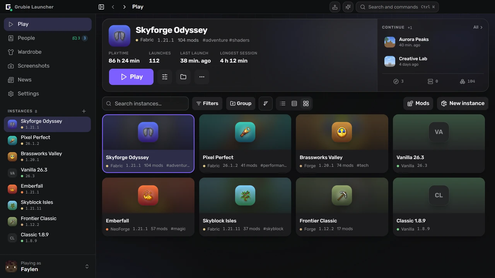
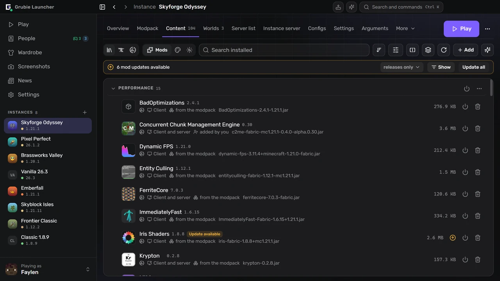
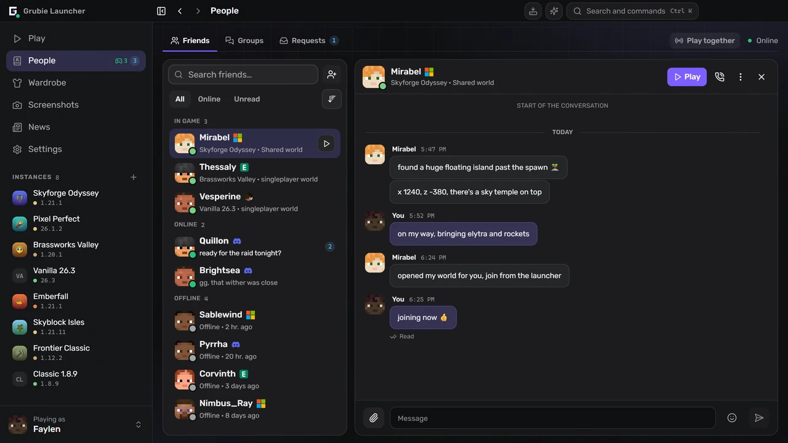
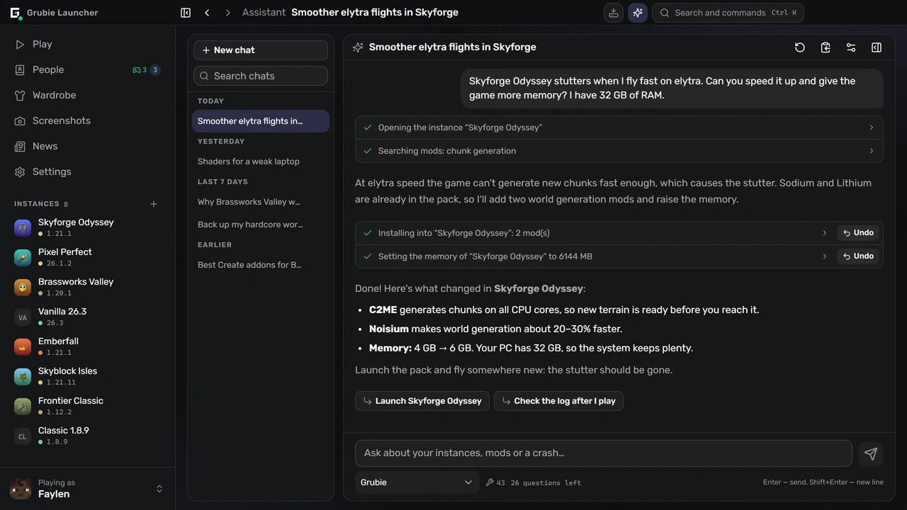

  

  <a href="https://grubielauncher.com/">grubielauncher.com</a>

  
  
  
  
   
  

---

# Grubie Launcher

A free, open-source Minecraft launcher for Windows, macOS and Linux, with no ads and no paid features. It installs any game version and mod loader with the Java it needs, handles mods and modpacks from CurseForge and Modrinth, and keeps every instance — mods, worlds, configs, launch settings — in one place. Your friends live in the same window: chat, voice, and joining each other's worlds without port forwarding. When the game crashes, the launcher reads the report and tells you what broke.

The interface is a permanent sidebar with full screens instead of stacked dialogs. <kbd>Ctrl</kbd>+<kbd>K</kbd> opens a command palette that reaches any instance, screen or setting, <kbd>Ctrl</kbd>+<kbd>I</kbd> opens the assistant, and <kbd>Alt</kbd>+<kbd>←</kbd> / <kbd>Alt</kbd>+<kbd>→</kbd> walk the history like a browser.

<kbd></kbd>
<kbd></kbd>
<kbd></kbd>
<kbd></kbd>
<kbd></kbd>
<kbd></kbd>
<kbd></kbd>
<kbd></kbd>

# Screenshots

**The library, and the instance you played last**

**Mods, resource packs and shaders, searched inside the launcher**

**Friends, groups and requests, next to the chat**

**An assistant that reads your instances, logs and crashes**

# Features

### Play and instances

- Every official Minecraft version: releases, snapshots and old alpha and beta builds.
- Mod loaders: **Forge**, **NeoForge**, **Fabric**, **Quilt**, and **Cleanroom** for 1.12.2 on modern Java.
- Old versions too: **Legacy Fabric**, **Babric**, **Ornithe**, **Better than Adventure** with Babric, **ReIndev** with FoxLoader, and jar mods.
- **OptiFine** for vanilla and Forge 1.7.2–1.16.5, downloaded from optifine.net; on newer versions the launcher points to Sodium and Iris.
- Java is downloaded and matched to each game version on its own.
- Accounts: **Microsoft**, **Ely.by**, **LittleSkin**, **Discord** and offline. Several at once, switched from the sidebar.
- Modpacks from **CurseForge** and **Modrinth**: see what is inside before installing, pick the optional files, update with a preview of what changes, and roll back if something breaks. A pack installed from a zip or a link updates the same way.
- Import a file: Grubie, CurseForge, Modrinth (`.mrpack`), Prism and MultiMC packs — drag the archive onto the window. Export to a Grubie archive or a Modrinth `.mrpack`, with checkboxes for folders and worlds.
- Move over from another launcher: Prism, MultiMC, ATLauncher, GDLauncher, CurseForge, Modrinth App, the official launcher, TLauncher and Legacy Launcher. Instances are copied; the old launcher stays as it was.
- Move an instance to another Minecraft version or loader: the launcher makes a copy with matching mod versions and can bring settings, configs and worlds along.
- Shared game settings: controls, video settings, servers, hotbars and resource packs carry over between instances. An instance can opt out of any group.
- Identical mods, resource packs and shaders are stored on disk once, however many instances use them.
- Instance library with list and grid views, groups, tags and notes. Continue straight into a world or onto a server; a desktop shortcut for a single instance.
- Memory, JVM flags and launch options globally, overridable per instance. On Minecraft 26.x the launcher guards against Vulkan crashes and can start the game on the dedicated graphics card.
- Settings stay open while you play; only the options that would break the running game wait.
- Gamepad navigation and a big mode for Steam Deck and TV.
- A portable Windows build that keeps all its data in a folder next to the program — for a USB stick or a shared computer.

### Mods and translation

- Mods, resource packs and shaders from **CurseForge** and **Modrinth**, searched and installed inside the launcher, or from the catalog straight into any instance.
- The "Install" buttons on the Modrinth and CurseForge websites can open Grubie — turned on in the settings.
- Updates show what changes first. Pick the channel — releases only, or betas and alphas too — and pin a mod to its version.
- Relations of a mod: what it requires, what needs it and what is bundled inside. Turning a mod off offers to turn off what depends on it; removing it removes the dependencies nothing else needs.
- Mod groups that collapse and switch on or off at once, and mod sets you save and add to any instance.
- Marks and filters for what came with the modpack and what you added yourself.
- Files found neither on CurseForge nor on Modrinth are flagged and not installed unless you tick them. Copies of the same mod are found and cleaned up in one click.
- The mod list of an instance stays open while the game runs.
- Config editor with search, syntax highlighting, groups, translated comments and saved copies to roll back to.
- **Mod translation into Russian and Ukrainian**, off by default: community translation packs first, AI on the Grubie server fills in the rest, with a shared cache. It covers mods, the modpack's own resource packs, guide books (Lavender, Patchouli, GuideME) and quests (FTB Quests, QuestZ). The AI part needs a Grubie account and has a daily limit.

### Worlds

- Maps and data packs from the catalog: a map becomes your own world, a data pack goes into the world you pick.
- Advancement progress of every world, and its seed opened on a seed map.
- Schematics (`.litematic`, `.schem`, `.schematic`, `.nbt`) with real block names and icons, a materials list and a 3D view.
- Chunk editor: a map of every generated chunk per dimension with a satellite view, filters for never-visited, outdated or damaged chunks, and deletion with a safety backup taken first.
- World backups: automatic after a session and manual, with a safety copy taken before any restore.

### Together

- Friends, friend requests, direct messages and group chats. On a Microsoft account, your friends from Minecraft 26.2 show up too.
- Voice: rooms inside groups and one-to-one calls, push-to-talk on a global key, noise suppression, per-participant volume.
- **Play together** — open the world you are in to friends or to everyone, over the internet, without port forwarding or Hamachi. Friends connect directly when the network allows it, and through the Grubie relay otherwise.
- Join a friend's world in one click: the launcher installs their instance with the same version and mods, then connects you.
- Share an instance by a short code: everyone who installed it gets your next update with a diff of what changes. Public instances appear in the community catalog, inside the launcher and on [grubielauncher.com/packs](https://grubielauncher.com/packs). Authors see installs, players and playtime, and can post a note to their players.
- Group invites as https links that open from Discord or Telegram.
- The server catalog shows which friends play where, and you join with their instance.
- Screenshots of every instance in one feed; send one to a chat.
- Message and invite toasts over the game in windowed and borderless mode, <kbd>F7</kbd> accepts.
- Telegram notifications while the launcher is closed; Discord Rich Presence with links to your profile and the instance.

### Companion mod

- Brings the launcher into the game: a friends panel on <kbd>G</kbd> with invites, Play together hosting and voice; Grubie buttons in the pause menu to open the world to friends or invite one; toasts for messages, invites, achievements and the screenshot you just took, with "Send to a friend"; who is talking in voice chat and your mute state.
- Tells the launcher which mod the game hangs in, and counts launcher achievements on multiplayer servers.
- Fabric, Quilt and Forge from 1.16.5, NeoForge from 1.20.1, up to 26.3. On by default in new instances, switched per instance. The source is open: [grubie-companion](https://github.com/MOJI6416/grubie-companion).

### Your own server

- Create a server next to an instance: **Vanilla**, **Paper**, **Purpur**, **Spigot**, **Bukkit**, **Forge**, **NeoForge**, **Fabric**, **Quilt**. It picks up the mods and configs of the instance it belongs to.
- Console and a `server.properties` editor. From 1.21.9, players, bans, operators, the whitelist and game rules go through Mojang's management protocol.
- Open it to friends through the Grubie relay: invite-only or open to everyone, a guest list, kick, a slot limit.

### When something goes wrong

- Crash card: the launcher reads the crash report, names the likely culprit and what to do about it. The rules come from the server, so they improve without a launcher update; obfuscated vanilla and Fabric logs are read with Mojang's names first.
- AI crash analysis for crashes the rules do not recognise — no key needed, and the log is stripped of paths, nicknames and tokens before it is sent.
- Culprit search: a wizard switches half of your mods off, you launch the game and say whether the problem is still there. A few runs later it is down to one mod or a pair — for lag and visual bugs too, not only crashes.
- When the game freezes, the companion mod tells the launcher which mod it hangs in.
- Integrity check that re-downloads damaged or missing files.
- Run history: every launch with its log, search and exit code. A support report with a `GRB-` code, and answers from support arrive in the launcher.
- If a sign-in service is down, the game starts with the saved session.
- Connection test against the launcher's own services and the official Minecraft, CurseForge and Modrinth endpoints. Downloads can go through the Grubie mirror and fall back to the official source on their own.
- Task center: installs and updates with progress, per-file errors and retry.

### Assistant

- Runs on **your** provider and **your** key: any OpenAI-compatible endpoint, OpenRouter by default. The key stays on your machine.
- Reads what it needs to answer: instances, installed mods, logs, the last crash, worlds, accounts, disk usage, system information.
- Acts on your behalf: creates instances, installs, updates, disables and removes mods, changes memory and launch arguments, backs up and restores worlds, picks a skin, launches the game.
- Asks before it changes anything, and asks again every time for deletions — no matter what you allowed earlier.
- Needs an online account (Microsoft, Ely.by, LittleSkin or Discord). Chat history syncs to your Grubie account; the sync can be turned off in the settings.

### Skins, themes and profile

- Wardrobe: skins and capes, import by file, link or nickname, a 3D preview. A community catalog you can publish to, where every author's name opens their profile.
- Themes: your own colours and a background picture, layout presets, and a gallery of player themes.
- Sync through the Grubie account: themes, the skin wardrobe and launcher settings follow you to another computer. Paths, memory and Java stay with each computer.
- 60 achievements counted from your own worlds, a friend's shared world and, with the companion mod, servers. Each shows how many players have it. A leaderboard and a public profile on [grubielauncher.com](https://grubielauncher.com/).

### Security and privacy

- Updates are signed: the launcher installs only an update that carries the Grubie signature.
- Published instances are checked for known malware in their jars before they reach the catalog, and checked again in the background.
- Jars of unknown origin are flagged when you import an instance and in the mod list.
- Crash diagnosis codes, feature counters and statistics for modpack authors are on by default and switch off in Settings → Privacy.
- Streamer mode hides addresses, seeds, codes and paths on stream.
- Nine interface languages: English, Russian, Ukrainian, German, Spanish, French, Polish, Portuguese (Brazil) and Turkish.

# Installation

1. Download the latest build from [grubielauncher.com/download](https://grubielauncher.com/download) or [Releases](https://github.com/MOJI6416/grubielauncher/releases).
2. **Windows** — run the `-setup.exe` installer, or unpack the `-portable.zip` anywhere. **macOS** (12 or later) — open the `.dmg` for your Mac (`arm64` for Apple Silicon, `x64` for Intel) and drag the app to Applications. **Linux** — run the `.AppImage`, or install the `.deb`.
3. Sign in with an account, or create an offline one, and pick a version.

The launcher updates itself; new versions arrive without a re-install.

# License

**GPL-3.0** — see [LICENSE](LICENSE).

The name Grubie Launcher and the logo are not covered by this license. Forks are welcome, but they need their own name and logo and must not present themselves as the official launcher.

# Links

- **Website:** [grubielauncher.com](https://grubielauncher.com/)
- **Downloads:** [grubielauncher.com/download](https://grubielauncher.com/download)
- **Changelog:** [grubielauncher.com/changelog](https://grubielauncher.com/changelog)
- **Discord:** [Grubie Launcher server](https://discord.com/invite/URrKha9hk7)
- **Privacy Policy:** [grubielauncher.com/privacy](https://grubielauncher.com/privacy)
