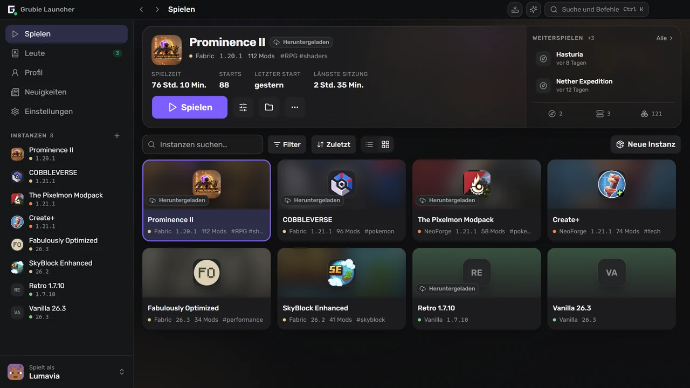
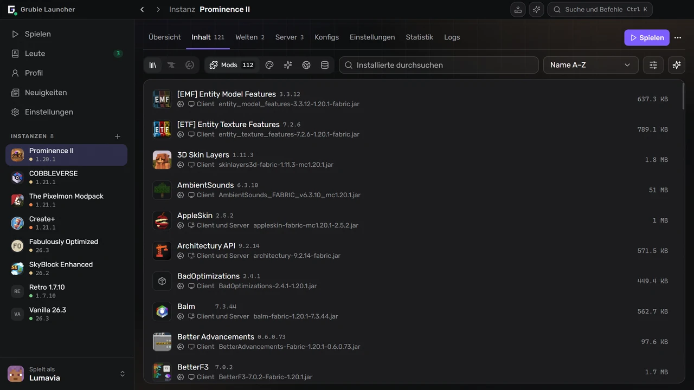
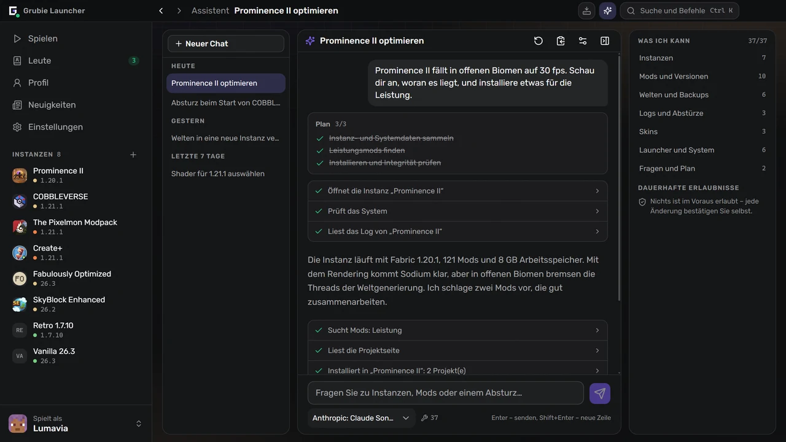
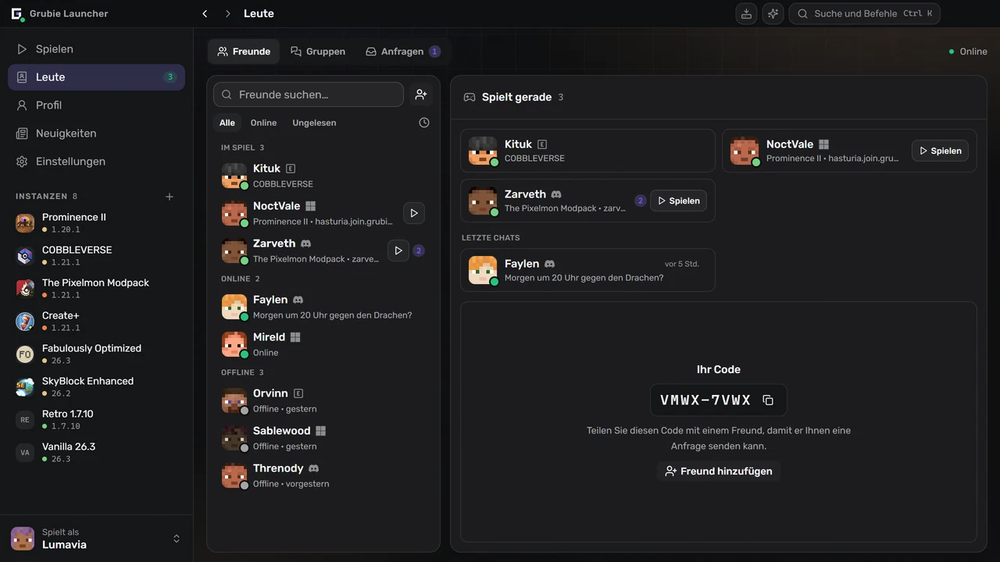

  

  <a href="https://grubielauncher.com/de">grubielauncher.com</a>

  
  
  
  
   
  

---

# Grubie Launcher

Ein Minecraft-Launcher für Windows, macOS und Linux. Er installiert Spielversionen und Mod-Loader, lädt die passende Java-Version selbst herunter und hält jede Instanz – Mods, Welten, Konfigs, Starteinstellungen – an einem Ort. Zwei Dinge unterscheiden ihn von einem einfachen Launcher: Wenn das Spiel abstürzt, liest er den Bericht und sagt Ihnen, was kaputt ist, und Ihre Freunde sind im selben Fenster – Chat, Sprachchat und gegenseitiges Beitreten zu Welten ohne Portweiterleitung oder gemieteten Server.

Die Oberfläche besteht aus einer festen Seitenleiste und ganzen Bildschirmen statt übereinandergestapelter Dialoge. <kbd>Ctrl</kbd>+<kbd>K</kbd> öffnet eine Befehlspalette, die jede Instanz, jeden Bildschirm und jede Einstellung erreicht, <kbd>Ctrl</kbd>+<kbd>I</kbd> öffnet den Assistenten, und <kbd>Alt</kbd>+<kbd>←</kbd> / <kbd>Alt</kbd>+<kbd>→</kbd> blättern wie im Browser durch den Verlauf.

<kbd></kbd>
<kbd></kbd>
<kbd></kbd>
<kbd></kbd>
<kbd></kbd>
<kbd></kbd>
<kbd></kbd>
<kbd></kbd>

# Screenshots

**Die Bibliothek und die zuletzt gespielte Instanz**

**Mods, Ressourcenpakete und Shader, direkt im Launcher gesucht**

**Ein Assistent, der Ihre Instanzen, Logs und Abstürze liest**

**Freunde, Gruppen und Anfragen neben dem Chat**

# Funktionen

### Spielen

- Offizielle Minecraft-Versionen: Releases, Snapshots und alte Alpha-/Beta-Versionen.
- Mod-Loader: **Forge**, **NeoForge**, **Fabric**, **Quilt**.
- Auch für alte Versionen: **Legacy Fabric**, **Babric**, **Ornithe**, **Better than Adventure** mit Babric, **ReIndev** mit FoxLoader sowie Jar-Mods.
- Java wird automatisch heruntergeladen und passend zur Spielversion gewählt.
- Konten: **Microsoft**, **Ely.by**, **Discord** und offline. Mehrere gleichzeitig, umschaltbar in der Seitenleiste.
- Instanzbibliothek mit Listen- und Rasteransicht, Gruppen, Tags und Notizen.
- Weiterspielen, wo Sie aufgehört haben: direkt aus dem Instanzbildschirm in eine Welt oder auf einen Server starten.
- Modrinth-Serverkatalog: Finden Sie einen Server, der zu Ihrer Instanz passt, oder erstellen Sie eine Instanz für einen beliebigen Server daraus.
- Arbeitsspeicher, JVM-Flags und Prozesspriorität werden global festgelegt und lassen sich pro Instanz überschreiben.
- Für eine einzelne Instanz lässt sich eine Desktopverknüpfung anlegen.

### Instanzen

- Mods, Ressourcenpakete, Shader und Datenpakete von **CurseForge** und **Modrinth**, direkt im Launcher gesucht und installiert.
- Update-Prüfung, die zuerst einen Vergleich zeigt: was hinzukommt, aktualisiert und entfernt wird.
- Import aus einer Datei: Grubie-, CurseForge-, Modrinth- (`.mrpack`), Prism- und MultiMC-Pakete – ziehen Sie das Archiv einfach ins Fenster.
- Export einer Instanz in ein Archiv; die Kopie enthält Mods, Konfigs und Welten.
- Veröffentlichen Sie eine Instanz und teilen Sie den Code: Alle, die sie installiert haben, sehen Ihr nächstes Update mit einem Vergleich der Änderungen und synchronisieren es mit einem Klick.
- Eine aus einem CurseForge- oder Modrinth-Modpack installierte Instanz bleibt mit ihm verknüpft: Updates auf neuere Versionen mit einer Vorschau der Änderungen und Rückkehr zur vorherigen Version, falls etwas kaputtgeht.
- Eine Instanz auf eine andere Minecraft-Version oder einen anderen Loader übertragen: Der Launcher erstellt eine Kopie mit passenden Mod-Versionen und kann Einstellungen, Mod-Konfigs und Welten mitnehmen.
- Mod-Sets: Speichern Sie die Mods einer Instanz als Set und fügen Sie es dann einer beliebigen Instanz hinzu oder wählen Sie es beim Erstellen einer neuen aus.
- Eigene Mod-Gruppen, die sich einklappen und als Ganzes ein- oder ausschalten lassen.
- Community-Katalog öffentlicher Instanzen, im Launcher und auf [grubielauncher.com/packs](https://grubielauncher.com/de/packs).
- Integritätsprüfung, die beschädigte oder fehlende Dateien neu herunterlädt.
- Konfig-Editor mit Suche, Autovervollständigung und gespeicherten Versionen zum Zurücksetzen.
- Chunk-Editor für Welten: eine Karte aller generierten Chunks pro Dimension mit Satellitenansicht des Geländes, Filter für nie besuchte, veraltete oder beschädigte Chunks und Löschen mit vorherigem Sicherheits-Backup.

### Gemeinsam

- Freunde, Freundschaftsanfragen, Direktnachrichten und Gruppenchats.
- Sprachchat: Räume in Gruppen und Einzelgespräche, Push-to-Talk, Rauschunterdrückung, Lautstärke pro Teilnehmer.
- **Gemeinsam spielen** – öffnen Sie die Welt, in der Sie gerade sind, für Freunde oder für alle, über das Internet und ohne Portweiterleitung.
- Mit einem Klick der Welt eines Freundes beitreten: Der Launcher installiert und synchronisiert dessen Instanz und verbindet Sie dann.
- Spieleinladungen; Telegram-Benachrichtigungen erreichen Sie auch bei geschlossenem Launcher.
- Discord Rich Presence mit der Instanz, die Sie gerade spielen.
- Profil mit Erfolgen, Statistiken und Bestenliste. Erfolge zählen auch in der geteilten Welt eines Freundes.
- Skins und Umhänge: Ihre eigene Garderobe, Import per Datei, Link oder Spielername sowie ein Community-Katalog, in dem Sie veröffentlichen können.

### Wenn etwas schiefgeht

- Absturzkarte: Der Launcher liest den Absturzbericht, nennt den wahrscheinlichen Verursacher und was zu tun ist. Die Regeln kommen vom Server und werden ohne Launcher-Update besser.
- KI-Absturzanalyse für Abstürze, die die Regeln nicht erkennen – nur auf Wunsch, und aus dem Log werden vor dem Senden Pfade, Spielernamen und Tokens entfernt.
- Startverlauf: jeder Start mit seinem Log, Suche, Exit-Code und einem Bericht, den Sie mit einem Klick kopieren und einer Hilfeanfrage beifügen.
- Welt-Backups: automatisch nach einer Sitzung und manuell, mit einer Sicherheitskopie vor jeder Wiederherstellung.
- Verbindungstest gegen die eigenen Dienste des Launchers und die offiziellen Endpunkte von Minecraft, CurseForge und Modrinth – nützlich, wenn ein Anbieter etwas blockiert.
- Aufgabenzentrale: Installationen und Updates mit Fortschritt, Fehlern pro Datei und erneutem Versuch.
- Downloads können über den Grubie-Mirror laufen und wechseln von selbst zur offiziellen Quelle zurück.

### Assistent

- Läuft mit **Ihrem** Anbieter und **Ihrem** Schlüssel: jeder OpenAI-kompatible Endpunkt, standardmäßig OpenRouter. Der Schlüssel bleibt auf Ihrem Rechner.
- Liest, was er für eine Antwort braucht: Instanzen, installierte Mods, Logs, den letzten Absturz, Welten, Konten, Speicherbelegung, Systeminformationen.
- Handelt in Ihrem Auftrag: erstellt Instanzen, installiert, aktualisiert, deaktiviert und entfernt Mods, ändert Arbeitsspeicher und Startargumente, sichert Welten und stellt sie wieder her, wählt einen Skin, startet das Spiel.
- Fragt, bevor er etwas ändert, und fragt bei Löschungen jedes Mal erneut – egal, was Sie vorher erlaubt haben.
- Der Chatverlauf wird mit Ihrem Grubie-Konto synchronisiert; die Synchronisierung lässt sich in den Einstellungen abschalten.

### Ihr eigener Server

- Erstellen Sie einen Server neben einer Instanz: **Vanilla**, **Spigot**, **Bukkit**, **Paper**, **Purpur**, **Forge**, **NeoForge**, **Fabric**, **Quilt**.
- Konsole, Editor für `server.properties`, und der Server übernimmt die Mods und Konfigs der Instanz, zu der er gehört.

# Installation

1. Laden Sie die neueste Version unter [Releases](https://github.com/MOJI6416/grubielauncher/releases) herunter.
2. **Windows** – starten Sie das Installationsprogramm `-setup.exe`. **macOS** (12 oder neuer) – öffnen Sie die `.dmg` für Ihren Mac (`arm64` für Apple Silicon, `x64` für Intel) und ziehen Sie die App in den Ordner Programme. **Linux** – starten Sie die `.AppImage` oder installieren Sie das `.deb`-Paket.
3. Melden Sie sich mit einem Konto an oder erstellen Sie ein Offline-Konto und wählen Sie eine Version.

Der Launcher aktualisiert sich selbst; neue Versionen kommen ohne Neuinstallation.

# Lizenz

**MIT** – siehe [LICENSE](../LICENSE).

# Links

- **Website:** [grubielauncher.com](https://grubielauncher.com/de)
- **Downloads:** [Releases](https://github.com/MOJI6416/grubielauncher/releases)
- **Changelog:** [grubielauncher.com/changelog](https://grubielauncher.com/de/changelog)
- **Discord:** [Grubie-Launcher-Server](https://discord.com/invite/URrKha9hk7)
- **Datenschutzerklärung:** [grubielauncher.com/privacy](https://grubielauncher.com/de/privacy)
