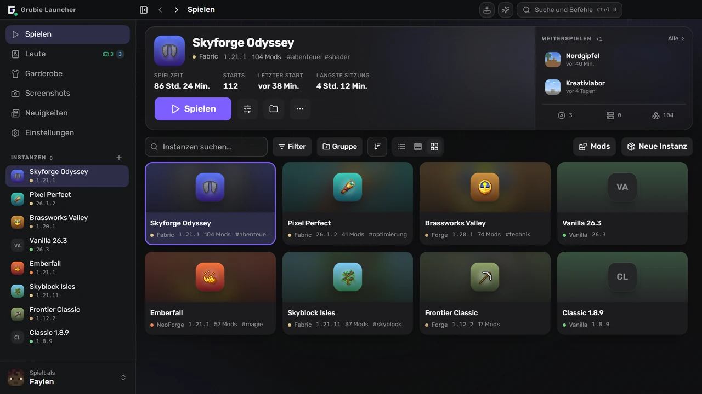
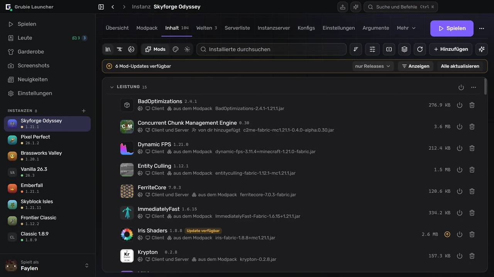
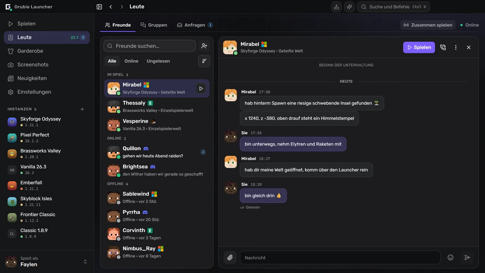
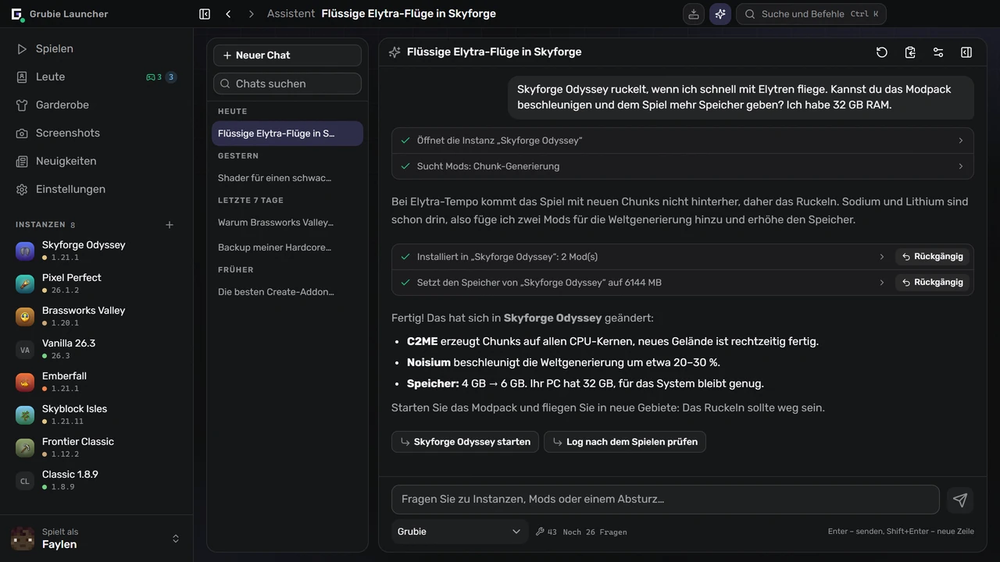

  

  <a href="https://grubielauncher.com/de">grubielauncher.com</a>

  
  
  
  
   
  

---

# Grubie Launcher

Ein kostenloser Open-Source-Launcher für Minecraft unter Windows, macOS und Linux, ohne Werbung und ohne kostenpflichtige Funktionen. Er installiert jede Spielversion und jeden Mod-Loader samt der passenden Java-Version, verwaltet Mods und Modpacks von CurseForge und Modrinth und hält jede Instanz – Mods, Welten, Konfigs, Starteinstellungen – an einem Ort. Ihre Freunde sind im selben Fenster: Chat, Sprachchat und gegenseitiges Beitreten zu Welten ohne Portweiterleitung. Wenn das Spiel abstürzt, liest der Launcher den Bericht und sagt Ihnen, was kaputt ist.

Die Oberfläche besteht aus einer festen Seitenleiste und ganzen Bildschirmen statt übereinandergestapelter Dialoge. <kbd>Ctrl</kbd>+<kbd>K</kbd> öffnet eine Befehlspalette, die jede Instanz, jeden Bildschirm und jede Einstellung erreicht, <kbd>Ctrl</kbd>+<kbd>I</kbd> öffnet den Assistenten, und <kbd>Alt</kbd>+<kbd>←</kbd> / <kbd>Alt</kbd>+<kbd>→</kbd> blättern wie im Browser durch den Verlauf.

<kbd></kbd>
<kbd></kbd>
<kbd></kbd>
<kbd></kbd>
<kbd></kbd>
<kbd></kbd>
<kbd></kbd>
<kbd></kbd>

# Screenshots

**Die Bibliothek und die zuletzt gespielte Instanz**

**Mods, Ressourcenpakete und Shader, direkt im Launcher gesucht**

**Freunde, Gruppen und Anfragen neben dem Chat**

**Ein Assistent, der Ihre Instanzen, Logs und Abstürze liest**

# Funktionen

### Spielen und Instanzen

- Alle offiziellen Minecraft-Versionen: Releases, Snapshots und alte Alpha- und Beta-Versionen.
- Mod-Loader: **Forge**, **NeoForge**, **Fabric**, **Quilt** und **Cleanroom** für 1.12.2 auf modernem Java.
- Auch für alte Versionen: **Legacy Fabric**, **Babric**, **Ornithe**, **Better than Adventure** mit Babric, **ReIndev** mit FoxLoader sowie Jar-Mods.
- **OptiFine** für Vanilla und Forge 1.7.2–1.16.5, heruntergeladen von optifine.net; auf neueren Versionen verweist der Launcher auf Sodium und Iris.
- Java wird von selbst heruntergeladen und passend zu jeder Spielversion gewählt.
- Konten: **Microsoft**, **Ely.by**, **LittleSkin**, **Discord** und offline. Mehrere gleichzeitig, umschaltbar in der Seitenleiste.
- Modpacks von **CurseForge** und **Modrinth**: Sie sehen vor der Installation, was enthalten ist, wählen die optionalen Dateien aus, aktualisieren mit einer Vorschau der Änderungen und kehren zur vorherigen Version zurück, falls etwas kaputtgeht. Ein aus einer ZIP-Datei oder über einen Link installiertes Paket wird genauso aktualisiert.
- Import aus einer Datei: Grubie-, CurseForge-, Modrinth- (`.mrpack`), Prism- und MultiMC-Pakete – ziehen Sie das Archiv einfach ins Fenster. Export in ein Grubie-Archiv oder ein Modrinth-`.mrpack`, mit Kontrollkästchen für Ordner und Welten.
- Umzug aus einem anderen Launcher: Prism, MultiMC, ATLauncher, GDLauncher, CurseForge, Modrinth App, der offizielle Launcher, TLauncher und Legacy Launcher. Die Instanzen werden kopiert; der alte Launcher bleibt, wie er war.
- Eine Instanz auf eine andere Minecraft-Version oder einen anderen Loader übertragen: Der Launcher erstellt eine Kopie mit passenden Mod-Versionen und kann Einstellungen, Konfigs und Welten mitnehmen.
- Gemeinsame Spieleinstellungen: Steuerung, Grafikeinstellungen, Server, Schnellzugriffsleisten und Ressourcenpakete werden zwischen Instanzen übernommen. Jede Instanz kann einzelne Gruppen davon ausnehmen.
- Identische Mods, Ressourcenpakete und Shader liegen nur einmal auf der Festplatte, egal wie viele Instanzen sie nutzen.
- Instanzbibliothek mit Listen- und Rasteransicht, Gruppen, Tags und Notizen. Weiterspielen direkt in einer Welt oder auf einem Server; eine Desktop-Verknüpfung für eine einzelne Instanz.
- Arbeitsspeicher, JVM-Flags und Startoptionen global, pro Instanz überschreibbar. Unter Minecraft 26.x schützt der Launcher vor Vulkan-Abstürzen und kann das Spiel auf der dedizierten Grafikkarte starten.
- Die Einstellungen bleiben während des Spiels offen; nur die Optionen, die das laufende Spiel kaputtmachen würden, warten.
- Gamepad-Steuerung und ein „Großer Modus“ für Steam Deck und Fernseher.
- Eine portable Version für Windows, die alle Daten in einem Ordner neben dem Programm ablegt – für einen USB-Stick oder einen gemeinsam genutzten Computer.

### Mods und Übersetzung

- Mods, Ressourcenpakete und Shader von **CurseForge** und **Modrinth**, direkt im Launcher gesucht und installiert, auch aus dem Katalog direkt in eine beliebige Instanz.
- Die „Installieren“-Schaltflächen auf den Websites von Modrinth und CurseForge können Grubie öffnen – einschaltbar in den Einstellungen.
- Updates zeigen zuerst, was sich ändert. Wählen Sie den Kanal – nur Releases oder auch Betas und Alphas – und fixieren Sie einen Mod auf seiner Version.
- Beziehungen eines Mods: was er benötigt, wer ihn benötigt und was in ihm eingebettet ist. Beim Ausschalten eines Mods bietet der Launcher an, auch die davon abhängigen Mods auszuschalten; beim Entfernen entfernt er die Abhängigkeiten, die sonst niemand braucht.
- Mod-Gruppen, die sich einklappen und als Ganzes ein- oder ausschalten lassen, und Mod-Sets, die Sie speichern und jeder Instanz hinzufügen.
- Markierungen und Filter dafür, was mit dem Modpack kam und was Sie selbst hinzugefügt haben.
- Dateien, die weder auf CurseForge noch auf Modrinth zu finden sind, werden markiert und nur installiert, wenn Sie sie anhaken. Kopien desselben Mods werden gefunden und mit einem Klick bereinigt.
- Die Modliste einer Instanz bleibt geöffnet, während das Spiel läuft.
- Konfig-Editor mit Suche, Syntaxhervorhebung, Gruppen, übersetzten Kommentaren und gespeicherten Kopien zum Zurücksetzen.
- **Mod-Übersetzung ins Russische und Ukrainische**, standardmäßig ausgeschaltet: zuerst Übersetzungspakete der Community, den Rest ergänzt KI auf dem Grubie-Server, mit gemeinsamem Cache. Übersetzt werden Mods, die eigenen Ressourcenpakete des Modpacks, Handbücher (Lavender, Patchouli, GuideME) und Quests (FTB Quests, QuestZ). Der KI-Teil benötigt ein Grubie-Konto und hat ein Tageslimit.

### Welten

- Karten und Datenpakete aus dem Katalog: Eine Karte wird zu Ihrer eigenen Welt, ein Datenpaket kommt in die Welt Ihrer Wahl.
- Der Stand der Fortschritte in jeder Welt, und ihr Startwert lässt sich auf einer Startwert-Karte öffnen.
- Schematics (`.litematic`, `.schem`, `.schematic`, `.nbt`) mit echten Blocknamen und -symbolen, einer Materialliste und einer 3D-Ansicht.
- Chunk-Editor: eine Karte aller generierten Chunks pro Dimension mit Satellitenansicht, Filter für nie besuchte, veraltete oder beschädigte Chunks und Löschen mit vorherigem Sicherheits-Backup.
- Welt-Backups: automatisch nach einer Sitzung und manuell, mit einer Sicherheitskopie vor jeder Wiederherstellung.

### Gemeinsam

- Freunde, Freundschaftsanfragen, Direktnachrichten und Gruppenchats. Mit einem Microsoft-Konto erscheinen auch Ihre Freunde aus Minecraft 26.2.
- Sprachchat: Räume in Gruppen und Einzelgespräche, Push-to-Talk auf einer globalen Taste, Rauschunterdrückung, Lautstärke pro Teilnehmer.
- **Zusammen spielen** – öffnen Sie die Welt, in der Sie gerade sind, für Freunde oder für alle, über das Internet, ohne Portweiterleitung oder Hamachi. Freunde verbinden sich direkt, wenn das Netzwerk es zulässt, und sonst über das Grubie-Relay.
- Mit einem Klick der Welt eines Freundes beitreten: Der Launcher installiert dessen Instanz mit derselben Version und denselben Mods und verbindet Sie dann.
- Teilen Sie eine Instanz per kurzem Code: Alle, die sie installiert haben, erhalten Ihr nächstes Update mit einem Vergleich der Änderungen. Öffentliche Instanzen erscheinen im Community-Katalog, im Launcher und auf [grubielauncher.com/packs](https://grubielauncher.com/de/packs). Autoren sehen Installationen, Spieler und Spielzeit und können ihren Spielern eine Notiz hinterlassen.
- Gruppeneinladungen als https-Links, die sich aus Discord oder Telegram öffnen.
- Der Serverkatalog zeigt, welche Freunde wo spielen, und Sie treten mit deren Instanz bei.
- Screenshots aller Instanzen in einem Feed; jeder lässt sich in einen Chat senden.
- Benachrichtigungen über Nachrichten und Einladungen über dem Spiel im Fenster- und im rahmenlosen Modus, <kbd>F7</kbd> nimmt an.
- Telegram-Benachrichtigungen bei geschlossenem Launcher; Discord Rich Presence mit Links zu Ihrem Profil und zur Instanz.

### Begleit-Mod

- Bringt den Launcher ins Spiel: eine Freundesliste auf <kbd>G</kbd> mit Einladungen, dem Öffnen der eigenen Welt und Sprachchat; Grubie-Schaltflächen im Spielmenü, um die Welt für Freunde zu öffnen oder einen Freund einzuladen; Benachrichtigungen über Nachrichten, Einladungen, Erfolge und den gerade aufgenommenen Screenshot mit „An einen Freund senden“; wer im Sprachchat spricht und ob Ihr Mikrofon stummgeschaltet ist.
- Teilt dem Launcher mit, in welchem Mod das Spiel hängt, und zählt Launcher-Erfolge auf Mehrspieler-Servern.
- Fabric, Quilt und Forge ab 1.16.5, NeoForge ab 1.20.1, bis 26.3. In neuen Instanzen standardmäßig an, pro Instanz umschaltbar. Der Quellcode ist offen: [grubie-companion](https://github.com/MOJI6416/grubie-companion).

### Ihr eigener Server

- Erstellen Sie einen Server neben einer Instanz: **Vanilla**, **Paper**, **Purpur**, **Spigot**, **Bukkit**, **Forge**, **NeoForge**, **Fabric**, **Quilt**. Er übernimmt die Mods und Konfigs der Instanz, zu der er gehört.
- Konsole und ein Editor für `server.properties`. Ab 1.21.9 laufen Spieler, Banns, Operatoren, Gästeliste und Spielregeln über das Verwaltungsprotokoll von Mojang.
- Öffnen Sie ihn für Freunde über das Grubie-Relay: nur auf Einladung oder für alle, eine Liste der Gäste, Kicken und eine begrenzte Zahl an Plätzen.

### Wenn etwas schiefgeht

- Absturzkarte: Der Launcher liest den Absturzbericht, nennt den wahrscheinlichen Verursacher und was zu tun ist. Die Regeln kommen vom Server und werden daher ohne Launcher-Update besser; obfuskierte Logs von Vanilla und Fabric werden zuerst mit den Namen von Mojang lesbar gemacht.
- KI-Absturzanalyse für Abstürze, die die Regeln nicht erkennen – ohne Schlüssel, und aus dem Log werden vor dem Senden Pfade, Spielernamen und Tokens entfernt.
- Verursachersuche: Ein Assistent schaltet die Hälfte Ihrer Mods aus, Sie starten das Spiel und sagen, ob das Problem noch da ist. Nach wenigen Starts bleibt ein Mod oder ein Paar übrig – auch bei Rucklern und Grafikfehlern, nicht nur bei Abstürzen.
- Wenn das Spiel einfriert, teilt der Begleit-Mod dem Launcher mit, in welchem Mod es hängt.
- Integritätsprüfung, die beschädigte oder fehlende Dateien neu herunterlädt.
- Startverlauf: jeder Start mit seinem Log, Suche und Exit-Code. Ein Bericht für den Support mit einem `GRB-`-Code, und die Antworten des Supports kommen im Launcher an.
- Ist ein Anmeldedienst nicht erreichbar, startet das Spiel mit der gespeicherten Sitzung.
- Verbindungstest gegen die eigenen Dienste des Launchers und die offiziellen Endpunkte von Minecraft, CurseForge und Modrinth. Downloads können über den Grubie-Mirror laufen und wechseln von selbst zur offiziellen Quelle zurück.
- Aufgabenzentrale: Installationen und Updates mit Fortschritt, Fehlern pro Datei und erneutem Versuch.

### Assistent

- Läuft mit **Ihrem** Anbieter und **Ihrem** Schlüssel: jeder OpenAI-kompatible Endpunkt, standardmäßig OpenRouter. Der Schlüssel bleibt auf Ihrem Rechner.
- Liest, was er für eine Antwort braucht: Instanzen, installierte Mods, Logs, den letzten Absturz, Welten, Konten, Speicherbelegung, Systeminformationen.
- Handelt in Ihrem Auftrag: erstellt Instanzen, installiert, aktualisiert, deaktiviert und entfernt Mods, ändert Arbeitsspeicher und Startargumente, sichert Welten und stellt sie wieder her, wählt einen Skin, startet das Spiel.
- Fragt, bevor er etwas ändert, und fragt bei Löschungen jedes Mal erneut – egal, was Sie vorher erlaubt haben.
- Benötigt ein Online-Konto (Microsoft, Ely.by, LittleSkin oder Discord). Der Chatverlauf wird mit Ihrem Grubie-Konto synchronisiert; die Synchronisierung lässt sich in den Einstellungen abschalten.

### Skins, Designs und Profil

- Garderobe: Skins und Umhänge, Import per Datei, Link oder Spielername, eine 3D-Vorschau. Ein Community-Katalog, in dem Sie veröffentlichen können und in dem der Name jedes Autors dessen Profil öffnet.
- Designs: eigene Farben und ein Hintergrundbild, Vorlagen für die Anordnung und eine Galerie mit Designs von Spielern.
- Synchronisierung über das Grubie-Konto: Designs, die Skin-Garderobe und die Launcher-Einstellungen begleiten Sie auf einen anderen Computer. Pfade, Arbeitsspeicher und Java bleiben auf jedem Computer eigenständig.
- 60 Erfolge, gezählt in Ihren eigenen Welten, in der geteilten Welt eines Freundes und mit dem Begleit-Mod auch auf Servern. Bei jedem Erfolg sehen Sie, wie viele Spieler ihn haben. Eine Bestenliste und ein öffentliches Profil auf [grubielauncher.com](https://grubielauncher.com/de).

### Sicherheit und Datenschutz

- Updates sind signiert: Der Launcher installiert nur ein Update, das die Grubie-Signatur trägt.
- Veröffentlichte Instanzen werden auf bekannte Schadsoftware in ihren Jars geprüft, bevor sie in den Katalog kommen, und im Hintergrund erneut geprüft.
- Jars unbekannter Herkunft werden beim Import einer Instanz und in der Modliste markiert.
- Codes für Absturzdiagnosen, Funktionszähler und Statistiken für Modpack-Autoren sind standardmäßig an und lassen sich unter „Einstellungen → Datenschutz“ abschalten.
- Der Streamer-Modus verbirgt im Stream Adressen, Startwerte, Codes und Pfade.
- Neun Sprachen der Oberfläche: Englisch, Russisch, Ukrainisch, Deutsch, Spanisch, Französisch, Polnisch, Portugiesisch (Brasilien) und Türkisch.

# Installation

1. Laden Sie die neueste Version unter [grubielauncher.com/download](https://grubielauncher.com/de/download) oder [Releases](https://github.com/MOJI6416/grubielauncher/releases) herunter.
2. **Windows** – starten Sie das Installationsprogramm `-setup.exe` oder entpacken Sie `-portable.zip` an einen beliebigen Ort. **macOS** (12 oder neuer) – öffnen Sie die `.dmg` für Ihren Mac (`arm64` für Apple Silicon, `x64` für Intel) und ziehen Sie die App in den Ordner Programme. **Linux** – starten Sie die `.AppImage` oder installieren Sie das `.deb`-Paket.
3. Melden Sie sich mit einem Konto an oder erstellen Sie ein Offline-Konto und wählen Sie eine Version.

Der Launcher aktualisiert sich selbst; neue Versionen kommen ohne Neuinstallation.

# Lizenz

**GPL-3.0** – siehe [LICENSE](../LICENSE).

Der Name Grubie Launcher und das Logo fallen nicht unter diese Lizenz. Forks sind willkommen, brauchen aber einen eigenen Namen und ein eigenes Logo und dürfen sich nicht als offizieller Launcher ausgeben.

# Links

- **Website:** [grubielauncher.com](https://grubielauncher.com/de)
- **Downloads:** [grubielauncher.com/download](https://grubielauncher.com/de/download)
- **Changelog:** [grubielauncher.com/changelog](https://grubielauncher.com/de/changelog)
- **Discord:** [Grubie-Launcher-Server](https://discord.com/invite/URrKha9hk7)
- **Datenschutzerklärung:** [grubielauncher.com/privacy](https://grubielauncher.com/de/privacy)
