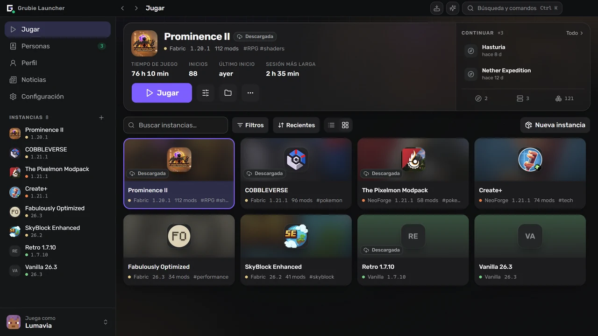
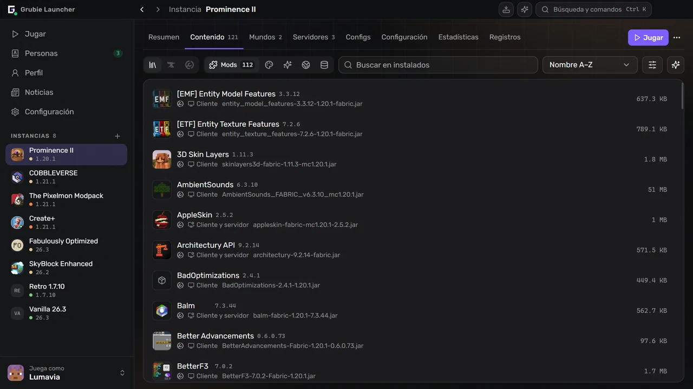
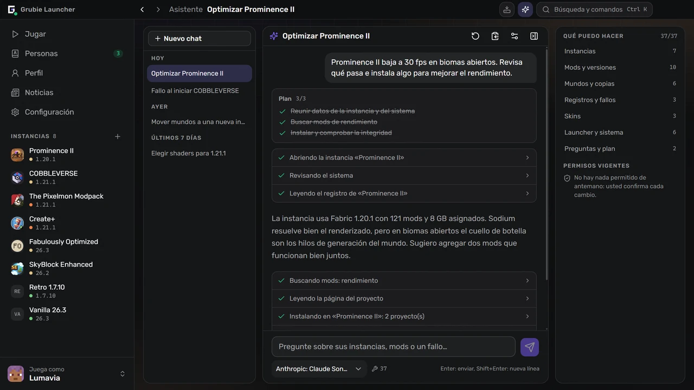
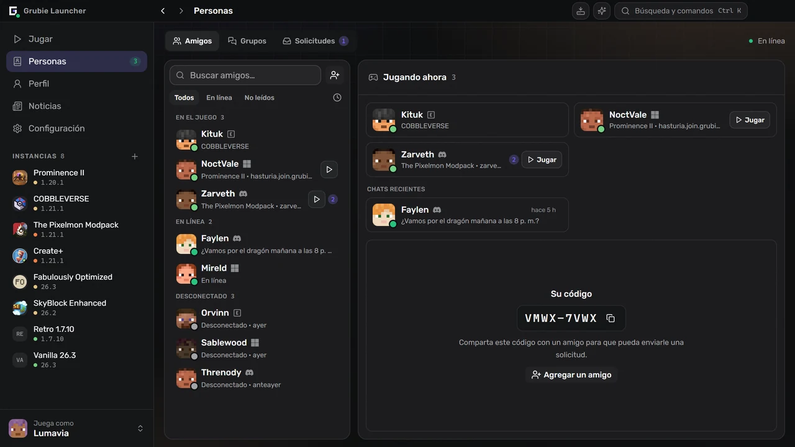

  

  <a href="https://grubielauncher.com/es">grubielauncher.com</a>

  
  
  
  
   
  

---

# Grubie Launcher

Un launcher de Minecraft para Windows, macOS y Linux. Instala versiones del juego y cargadores de mods, descarga por sí mismo el Java adecuado y guarda cada instancia —mods, mundos, configuraciones, ajustes de inicio— en un solo lugar. Dos cosas lo distinguen de un launcher común: cuando el juego falla, lee el informe y le dice qué se rompió, y sus amigos están en la misma ventana: chat, voz y la posibilidad de unirse a los mundos de los demás sin abrir puertos ni rentar un servidor.

La interfaz es una barra lateral fija con pantallas completas en lugar de diálogos apilados. <kbd>Ctrl</kbd>+<kbd>K</kbd> abre una paleta de comandos que llega a cualquier instancia, pantalla o ajuste, <kbd>Ctrl</kbd>+<kbd>I</kbd> abre el asistente y <kbd>Alt</kbd>+<kbd>←</kbd> / <kbd>Alt</kbd>+<kbd>→</kbd> recorren el historial como en un navegador.

<kbd></kbd>
<kbd></kbd>
<kbd></kbd>
<kbd></kbd>
<kbd></kbd>
<kbd></kbd>
<kbd></kbd>
<kbd></kbd>

# Capturas de pantalla

**La biblioteca y la última instancia que jugó**

**Mods, paquetes de recursos y shaders, buscados dentro del launcher**

**Un asistente que lee sus instancias, registros y fallos**

**Amigos, grupos y solicitudes, junto al chat**

# Funciones

### Jugar

- Versiones oficiales de Minecraft: lanzamientos, snapshots y versiones alfa y beta antiguas.
- Cargadores de mods: **Forge**, **NeoForge**, **Fabric**, **Quilt**.
- También versiones antiguas: **Legacy Fabric**, **Babric**, **Ornithe**, **Better than Adventure** con Babric, **ReIndev** con FoxLoader y mods jar.
- Java se descarga automáticamente y se elige según la versión del juego.
- Cuentas: **Microsoft**, **Ely.by**, **Discord** y sin conexión. Varias a la vez, se cambian desde la barra lateral.
- Biblioteca de instancias con vista de lista y de cuadrícula, grupos, etiquetas y notas.
- Continúe donde lo dejó: entre directamente a un mundo o a un servidor desde la pantalla de la instancia.
- Catálogo de servidores de Modrinth: encuentre un servidor que encaje con su instancia o cree una instancia para cualquier servidor del catálogo.
- La memoria, los flags de la JVM y la prioridad del proceso se configuran de forma global y se pueden cambiar para cada instancia.
- Puede crear un acceso directo en el escritorio para una sola instancia.

### Instancias

- Mods, paquetes de recursos, shaders y paquetes de datos de **CurseForge** y **Modrinth**, buscados e instalados dentro del launcher.
- Comprobación de actualizaciones que primero muestra las diferencias: qué se agrega, qué se actualiza y qué se elimina.
- Importación desde archivo: paquetes de Grubie, CurseForge, Modrinth (`.mrpack`), Prism y MultiMC; solo arrastre el archivo a la ventana.
- Exportación de una instancia a un archivo comprimido; la copia incluye mods, configuraciones y mundos.
- Publique una instancia y comparta el código: todos los que la instalaron verán su próxima actualización, con las diferencias de lo que cambia, y la sincronizarán con un clic.
- Una instancia instalada desde un modpack de CurseForge o Modrinth queda vinculada a él: actualice a una versión más nueva con una vista previa de los cambios y vuelva a la anterior si algo se rompe.
- Pase una instancia a otra versión de Minecraft o a otro cargador: el launcher crea una copia con versiones de mods compatibles y puede llevar los ajustes, las configuraciones de los mods y los mundos.
- Conjuntos de mods: guarde los mods de una instancia como un conjunto y luego agréguelo a cualquier instancia o elíjalo al crear una nueva.
- Sus propios grupos de mods: se pueden contraer, y un grupo entero se activa o desactiva de una vez.
- Catálogo comunitario de instancias públicas, dentro del launcher y en [grubielauncher.com/packs](https://grubielauncher.com/es/packs).
- Comprobación de integridad que vuelve a descargar los archivos dañados o faltantes.
- Editor de configuraciones con búsqueda, autocompletado y versiones guardadas para volver atrás.
- Editor de chunks para mundos: un mapa de todos los chunks generados en cada dimensión con vista satelital del terreno, filtros para chunks nunca visitados, desactualizados o dañados, y borrado con una copia de seguridad previa.

### Juntos

- Amigos, solicitudes de amistad, mensajes directos y chats de grupo.
- Voz: salas dentro de los grupos y llamadas uno a uno, presionar para hablar, supresión de ruido y volumen por participante.
- **Jugar juntos**: abra el mundo en el que está a sus amigos o a todos, por internet, sin abrir puertos.
- Únase al mundo de un amigo con un clic: el launcher instala y sincroniza su instancia y luego lo conecta.
- Invitaciones a jugar; las notificaciones de Telegram le llegan aunque el launcher esté cerrado.
- Discord Rich Presence con la instancia que está jugando.
- Perfil con logros, estadísticas y clasificación. Los logros también cuentan en el mundo compartido de un amigo.
- Skins y capas: su propio guardarropa, importación por archivo, enlace o nombre de usuario, y un catálogo comunitario en el que puede publicar.

### Cuando algo sale mal

- Tarjeta de fallo: el launcher lee el informe del fallo, señala al culpable probable y qué hacer. Las reglas vienen del servidor, así que mejoran sin actualizar el launcher.
- Análisis de fallos con IA para los que las reglas no reconocen: solo si usted lo activa, y antes de enviar el registro se quitan rutas, nombres de usuario y tokens.
- Historial de ejecuciones: cada inicio con su registro, búsqueda, código de salida y un informe que se copia con un clic para pedir ayuda.
- Copias de seguridad de mundos: automáticas después de cada sesión y manuales, con una copia de seguridad antes de cualquier restauración.
- Prueba de conexión con los servicios propios del launcher y los servidores oficiales de Minecraft, CurseForge y Modrinth; útil cuando un proveedor bloquea algo.
- Centro de tareas: instalaciones y actualizaciones con progreso, errores por archivo y reintento.
- Las descargas pueden pasar por el espejo de Grubie y vuelven solas a la fuente oficial.

### Asistente

- Funciona con **su** proveedor y **su** clave: cualquier endpoint compatible con OpenAI, OpenRouter por defecto. La clave se queda en su computadora.
- Lee lo que necesita para responder: instancias, mods instalados, registros, el último fallo, mundos, cuentas, uso del disco e información del sistema.
- Actúa por usted: crea instancias; instala, actualiza, desactiva y elimina mods; cambia la memoria y los argumentos de inicio; respalda y restaura mundos; elige una skin; inicia el juego.
- Pregunta antes de cambiar algo y vuelve a preguntar cada vez que va a borrar, sin importar lo que haya permitido antes.
- El historial del chat se sincroniza con su cuenta de Grubie; la sincronización se puede desactivar en la configuración.

### Su propio servidor

- Cree un servidor junto a una instancia: **Vanilla**, **Spigot**, **Bukkit**, **Paper**, **Purpur**, **Forge**, **NeoForge**, **Fabric**, **Quilt**.
- Consola, editor de `server.properties`, y el servidor toma los mods y las configuraciones de la instancia a la que pertenece.

# Instalación

1. Descargue la última versión desde [Releases](https://github.com/MOJI6416/grubielauncher/releases).
2. **Windows**: ejecute el instalador `-setup.exe`. **macOS** (12 o posterior): abra el `.dmg` para su Mac (`arm64` para Apple Silicon, `x64` para Intel) y arrastre la aplicación a Aplicaciones. **Linux**: ejecute el `.AppImage` o instale el `.deb`.
3. Inicie sesión con una cuenta o cree una sin conexión, y elija una versión.

El launcher se actualiza solo; las versiones nuevas llegan sin reinstalar.

# Licencia

**MIT**: consulte [LICENSE](../LICENSE).

# Enlaces

- **Sitio web:** [grubielauncher.com](https://grubielauncher.com/es)
- **Descargas:** [Releases](https://github.com/MOJI6416/grubielauncher/releases)
- **Registro de cambios:** [grubielauncher.com/changelog](https://grubielauncher.com/es/changelog)
- **Discord:** [servidor de Grubie Launcher](https://discord.com/invite/URrKha9hk7)
- **Política de privacidad:** [grubielauncher.com/privacy](https://grubielauncher.com/es/privacy)
