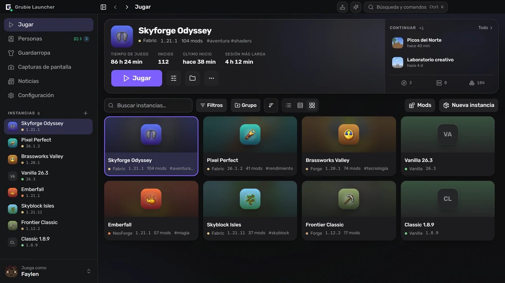
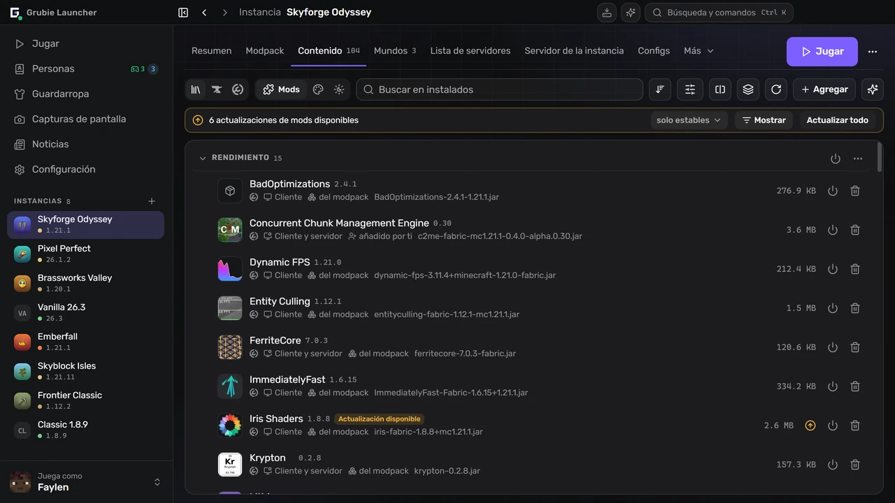
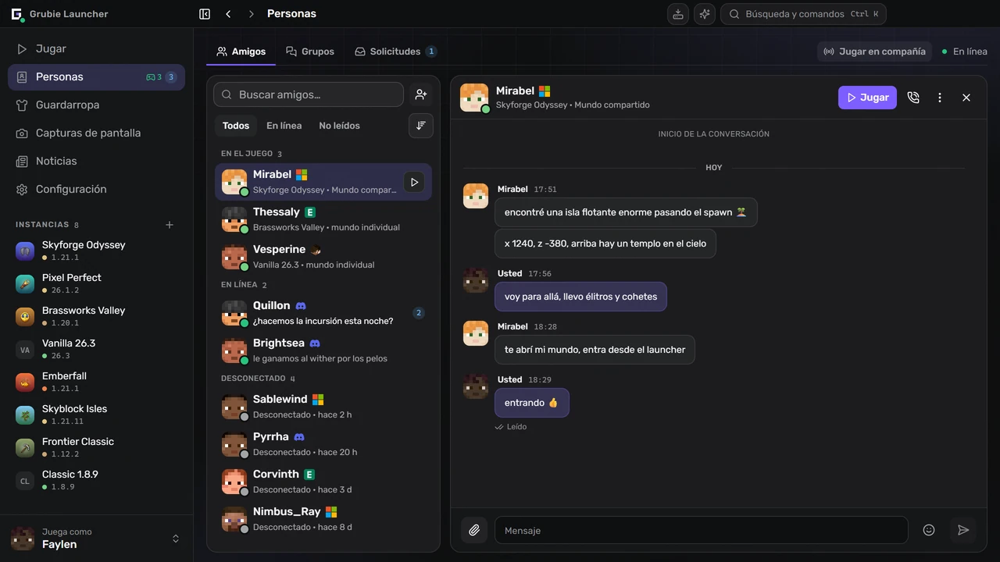
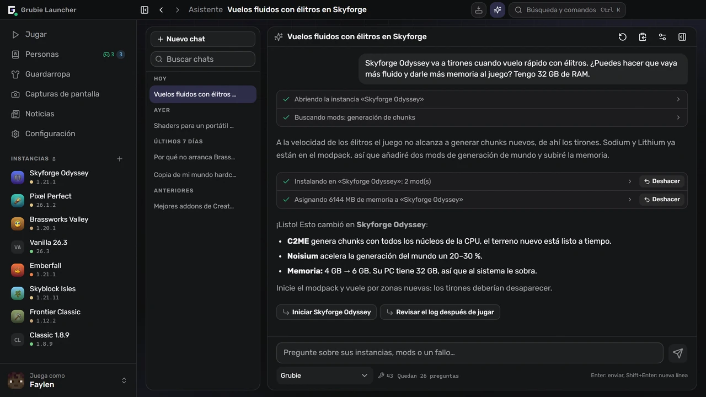

  

  <a href="https://grubielauncher.com/es">grubielauncher.com</a>

  
  
  
  
   
  

---

# Grubie Launcher

Un launcher de Minecraft gratuito y de código abierto para Windows, macOS y Linux, sin anuncios ni funciones de pago. Instala cualquier versión del juego y cualquier cargador de mods junto con el Java que necesita, gestiona mods y modpacks de CurseForge y Modrinth y guarda cada instancia —mods, mundos, configuraciones, ajustes de inicio— en un solo lugar. Sus amigos están en la misma ventana: chat, voz y la posibilidad de unirse a los mundos de los demás sin abrir puertos. Cuando el juego falla, el launcher lee el informe y le dice qué se rompió.

La interfaz es una barra lateral fija con pantallas completas en lugar de diálogos apilados. <kbd>Ctrl</kbd>+<kbd>K</kbd> abre una paleta de comandos que llega a cualquier instancia, pantalla o ajuste, <kbd>Ctrl</kbd>+<kbd>I</kbd> abre el asistente y <kbd>Alt</kbd>+<kbd>←</kbd> / <kbd>Alt</kbd>+<kbd>→</kbd> recorren el historial como en un navegador.

<kbd></kbd>
<kbd></kbd>
<kbd></kbd>
<kbd></kbd>
<kbd></kbd>
<kbd></kbd>
<kbd></kbd>
<kbd></kbd>

# Capturas de pantalla

**La biblioteca y la última instancia que jugó**

**Mods, paquetes de recursos y shaders, buscados dentro del launcher**

**Amigos, grupos y solicitudes, junto al chat**

**Un asistente que lee sus instancias, registros y fallos**

# Funciones

### Jugar e instancias

- Todas las versiones oficiales de Minecraft: lanzamientos, snapshots y versiones alfa y beta antiguas.
- Cargadores de mods: **Forge**, **NeoForge**, **Fabric**, **Quilt** y **Cleanroom** para 1.12.2 con Java moderno.
- También versiones antiguas: **Legacy Fabric**, **Babric**, **Ornithe**, **Better than Adventure** con Babric, **ReIndev** con FoxLoader y mods jar.
- **OptiFine** para vanilla y Forge 1.7.2–1.16.5, descargado de optifine.net; en versiones más nuevas el launcher sugiere Sodium e Iris.
- Java se descarga solo y se elige según cada versión del juego.
- Cuentas: **Microsoft**, **Ely.by**, **LittleSkin**, **Discord** y sin conexión. Varias a la vez, se cambian desde la barra lateral.
- Modpacks de **CurseForge** y **Modrinth**: vea qué contienen antes de instalarlos, elija los archivos opcionales, actualice con una vista previa de los cambios y vuelva atrás si algo se rompe. Un paquete instalado desde un zip o un enlace se actualiza de la misma forma.
- Importación desde archivo: paquetes de Grubie, CurseForge, Modrinth (`.mrpack`), Prism y MultiMC; solo arrastre el archivo a la ventana. Exportación a un archivo de Grubie o a un `.mrpack` de Modrinth, con casillas para carpetas y mundos.
- Traiga sus instancias desde otro launcher: Prism, MultiMC, ATLauncher, GDLauncher, CurseForge, Modrinth App, el launcher oficial, TLauncher y Legacy Launcher. Las instancias se copian; el launcher anterior queda como estaba.
- Pase una instancia a otra versión de Minecraft o a otro cargador: el launcher crea una copia con versiones de mods compatibles y puede llevar los ajustes, las configuraciones y los mundos.
- Ajustes de juego compartidos: controles, gráficos, servidores, barras de ítems y paquetes de recursos pasan de una instancia a otra. Cada instancia puede excluir cualquier grupo.
- Los mods, paquetes de recursos y shaders idénticos se guardan en el disco una sola vez, sin importar cuántas instancias los usen.
- Biblioteca de instancias con vista de lista y de cuadrícula, grupos, etiquetas y notas. Continúe directamente en un mundo o en un servidor; un acceso directo en el escritorio para una sola instancia.
- La memoria, los flags de la JVM y las opciones de inicio se configuran de forma global y se pueden cambiar para cada instancia. En Minecraft 26.x el launcher protege contra los fallos de Vulkan y puede iniciar el juego en la tarjeta gráfica dedicada.
- La configuración sigue abierta mientras juega; solo esperan las opciones que romperían el juego en marcha.
- Navegación con gamepad y un «Modo grande» para Steam Deck y televisores.
- Una versión portátil para Windows que guarda todos sus datos en una carpeta junto al programa, para una memoria USB o una computadora compartida.

### Mods y traducción

- Mods, paquetes de recursos y shaders de **CurseForge** y **Modrinth**, buscados e instalados dentro del launcher, o desde el catálogo directamente en cualquier instancia.
- Los botones «Instalar» de los sitios de Modrinth y CurseForge pueden abrir Grubie; se activa en la configuración.
- Las actualizaciones muestran primero qué cambia. Elija el canal —solo versiones estables o también betas y alfas— y fije un mod en su versión.
- Relaciones de un mod: qué requiere, qué lo necesita y qué trae integrado. Al desactivar un mod, el launcher ofrece desactivar lo que depende de él; al eliminarlo, elimina las dependencias que nadie más necesita.
- Grupos de mods que se contraen y se activan o desactivan de una vez, y conjuntos de mods que se guardan y se agregan a cualquier instancia.
- Marcas y filtros para lo que vino con el modpack y lo que agregó usted.
- Los archivos que no están ni en CurseForge ni en Modrinth se marcan y no se instalan a menos que los seleccione. Las copias del mismo mod se detectan y se limpian con un clic.
- La lista de mods de una instancia sigue abierta mientras el juego está en marcha.
- Editor de configuraciones con búsqueda, resaltado de sintaxis, grupos, comentarios traducidos y copias guardadas para volver atrás.
- **Traducción de mods al ruso y al ucraniano**, desactivada por defecto: primero los paquetes de traducción de la comunidad, y la IA en el servidor de Grubie completa el resto, con una caché compartida. Abarca mods, los paquetes de recursos propios del modpack, libros guía (Lavender, Patchouli, GuideME) y misiones (FTB Quests, QuestZ). La parte de IA requiere una cuenta de Grubie y tiene un límite diario.

### Mundos

- Mapas y paquetes de datos del catálogo: un mapa se convierte en su propio mundo y un paquete de datos va al mundo que elija.
- Los progresos de cada mundo, y su semilla, que se abre en el mapa de la semilla.
- Esquemas (`.litematic`, `.schem`, `.schematic`, `.nbt`) con los nombres e íconos reales de los bloques, una lista de materiales y una vista 3D.
- Editor de chunks: un mapa de todos los chunks generados en cada dimensión con vista satelital, filtros para chunks nunca visitados, desactualizados o dañados, y borrado con una copia de seguridad previa.
- Copias de seguridad de mundos: automáticas después de cada sesión y manuales, con una copia de seguridad antes de cualquier restauración.

### Juntos

- Amigos, solicitudes de amistad, mensajes directos y chats de grupo. Con una cuenta de Microsoft también aparecen sus amigos de Minecraft 26.2.
- Voz: salas dentro de los grupos y llamadas uno a uno, «Presionar para hablar» con una tecla global, supresión de ruido y volumen por participante.
- **Jugar en compañía**: abra el mundo en el que está a sus amigos o a todos, por internet, sin abrir puertos ni usar Hamachi. Los amigos se conectan directamente cuando la red lo permite y, si no, a través del servidor de retransmisión de Grubie.
- Únase al mundo de un amigo con un clic: el launcher instala su instancia con la misma versión y los mismos mods y luego lo conecta.
- Comparta una instancia con un código corto: todos los que la instalaron reciben su próxima actualización con las diferencias de lo que cambia. Las instancias públicas aparecen en el catálogo de la comunidad, dentro del launcher y en [grubielauncher.com/packs](https://grubielauncher.com/es/packs). Los autores ven instalaciones, jugadores y tiempo de juego, y pueden publicar una nota para sus jugadores.
- Invitaciones a grupos como enlaces https que se abren desde Discord o Telegram.
- El catálogo de servidores muestra qué amigos juegan dónde, y usted entra con la instancia de ellos.
- Capturas de pantalla de todas las instancias en una sola galería; cualquiera se puede enviar a un chat.
- Avisos de mensajes e invitaciones sobre el juego en modo ventana y sin bordes; <kbd>F7</kbd> acepta.
- Notificaciones de Telegram mientras el launcher está cerrado; Discord Rich Presence con enlaces a su perfil y a la instancia.

### Mod complementario

- Lleva el launcher al juego: un panel de amigos en <kbd>G</kbd> con invitaciones, la apertura de su mundo y voz; botones de Grubie en el menú de pausa para abrir el mundo a los amigos o invitar a uno; avisos de mensajes, invitaciones, logros y la captura que acaba de tomar, con «Enviar a un amigo»; quién habla en el chat de voz y si su micrófono está silenciado.
- Le indica al launcher en qué mod se cuelga el juego y cuenta los logros del launcher en servidores multijugador.
- Fabric, Quilt y Forge desde 1.16.5, NeoForge desde 1.20.1, hasta 26.3. Activado por defecto en las instancias nuevas, se activa o desactiva en cada instancia. El código es abierto: [grubie-companion](https://github.com/MOJI6416/grubie-companion).

### Su propio servidor

- Cree un servidor junto a una instancia: **Vanilla**, **Paper**, **Purpur**, **Spigot**, **Bukkit**, **Forge**, **NeoForge**, **Fabric**, **Quilt**. Toma los mods y las configuraciones de la instancia a la que pertenece.
- Consola y editor de `server.properties`. Desde 1.21.9, los jugadores, los baneos, los operadores, la lista blanca y las reglas del juego se gestionan con el protocolo de administración de Mojang.
- Ábralo a sus amigos a través del servidor de retransmisión de Grubie: solo con invitación o abierto a todos, una lista de invitados, expulsión y un límite de plazas.

### Cuando algo sale mal

- Tarjeta de fallo: el launcher lee el informe del fallo, señala al culpable probable y qué hacer. Las reglas vienen del servidor, así que mejoran sin actualizar el launcher; los registros ofuscados de vanilla y Fabric se leen primero con los nombres de Mojang.
- Análisis de fallos con IA para los que las reglas no reconocen: sin clave, y antes de enviar el registro se quitan rutas, nombres de usuario y tokens.
- Buscar culpable: un asistente desactiva la mitad de sus mods, usted inicia el juego y dice si el problema sigue. Tras unos pocos inicios queda un solo mod o una pareja, también para el lag y los errores visuales, no solo para los fallos.
- Cuando el juego se congela, el mod complementario le indica al launcher en qué mod se cuelga.
- Comprobación de integridad que vuelve a descargar los archivos dañados o faltantes.
- Historial de ejecuciones: cada inicio con su registro, búsqueda y código de salida. Un informe para soporte con un código `GRB-`, y las respuestas de soporte llegan al launcher.
- Si un servicio de inicio de sesión no responde, el juego se inicia con la sesión guardada.
- Prueba de conexión con los servicios propios del launcher y los servidores oficiales de Minecraft, CurseForge y Modrinth. Las descargas pueden pasar por el espejo de Grubie y vuelven solas a la fuente oficial.
- Centro de tareas: instalaciones y actualizaciones con progreso, errores por archivo y reintento.

### Asistente

- Funciona con **su** proveedor y **su** clave: cualquier endpoint compatible con OpenAI, OpenRouter por defecto. La clave se queda en su computadora.
- Lee lo que necesita para responder: instancias, mods instalados, registros, el último fallo, mundos, cuentas, uso del disco e información del sistema.
- Actúa por usted: crea instancias; instala, actualiza, desactiva y elimina mods; cambia la memoria y los argumentos de inicio; respalda y restaura mundos; elige una skin; inicia el juego.
- Pregunta antes de cambiar algo y vuelve a preguntar cada vez que va a borrar, sin importar lo que haya permitido antes.
- Requiere una cuenta en línea (Microsoft, Ely.by, LittleSkin o Discord). El historial del chat se sincroniza con su cuenta de Grubie; la sincronización se puede desactivar en la configuración.

### Skins, temas y perfil

- Guardarropa: skins y capas, importación por archivo, enlace o nombre de usuario, y una vista previa en 3D. Un catálogo de la comunidad en el que puede publicar, donde el nombre de cada autor abre su perfil.
- Temas: sus propios colores y una imagen de fondo, distribuciones predefinidas y una galería de temas de jugadores.
- Sincronización con la cuenta de Grubie: los temas, el guardarropa de skins y la configuración del launcher lo acompañan a otra computadora. Las rutas, la memoria y Java se quedan en cada computadora.
- 60 logros que se cuentan en sus propios mundos, en el mundo compartido de un amigo y, con el mod complementario, en servidores. Cada uno muestra cuántos jugadores lo tienen. Una clasificación y un perfil público en [grubielauncher.com](https://grubielauncher.com/es).

### Seguridad y privacidad

- Las actualizaciones están firmadas: el launcher solo instala una actualización que lleva la firma de Grubie.
- Las instancias publicadas se revisan en busca de malware conocido en sus jars antes de llegar al catálogo, y se vuelven a revisar en segundo plano.
- Los jars de origen desconocido se marcan al importar una instancia y en la lista de mods.
- Los códigos de diagnóstico de fallos, los contadores de funciones y las estadísticas para autores de modpacks están activados por defecto y se desactivan en «Configuración → Privacidad».
- El modo streamer oculta direcciones, semillas, códigos y rutas durante la transmisión.
- Nueve idiomas de interfaz: inglés, ruso, ucraniano, alemán, español, francés, polaco, portugués (Brasil) y turco.

# Instalación

1. Descargue la última versión desde [grubielauncher.com/download](https://grubielauncher.com/es/download) o desde [Releases](https://github.com/MOJI6416/grubielauncher/releases).
2. **Windows**: ejecute el instalador `-setup.exe` o descomprima el `-portable.zip` en cualquier carpeta. **macOS** (12 o posterior): abra el `.dmg` para su Mac (`arm64` para Apple Silicon, `x64` para Intel) y arrastre la aplicación a Aplicaciones. **Linux**: ejecute el `.AppImage` o instale el `.deb`.
3. Inicie sesión con una cuenta o cree una sin conexión, y elija una versión.

El launcher se actualiza solo; las versiones nuevas llegan sin reinstalar.

# Licencia

**GPL-3.0**: consulte [LICENSE](../LICENSE).

El nombre Grubie Launcher y el logotipo no están cubiertos por esta licencia. Los forks son bienvenidos, pero necesitan su propio nombre y logotipo y no deben presentarse como el launcher oficial.

# Enlaces

- **Sitio web:** [grubielauncher.com](https://grubielauncher.com/es)
- **Descargas:** [grubielauncher.com/download](https://grubielauncher.com/es/download)
- **Registro de cambios:** [grubielauncher.com/changelog](https://grubielauncher.com/es/changelog)
- **Discord:** [servidor de Grubie Launcher](https://discord.com/invite/URrKha9hk7)
- **Política de privacidad:** [grubielauncher.com/privacy](https://grubielauncher.com/es/privacy)
