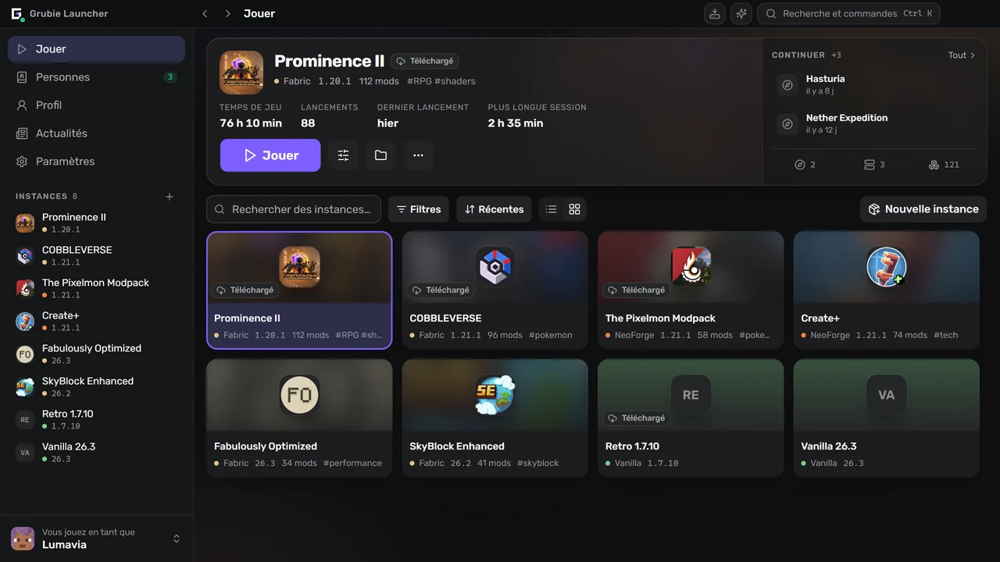
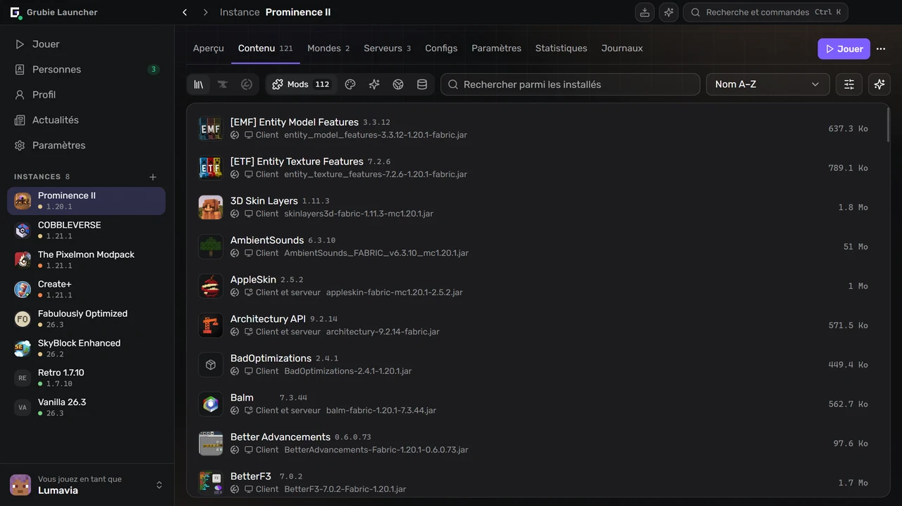
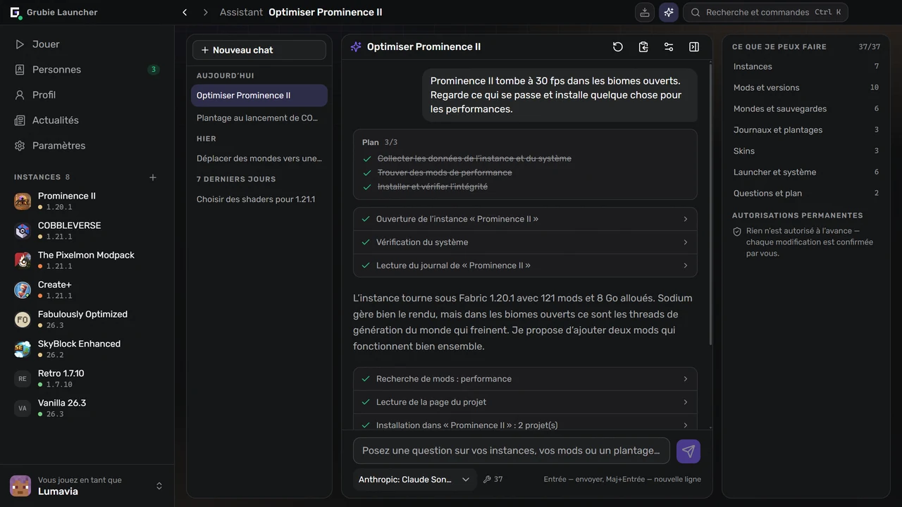
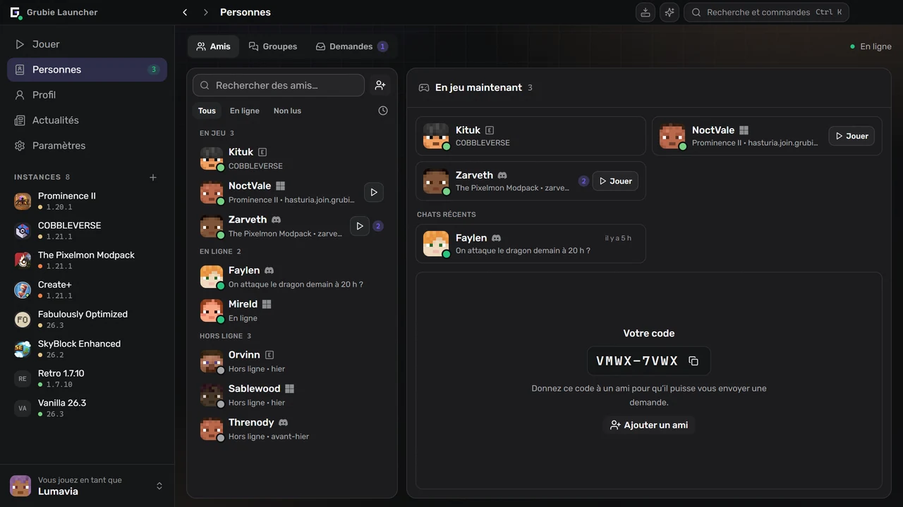

  

  <a href="https://grubielauncher.com/fr">grubielauncher.com</a>

  
  
  
  
   
  

---

# Grubie Launcher

Un launcher Minecraft pour Windows, macOS et Linux. Il installe les versions du jeu et les chargeurs de mods, télécharge lui-même le Java adapté et garde chaque instance — mods, mondes, configs, paramètres de lancement — au même endroit. Deux choses le distinguent d’un launcher ordinaire : quand le jeu plante, il lit le rapport et vous dit ce qui a cassé, et vos amis sont dans la même fenêtre — chat, voix et accès aux mondes des uns et des autres sans redirection de ports ni serveur loué.

L’interface est une barre latérale permanente avec des écrans complets au lieu de fenêtres empilées. <kbd>Ctrl</kbd>+<kbd>K</kbd> ouvre une palette de commandes qui mène à n’importe quelle instance, écran ou paramètre, <kbd>Ctrl</kbd>+<kbd>I</kbd> ouvre l’assistant, et <kbd>Alt</kbd>+<kbd>←</kbd> / <kbd>Alt</kbd>+<kbd>→</kbd> parcourent l’historique comme dans un navigateur.

<kbd></kbd>
<kbd></kbd>
<kbd></kbd>
<kbd></kbd>
<kbd></kbd>
<kbd></kbd>
<kbd></kbd>
<kbd></kbd>

# Captures d’écran

**La bibliothèque et la dernière instance jouée**

**Mods, packs de ressources et shaders, recherchés dans le launcher**

**Un assistant qui lit vos instances, journaux et plantages**

**Amis, groupes et demandes, à côté du chat**

# Fonctionnalités

### Jouer

- Versions officielles de Minecraft : versions stables, snapshots et anciennes alpha/bêta.
- Chargeurs de mods : **Forge**, **NeoForge**, **Fabric**, **Quilt**.
- Les anciennes versions aussi : **Legacy Fabric**, **Babric**, **Ornithe**, **Better than Adventure** avec Babric, **ReIndev** avec FoxLoader et les mods jar.
- Java est téléchargé automatiquement et choisi selon la version du jeu.
- Comptes : **Microsoft**, **Ely.by**, **Discord** et hors ligne. Plusieurs à la fois, changés depuis la barre latérale.
- Bibliothèque d’instances en liste ou en grille, avec groupes, tags et notes.
- Reprenez là où vous vous êtes arrêté : lancez directement un monde ou un serveur depuis l’écran de l’instance.
- Catalogue de serveurs Modrinth : trouvez un serveur adapté à votre instance ou créez une instance pour n’importe quel serveur du catalogue.
- La mémoire, les flags JVM et la priorité du processus se règlent globalement et peuvent être remplacés pour chaque instance.
- Un raccourci sur le bureau peut être créé pour une instance.

### Instances

- Mods, packs de ressources, shaders et packs de données de **CurseForge** et **Modrinth**, recherchés et installés dans le launcher.
- Vérification des mises à jour qui montre d’abord les différences : ce qui est ajouté, mis à jour et supprimé.
- Import depuis un fichier : packs Grubie, CurseForge, Modrinth (`.mrpack`), Prism et MultiMC — glissez l’archive sur la fenêtre.
- Export d’une instance dans une archive ; la copie contient les mods, les configs et les mondes.
- Publiez une instance et partagez le code : tous ceux qui l’ont installée voient votre prochaine mise à jour, avec les différences, et la synchronisent en un clic.
- Une instance installée depuis un modpack CurseForge ou Modrinth y reste liée : mise à jour vers une version plus récente avec un aperçu des changements, et retour à la précédente si quelque chose casse.
- Passez une instance à une autre version de Minecraft ou à un autre chargeur : le launcher crée une copie avec les versions de mods correspondantes et peut emporter les paramètres, les configs des mods et les mondes.
- Ensembles de mods : enregistrez les mods d’une instance comme ensemble, puis ajoutez-le à n’importe quelle instance ou choisissez-le en créant une nouvelle.
- Vos propres groupes de mods : repliez-les et activez ou désactivez un groupe entier d’un coup.
- Catalogue communautaire d’instances publiques, dans le launcher et sur [grubielauncher.com/packs](https://grubielauncher.com/fr/packs).
- Vérification de l’intégrité qui retélécharge les fichiers endommagés ou manquants.
- Éditeur de configs avec recherche, complétion et versions enregistrées pour revenir en arrière.
- Éditeur de chunks pour les mondes : une carte de tous les chunks générés par dimension avec vue satellite du terrain, des filtres pour les chunks jamais visités, obsolètes ou endommagés, et une suppression précédée d’une sauvegarde de sécurité.

### Ensemble

- Amis, demandes d’ami, messages privés et discussions de groupe.
- Voix : salons dans les groupes et appels en tête-à-tête, appuyer pour parler, suppression du bruit, volume par participant.
- **Jouer ensemble** — ouvrez le monde où vous êtes à vos amis ou à tous, par Internet, sans redirection de ports.
- Rejoignez le monde d’un ami en un clic : le launcher installe et synchronise son instance, puis vous connecte.
- Invitations à jouer ; les notifications Telegram vous parviennent même quand le launcher est fermé.
- Discord Rich Presence avec l’instance à laquelle vous jouez.
- Profil avec succès, statistiques et classement. Les succès comptent aussi dans le monde partagé d’un ami.
- Skins et capes : votre propre garde-robe, import par fichier, lien ou pseudo, et un catalogue communautaire où publier.

### Quand quelque chose ne va pas

- Carte de plantage : le launcher lit le rapport de plantage, désigne le coupable probable et ce qu’il faut faire. Les règles viennent du serveur et s’améliorent sans mise à jour du launcher.
- Analyse des plantages par IA pour ceux que les règles ne reconnaissent pas — sur demande, et le journal est débarrassé des chemins, pseudos et jetons avant l’envoi.
- Historique des lancements : chaque lancement avec son journal, recherche, code de sortie et un rapport à copier en un clic pour demander de l’aide.
- Sauvegardes des mondes : automatiques après une session et manuelles, avec une copie de sécurité avant toute restauration.
- Test de connexion aux services du launcher et aux serveurs officiels de Minecraft, CurseForge et Modrinth — utile quand un fournisseur bloque quelque chose.
- Centre des tâches : installations et mises à jour avec progression, erreurs par fichier et nouvel essai.
- Les téléchargements peuvent passer par le miroir Grubie et reviennent d’eux-mêmes à la source officielle.

### Assistant

- Fonctionne avec **votre** fournisseur et **votre** clé : n’importe quel endpoint compatible OpenAI, OpenRouter par défaut. La clé reste sur votre machine.
- Lit ce dont il a besoin pour répondre : instances, mods installés, journaux, dernier plantage, mondes, comptes, espace disque, informations système.
- Agit pour vous : crée des instances, installe, met à jour, désactive et supprime des mods, change la mémoire et les arguments de lancement, sauvegarde et restaure des mondes, choisit un skin, lance le jeu.
- Demande avant de modifier quoi que ce soit, et redemande à chaque suppression — quoi que vous ayez autorisé avant.
- L’historique des discussions se synchronise avec votre compte Grubie ; la synchronisation peut être désactivée dans les paramètres.

### Votre propre serveur

- Créez un serveur à côté d’une instance : **Vanilla**, **Spigot**, **Bukkit**, **Paper**, **Purpur**, **Forge**, **NeoForge**, **Fabric**, **Quilt**.
- Console, éditeur de `server.properties`, et le serveur reprend les mods et les configs de l’instance à laquelle il appartient.

# Installation

1. Téléchargez la dernière version depuis [Releases](https://github.com/MOJI6416/grubielauncher/releases).
2. **Windows** — lancez l’installateur `-setup.exe`. **macOS** (12 ou plus récent) — ouvrez le `.dmg` correspondant à votre Mac (`arm64` pour Apple Silicon, `x64` pour Intel) et glissez l’application dans Applications. **Linux** — lancez le `.AppImage` ou installez le `.deb`.
3. Connectez-vous avec un compte ou créez un compte hors ligne, puis choisissez une version.

Le launcher se met à jour tout seul ; les nouvelles versions arrivent sans réinstallation.

# Licence

**MIT** — voir [LICENSE](../LICENSE).

# Liens

- **Site web :** [grubielauncher.com](https://grubielauncher.com/fr)
- **Téléchargements :** [Releases](https://github.com/MOJI6416/grubielauncher/releases)
- **Journal des modifications :** [grubielauncher.com/changelog](https://grubielauncher.com/fr/changelog)
- **Discord :** [serveur Grubie Launcher](https://discord.com/invite/URrKha9hk7)
- **Politique de confidentialité :** [grubielauncher.com/privacy](https://grubielauncher.com/fr/privacy)
