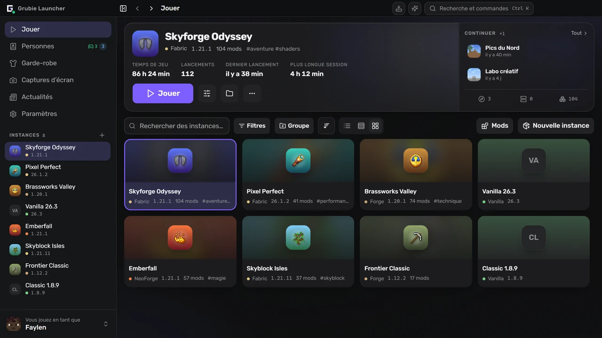
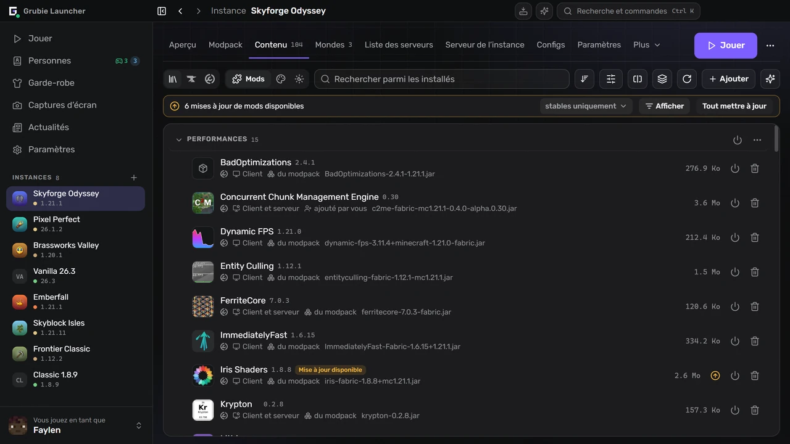
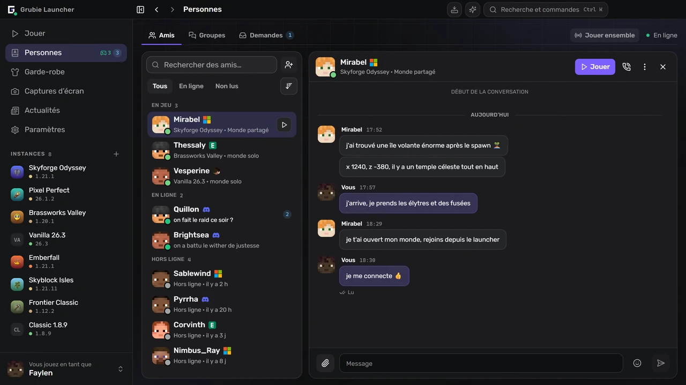
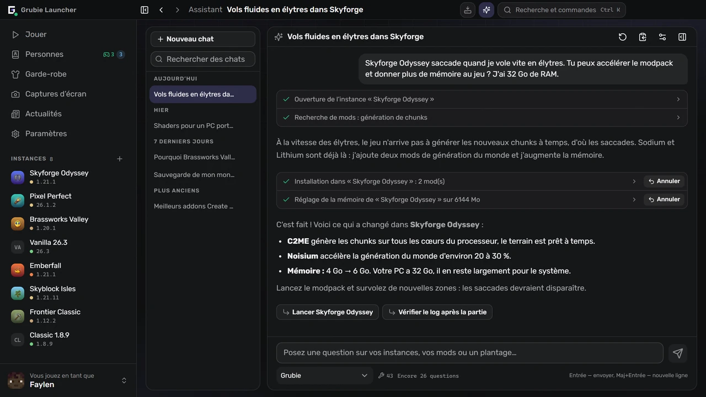

  

  <a href="https://grubielauncher.com/fr">grubielauncher.com</a>

  
  
  
  
   
  

---

# Grubie Launcher

Un launcher Minecraft gratuit et open source pour Windows, macOS et Linux, sans publicité ni fonctionnalités payantes. Il installe n’importe quelle version du jeu et n’importe quel chargeur de mods avec le Java nécessaire, gère les mods et les modpacks de CurseForge et Modrinth, et garde chaque instance — mods, mondes, configs, paramètres de lancement — au même endroit. Vos amis sont dans la même fenêtre : chat, voix et accès aux mondes des uns et des autres sans redirection de ports. Quand le jeu plante, le launcher lit le rapport et vous dit ce qui a cassé.

L’interface est une barre latérale permanente avec des écrans complets au lieu de fenêtres empilées. <kbd>Ctrl</kbd>+<kbd>K</kbd> ouvre une palette de commandes qui mène à n’importe quelle instance, écran ou paramètre, <kbd>Ctrl</kbd>+<kbd>I</kbd> ouvre l’assistant, et <kbd>Alt</kbd>+<kbd>←</kbd> / <kbd>Alt</kbd>+<kbd>→</kbd> parcourent l’historique comme dans un navigateur.

<kbd></kbd>
<kbd></kbd>
<kbd></kbd>
<kbd></kbd>
<kbd></kbd>
<kbd></kbd>
<kbd></kbd>
<kbd></kbd>

# Captures d’écran

**La bibliothèque et la dernière instance jouée**

**Mods, packs de ressources et shaders, recherchés dans le launcher**

**Amis, groupes et demandes, à côté du chat**

**Un assistant qui lit vos instances, journaux et plantages**

# Fonctionnalités

### Jouer et instances

- Toutes les versions officielles de Minecraft : versions stables, snapshots et anciennes alpha et bêta.
- Chargeurs de mods : **Forge**, **NeoForge**, **Fabric**, **Quilt**, et **Cleanroom** pour 1.12.2 sur un Java récent.
- Les anciennes versions aussi : **Legacy Fabric**, **Babric**, **Ornithe**, **Better than Adventure** avec Babric, **ReIndev** avec FoxLoader et les mods jar.
- **OptiFine** pour le vanilla et Forge 1.7.2–1.16.5, téléchargé depuis optifine.net ; sur les versions plus récentes, le launcher oriente vers Sodium et Iris.
- Java est téléchargé et choisi tout seul pour chaque version du jeu.
- Comptes : **Microsoft**, **Ely.by**, **LittleSkin**, **Discord** et hors ligne. Plusieurs à la fois, changés depuis la barre latérale.
- Modpacks de **CurseForge** et **Modrinth** : voyez leur contenu avant l’installation, choisissez les fichiers facultatifs, mettez à jour avec un aperçu des changements et revenez en arrière si quelque chose casse. Un pack installé depuis un zip ou un lien se met à jour de la même façon.
- Import depuis un fichier : packs Grubie, CurseForge, Modrinth (`.mrpack`), Prism et MultiMC — glissez l’archive sur la fenêtre. Export vers une archive Grubie ou un `.mrpack` Modrinth, avec des cases à cocher pour les dossiers et les mondes.
- Transfert depuis un autre launcher : Prism, MultiMC, ATLauncher, GDLauncher, CurseForge, Modrinth App, le launcher officiel, TLauncher et Legacy Launcher. Les instances sont copiées ; l’ancien launcher reste tel quel.
- Passez une instance à une autre version de Minecraft ou à un autre chargeur : le launcher crée une copie avec les versions de mods correspondantes et peut emporter les paramètres, les configs et les mondes.
- Paramètres de jeu partagés : commandes, graphismes, serveurs, barres d’action et packs de ressources passent d’une instance à l’autre. Chaque instance peut exclure n’importe quel groupe.
- Les mods, packs de ressources et shaders identiques ne sont stockés qu’une fois sur le disque, quel que soit le nombre d’instances qui les utilisent.
- Bibliothèque d’instances en liste ou en grille, avec groupes, tags et notes. Reprenez directement dans un monde ou sur un serveur ; un raccourci sur le bureau pour une seule instance.
- La mémoire, les flags JVM et les options de lancement se règlent globalement et peuvent être remplacés pour chaque instance. Sur Minecraft 26.x, le launcher protège des plantages liés à Vulkan et peut lancer le jeu sur la carte graphique dédiée.
- Les paramètres restent accessibles pendant la partie ; seules les options qui casseraient le jeu en cours attendent.
- Navigation à la manette et un « Mode grand écran » pour Steam Deck et la télé.
- Une version portable pour Windows qui garde toutes ses données dans un dossier à côté du programme — pour une clé USB ou un ordinateur partagé.

### Mods et traduction

- Mods, packs de ressources et shaders de **CurseForge** et **Modrinth**, recherchés et installés dans le launcher, ou depuis le catalogue directement dans n’importe quelle instance.
- Les boutons « Installer » des sites Modrinth et CurseForge peuvent ouvrir Grubie — à activer dans les paramètres.
- Les mises à jour montrent d’abord ce qui change. Choisissez le canal — versions stables uniquement, ou aussi bêtas et alphas — et épinglez un mod sur sa version.
- Relations d’un mod : ce dont il a besoin, ce qui a besoin de lui et ce qui est intégré dedans. Désactiver un mod propose de désactiver aussi ce qui en dépend ; le supprimer retire les dépendances dont plus rien n’a besoin.
- Des groupes de mods qui se replient et s’activent ou se désactivent d’un coup, et des ensembles de mods à enregistrer et à ajouter à n’importe quelle instance.
- Marques et filtres pour ce qui vient du modpack et ce que vous avez ajouté vous-même.
- Les fichiers introuvables sur CurseForge comme sur Modrinth sont signalés et ne sont installés que si vous les cochez. Les copies d’un même mod sont détectées et nettoyées en un clic.
- La liste des mods d’une instance reste ouverte pendant que le jeu tourne.
- Éditeur de configs avec recherche, coloration syntaxique, groupes, commentaires traduits et copies enregistrées pour revenir en arrière.
- **Traduction des mods en russe et en ukrainien**, désactivée par défaut : d’abord les packs de traduction de la communauté, puis l’IA du serveur Grubie complète le reste, avec un cache partagé. Elle couvre les mods, les packs de ressources propres au modpack, les livres-guides (Lavender, Patchouli, GuideME) et les quêtes (FTB Quests, QuestZ). La partie IA demande un compte Grubie et a une limite quotidienne.

### Mondes

- Cartes et packs de données du catalogue : une carte devient votre propre monde, un pack de données va dans le monde de votre choix.
- L’avancement des progrès de chaque monde, et sa graine, à ouvrir sur la carte de la graine.
- Schémas (`.litematic`, `.schem`, `.schematic`, `.nbt`) avec les vrais noms et icônes des blocs, une liste de matériaux et une vue 3D.
- Éditeur de chunks : une carte de tous les chunks générés par dimension avec vue satellite, des filtres pour les chunks jamais visités, obsolètes ou endommagés, et une suppression précédée d’une sauvegarde de sécurité.
- Sauvegardes des mondes : automatiques après une session et manuelles, avec une copie de sécurité avant toute restauration.

### Ensemble

- Amis, demandes d’ami, messages privés et discussions de groupe. Avec un compte Microsoft, vos amis de Minecraft 26.2 apparaissent aussi.
- Voix : salons dans les groupes et appels en tête-à-tête, « Appuyer pour parler » sur une touche globale, suppression du bruit, volume par participant.
- **Jouer ensemble** — ouvrez le monde où vous êtes à vos amis ou à tous, par Internet, sans redirection de ports ni Hamachi. Les amis se connectent directement quand le réseau le permet, sinon via le relais Grubie.
- Rejoignez le monde d’un ami en un clic : le launcher installe son instance avec la même version et les mêmes mods, puis vous connecte.
- Partagez une instance avec un code court : tous ceux qui l’ont installée reçoivent votre prochaine mise à jour avec les différences. Les instances publiques apparaissent dans le catalogue de la communauté, dans le launcher et sur [grubielauncher.com/packs](https://grubielauncher.com/fr/packs). Les auteurs voient les installations, les joueurs et le temps de jeu, et peuvent publier une note pour leurs joueurs.
- Invitations de groupe sous forme de liens https qui s’ouvrent depuis Discord ou Telegram.
- Le catalogue de serveurs montre quels amis jouent où, et vous les rejoignez avec leur instance.
- Les captures d’écran de toutes les instances dans un seul fil ; chacune peut être envoyée dans une discussion.
- Notifications de messages et d’invitations par-dessus le jeu en mode fenêtré et sans bordure, <kbd>F7</kbd> pour accepter.
- Notifications Telegram quand le launcher est fermé ; Discord Rich Presence avec des liens vers votre profil et l’instance.

### Mod compagnon

- Fait entrer le launcher dans le jeu : un panneau des amis sur <kbd>G</kbd> avec les invitations, l’ouverture de votre monde et la voix ; des boutons Grubie dans le menu du jeu pour ouvrir le monde aux amis ou inviter un ami ; des notifications pour les messages, les invitations, les succès et la capture que vous venez de prendre, avec « Envoyer à un ami » ; qui parle dans le chat vocal et si votre micro est coupé.
- Indique au launcher dans quel mod le jeu se bloque, et compte les succès du launcher sur les serveurs multijoueurs.
- Fabric, Quilt et Forge à partir de 1.16.5, NeoForge à partir de 1.20.1, jusqu’à 26.3. Activé par défaut dans les nouvelles instances, réglable pour chaque instance. Le code est ouvert : [grubie-companion](https://github.com/MOJI6416/grubie-companion).

### Votre propre serveur

- Créez un serveur à côté d’une instance : **Vanilla**, **Paper**, **Purpur**, **Spigot**, **Bukkit**, **Forge**, **NeoForge**, **Fabric**, **Quilt**. Il reprend les mods et les configs de l’instance à laquelle il appartient.
- Console et éditeur de `server.properties`. À partir de 1.21.9, les joueurs, les bannissements, les opérateurs, la liste blanche et les règles de jeu passent par le protocole de gestion de Mojang.
- Ouvrez-le à vos amis via le relais Grubie : sur invitation ou ouvert à tous, une liste d’invités, l’expulsion et une limite de places.

### Quand quelque chose ne va pas

- Carte de plantage : le launcher lit le rapport de plantage, désigne le coupable probable et ce qu’il faut faire. Les règles viennent du serveur et s’améliorent donc sans mise à jour du launcher ; les journaux obfusqués du vanilla et de Fabric sont d’abord lus avec les noms de Mojang.
- Analyse des plantages par IA pour ceux que les règles ne reconnaissent pas — sans clé, et le journal est débarrassé des chemins, pseudos et jetons avant l’envoi.
- Recherche du coupable : un assistant désactive la moitié de vos mods, vous lancez le jeu et indiquez si le problème est toujours là. Après quelques lancements, il reste un seul mod ou une paire — y compris pour les ralentissements et les bugs visuels, pas seulement pour les plantages.
- Quand le jeu se fige, le mod compagnon indique au launcher dans quel mod il se bloque.
- Vérification de l’intégrité qui retélécharge les fichiers endommagés ou manquants.
- Historique des lancements : chaque lancement avec son journal, une recherche et le code de sortie. Un rapport pour le support avec un code `GRB-`, et les réponses du support arrivent dans le launcher.
- Si un service de connexion est en panne, le jeu démarre avec la session enregistrée.
- Test de connexion aux services du launcher et aux serveurs officiels de Minecraft, CurseForge et Modrinth. Les téléchargements peuvent passer par le miroir Grubie et reviennent d’eux-mêmes à la source officielle.
- Centre des tâches : installations et mises à jour avec progression, erreurs par fichier et nouvel essai.

### Assistant

- Fonctionne avec **votre** fournisseur et **votre** clé : n’importe quel endpoint compatible OpenAI, OpenRouter par défaut. La clé reste sur votre machine.
- Lit ce dont il a besoin pour répondre : instances, mods installés, journaux, dernier plantage, mondes, comptes, espace disque, informations système.
- Agit pour vous : crée des instances, installe, met à jour, désactive et supprime des mods, change la mémoire et les arguments de lancement, sauvegarde et restaure des mondes, choisit un skin, lance le jeu.
- Demande avant de modifier quoi que ce soit, et redemande à chaque suppression — quoi que vous ayez autorisé avant.
- Nécessite un compte en ligne (Microsoft, Ely.by, LittleSkin ou Discord). L’historique des discussions se synchronise avec votre compte Grubie ; la synchronisation peut être désactivée dans les paramètres.

### Skins, thèmes et profil

- Garde-robe : skins et capes, import par fichier, lien ou pseudo, un aperçu 3D. Un catalogue de la communauté où publier, dans lequel le nom de chaque auteur ouvre son profil.
- Thèmes : vos propres couleurs et une image de fond, des dispositions prédéfinies et une galerie de thèmes de joueurs.
- Synchronisation via le compte Grubie : les thèmes, la garde-robe de skins et les paramètres du launcher vous suivent sur un autre ordinateur. Les chemins, la mémoire et Java restent propres à chaque ordinateur.
- 60 succès comptés dans vos propres mondes, dans le monde partagé d’un ami et, avec le mod compagnon, sur les serveurs. Chacun indique combien de joueurs l’ont obtenu. Un classement et un profil public sur [grubielauncher.com](https://grubielauncher.com/fr).

### Sécurité et confidentialité

- Les mises à jour sont signées : le launcher n’installe qu’une mise à jour qui porte la signature Grubie.
- Les instances publiées sont analysées à la recherche de logiciels malveillants connus dans leurs jars avant d’arriver dans le catalogue, puis vérifiées à nouveau en arrière-plan.
- Les jars d’origine inconnue sont signalés lors de l’import d’une instance et dans la liste des mods.
- Les codes de diagnostic des plantages, les compteurs de fonctionnalités et les statistiques pour les auteurs de modpacks sont activés par défaut et se désactivent dans « Paramètres → Confidentialité ».
- Le mode streamer masque les adresses, les graines, les codes et les chemins pendant le stream.
- Neuf langues d’interface : anglais, russe, ukrainien, allemand, espagnol, français, polonais, portugais (Brésil) et turc.

# Installation

1. Téléchargez la dernière version depuis [grubielauncher.com/download](https://grubielauncher.com/fr/download) ou [Releases](https://github.com/MOJI6416/grubielauncher/releases).
2. **Windows** — lancez l’installateur `-setup.exe` ou décompressez le `-portable.zip` où vous voulez. **macOS** (12 ou plus récent) — ouvrez le `.dmg` correspondant à votre Mac (`arm64` pour Apple Silicon, `x64` pour Intel) et glissez l’application dans Applications. **Linux** — lancez le `.AppImage` ou installez le `.deb`.
3. Connectez-vous avec un compte ou créez un compte hors ligne, puis choisissez une version.

Le launcher se met à jour tout seul ; les nouvelles versions arrivent sans réinstallation.

# Licence

**GPL-3.0** — voir [LICENSE](../LICENSE).

Le nom Grubie Launcher et le logo ne sont pas couverts par cette licence. Les forks sont les bienvenus, mais ils doivent avoir leur propre nom et leur propre logo et ne pas se présenter comme le launcher officiel.

# Liens

- **Site web :** [grubielauncher.com](https://grubielauncher.com/fr)
- **Téléchargements :** [grubielauncher.com/download](https://grubielauncher.com/fr/download)
- **Journal des modifications :** [grubielauncher.com/changelog](https://grubielauncher.com/fr/changelog)
- **Discord :** [serveur Grubie Launcher](https://discord.com/invite/URrKha9hk7)
- **Politique de confidentialité :** [grubielauncher.com/privacy](https://grubielauncher.com/fr/privacy)
