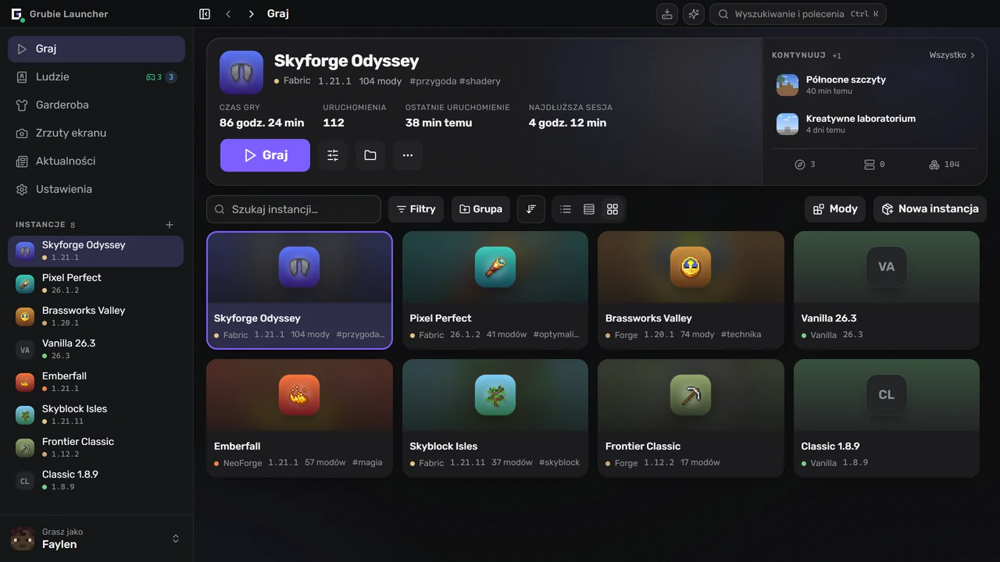
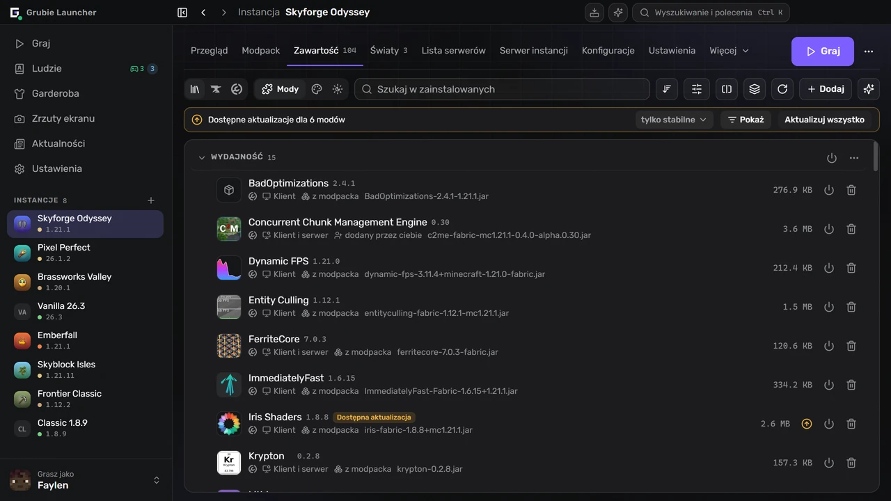
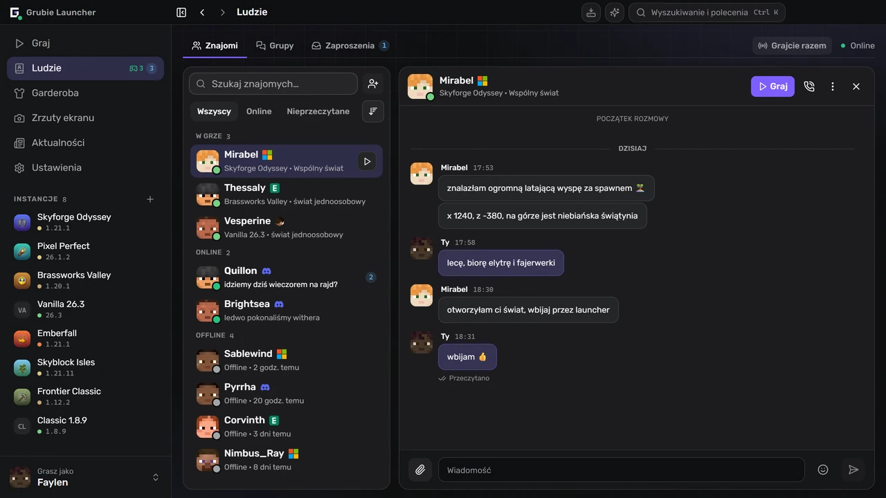
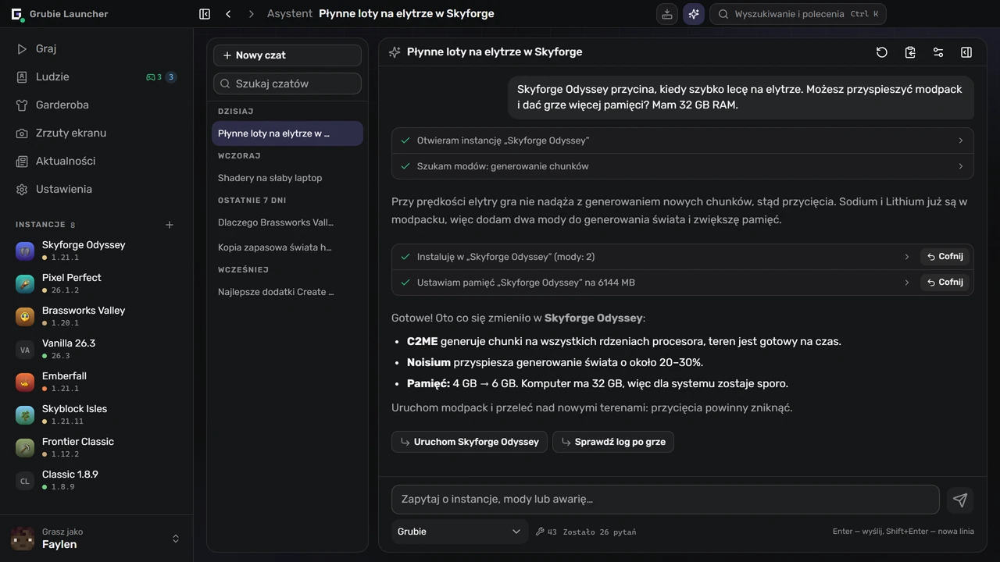

  

  <a href="https://grubielauncher.com/pl">grubielauncher.com</a>

  
  
  
  
   
  

---

# Grubie Launcher

Darmowy launcher Minecrafta z otwartym kodem na Windows, macOS i Linux — bez reklam i płatnych funkcji. Instaluje każdą wersję gry i każdy loader modów razem z potrzebną Javą, obsługuje mody i modpacki z CurseForge i Modrinth i trzyma każdą instancję — mody, światy, konfiguracje, ustawienia uruchamiania — w jednym miejscu. Znajomi są w tym samym oknie: czat, głos i dołączanie do swoich światów bez przekierowania portów. Gdy gra ulegnie awarii, launcher czyta raport i mówi, co się zepsuło.

Interfejs to stały pasek boczny i pełne ekrany zamiast piętrzących się okien. <kbd>Ctrl</kbd>+<kbd>K</kbd> otwiera paletę poleceń, która prowadzi do każdej instancji, ekranu i ustawienia, <kbd>Ctrl</kbd>+<kbd>I</kbd> otwiera asystenta, a <kbd>Alt</kbd>+<kbd>←</kbd> / <kbd>Alt</kbd>+<kbd>→</kbd> przechodzą po historii jak w przeglądarce.

<kbd></kbd>
<kbd></kbd>
<kbd></kbd>
<kbd></kbd>
<kbd></kbd>
<kbd></kbd>
<kbd></kbd>
<kbd></kbd>

# Zrzuty ekranu

**Biblioteka i ostatnio uruchamiana instancja**

**Mody, paczki zasobów i shadery wyszukiwane w launcherze**

**Znajomi, grupy i zaproszenia obok czatu**

**Asystent, który czyta instancje, logi i awarie**

# Funkcje

### Granie i instancje

- Wszystkie oficjalne wersje Minecrafta: wydania, snapshoty i stare wersje alfa i beta.
- Loadery modów: **Forge**, **NeoForge**, **Fabric**, **Quilt** oraz **Cleanroom** dla 1.12.2 na nowoczesnej Javie.
- Również stare wersje: **Legacy Fabric**, **Babric**, **Ornithe**, **Better than Adventure** z Babric, **ReIndev** z FoxLoaderem i mody jar.
- **OptiFine** dla wersji vanilla i Forge 1.7.2–1.16.5, pobierany z optifine.net; na nowszych wersjach launcher podpowiada Sodium i Iris.
- Java pobiera się sama i jest dobierana do każdej wersji gry.
- Konta: **Microsoft**, **Ely.by**, **LittleSkin**, **Discord** i offline. Kilka naraz, przełączane z paska bocznego.
- Modpacki z **CurseForge** i **Modrinth**: zawartość widać przed instalacją, pliki opcjonalne można wybrać, aktualizacja pokazuje, co się zmieni, a jeśli coś się zepsuje, można ją wycofać. Paczka zainstalowana z pliku zip lub z linku aktualizuje się tak samo.
- Import z pliku: paczki Grubie, CurseForge, Modrinth (`.mrpack`), Prism i MultiMC — wystarczy przeciągnąć archiwum na okno. Eksport do archiwum Grubie lub do `.mrpack` dla Modrinth, z polami wyboru dla folderów i światów.
- Przeniesienie z innego launchera: Prism, MultiMC, ATLauncher, GDLauncher, CurseForge, Modrinth App, oficjalny launcher, TLauncher i Legacy Launcher. Instancje są kopiowane; w starym launcherze wszystko zostaje bez zmian.
- Przeniesienie instancji na inną wersję Minecrafta lub inny loader: launcher tworzy kopię z pasującymi wersjami modów i może przenieść ustawienia, konfiguracje i światy.
- Wspólne ustawienia gry: sterowanie, ustawienia graficzne, serwery, paski szybkiego wyboru i paczki zasobów przechodzą między instancjami. Każda instancja może wyłączyć dowolną grupę.
- Identyczne mody, paczki zasobów i shadery są przechowywane na dysku tylko raz, niezależnie od tego, ile instancji z nich korzysta.
- Biblioteka instancji w widoku listy i siatki, z grupami, tagami i notatkami. Kontynuacja prosto w świecie lub na serwerze; skrót na pulpicie dla pojedynczej instancji.
- Pamięć, flagi JVM i opcje uruchamiania ustawia się globalnie, a dla każdej instancji można je nadpisać. Na Minecrafcie 26.x launcher chroni przed awariami Vulkana i potrafi uruchomić grę na dedykowanej karcie graficznej.
- Ustawienia są dostępne także w trakcie gry; czekają tylko te opcje, które zepsułyby uruchomioną grę.
- Sterowanie padem i „Tryb duży” dla Steam Decka i telewizora.
- Wersja przenośna dla Windows, która trzyma wszystkie dane w folderze obok programu — na pendrive’a lub wspólny komputer.

### Mody i tłumaczenie

- Mody, paczki zasobów i shadery z **CurseForge** i **Modrinth**, wyszukiwane i instalowane w launcherze, także z katalogu prosto do dowolnej instancji.
- Przyciski „Zainstaluj” na stronach Modrinth i CurseForge mogą otwierać Grubie — włącza się to w ustawieniach.
- Przed aktualizacją widać, co się zmieni. Można wybrać kanał — tylko wersje stabilne albo także bety i alfy — i przypiąć mod do jego wersji.
- Powiązania moda: czego wymaga, co go potrzebuje i co jest w nim wbudowane. Przy wyłączaniu moda launcher proponuje wyłączenie tego, co od niego zależy; przy usuwaniu usuwa zależności, których nic innego nie potrzebuje.
- Grupy modów, które się zwija i włącza lub wyłącza naraz, oraz zestawy modów, które można zapisać i dodać do dowolnej instancji.
- Oznaczenia i filtry: co przyszło z modpackiem, a co dodano samodzielnie.
- Pliki, których nie ma ani na CurseForge, ani na Modrinth, są oznaczane i nie instalują się bez zaznaczenia. Kopie tego samego moda są wykrywane i usuwane jednym kliknięciem.
- Lista modów instancji pozostaje dostępna podczas gry.
- Edytor konfiguracji z wyszukiwaniem, podświetlaniem składni, grupami, tłumaczeniem komentarzy i zapisanymi kopiami do przywrócenia.
- **Tłumaczenie modów na rosyjski i ukraiński**, domyślnie wyłączone: najpierw paczki tłumaczeń społeczności, resztę uzupełnia AI na serwerze Grubie, ze wspólną pamięcią podręczną. Obejmuje mody, własne paczki zasobów modpacka, księgi-poradniki (Lavender, Patchouli, GuideME) i zadania (FTB Quests, QuestZ). Część AI wymaga konta Grubie i ma dzienny limit.

### Światy

- Mapy i paczki danych z katalogu: mapa staje się własnym światem, paczka danych trafia do wybranego świata.
- Stan postępów w każdym świecie, a jego ziarno otwiera się na mapie ziarna.
- Schematy (`.litematic`, `.schem`, `.schematic`, `.nbt`) z prawdziwymi nazwami i ikonami bloków, listą materiałów i widokiem 3D.
- Edytor chunków: mapa wszystkich wygenerowanych chunków w każdym wymiarze z widokiem satelitarnym, filtry chunków nigdy nieodwiedzanych, nieaktualnych lub uszkodzonych oraz usuwanie poprzedzone kopią zapasową.
- Kopie zapasowe światów: automatyczne po sesji i ręczne, z kopią bezpieczeństwa przed każdym przywróceniem.

### Razem

- Znajomi, zaproszenia do znajomych, wiadomości prywatne i czaty grupowe. Na koncie Microsoft widać także znajomych z Minecrafta 26.2.
- Głos: pokoje w grupach i rozmowy jeden na jeden, „Naciśnij, aby mówić” pod globalnym klawiszem, tłumienie szumów, głośność dla każdego uczestnika.
- **Grajcie razem** — otwarcie świata, w którym się gra, dla znajomych lub dla wszystkich, przez internet, bez przekierowania portów i Hamachi. Znajomi łączą się bezpośrednio, gdy sieć na to pozwala, a w przeciwnym razie przez przekaźnik Grubie.
- Dołączanie do świata znajomego jednym kliknięciem: launcher instaluje jego instancję w tej samej wersji i z tymi samymi modami, a potem łączy.
- Instancję można udostępnić krótkim kodem: każdy, kto ją zainstalował, dostanie kolejną aktualizację z listą zmian. Publiczne instancje trafiają do katalogu społeczności, w launcherze i na [grubielauncher.com/packs](https://grubielauncher.com/pl/packs). Autorzy widzą instalacje, graczy i czas gry i mogą zostawić graczom ogłoszenie.
- Zaproszenia do grup jako linki https, które otwierają się z Discorda lub Telegrama.
- Katalog serwerów pokazuje, którzy znajomi gdzie grają, a dołączyć można z ich instancją.
- Zrzuty ekranu wszystkich instancji w jednym kanale; każdy można wysłać na czat.
- Powiadomienia o wiadomościach i zaproszeniach nad grą w trybie okienkowym i bez ramki, <kbd>F7</kbd> — przyjęcie.
- Powiadomienia w Telegramie, gdy launcher jest zamknięty; Discord Rich Presence z linkami do profilu i instancji.

### Mod towarzyszący

- Przenosi launcher do gry: panel znajomych pod <kbd>G</kbd> z zaproszeniami, otwieraniem świata i głosem; przyciski Grubie w menu gry, żeby otworzyć świat znajomym lub zaprosić znajomego; powiadomienia o wiadomościach, zaproszeniach, osiągnięciach i właśnie zrobionym zrzucie ekranu z przyciskiem „Wyślij znajomemu”; kto mówi na czacie głosowym i czy mikrofon jest wyciszony.
- Podpowiada launcherowi, na którym modzie zawiesiła się gra, i zalicza osiągnięcia launchera na serwerach wieloosobowych.
- Fabric, Quilt i Forge od 1.16.5, NeoForge od 1.20.1, do 26.3. W nowych instancjach domyślnie włączony, przełączany osobno dla każdej instancji. Kod jest otwarty: [grubie-companion](https://github.com/MOJI6416/grubie-companion).

### Własny serwer

- Serwer tworzy się obok instancji: **Vanilla**, **Paper**, **Purpur**, **Spigot**, **Bukkit**, **Forge**, **NeoForge**, **Fabric**, **Quilt**. Mody i konfiguracje bierze z instancji, do której należy.
- Konsola i edytor `server.properties`. Od 1.21.9 gracze, bany, operatorzy, biała lista i zasady gry obsługiwane są przez protokół zarządzania Mojang.
- Serwer można otworzyć znajomym przez przekaźnik Grubie: tylko na zaproszenie albo dla wszystkich, lista gości, wyrzucanie, limit miejsc.

### Gdy coś pójdzie nie tak

- Karta awarii: launcher czyta raport awarii, wskazuje prawdopodobnego winowajcę i podpowiada, co zrobić. Reguły przychodzą z serwera, więc poprawiają się bez aktualizacji launchera; zaciemnione logi wersji vanilla i Fabric są najpierw tłumaczone na nazwy Mojang.
- Analiza awarii przez AI dla przypadków, których reguły nie rozpoznają — bez klucza, a przed wysłaniem z logu usuwane są ścieżki, nicki i tokeny.
- Szukanie winowajcy: kreator wyłącza połowę modów, a potem uruchamia się grę i odpowiada, czy problem nadal występuje. Po kilku uruchomieniach zostaje jeden mod albo para — także przy lagach i błędach graficznych, nie tylko przy awariach.
- Gdy gra się zawiesi, mod towarzyszący podpowie launcherowi, na którym modzie.
- Sprawdzanie integralności, które ponownie pobiera uszkodzone lub brakujące pliki.
- Historia uruchomień: każde uruchomienie z logiem, wyszukiwaniem i kodem wyjścia. Raport dla pomocy technicznej z kodem `GRB-`, a odpowiedzi pomocy technicznej przychodzą do launchera.
- Gdy usługa logowania nie działa, gra uruchamia się z zapisaną sesją.
- Test połączenia z usługami launchera oraz oficjalnymi serwerami Minecrafta, CurseForge i Modrinth. Pobieranie może iść przez mirror Grubie i samo wraca do oficjalnego źródła.
- Centrum zadań: instalacje i aktualizacje z postępem, błędami dla każdego pliku i ponowieniem.

### Asystent

- Działa z **własnym** dostawcą i **własnym** kluczem: dowolny endpoint zgodny z OpenAI, domyślnie OpenRouter. Klucz zostaje na komputerze.
- Czyta to, czego potrzebuje do odpowiedzi: instancje, zainstalowane mody, logi, ostatnią awarię, światy, konta, zajęte miejsce na dysku, informacje o systemie.
- Działa w imieniu użytkownika: tworzy instancje, instaluje, aktualizuje, wyłącza i usuwa mody, zmienia pamięć i argumenty uruchamiania, robi i przywraca kopie zapasowe światów, wybiera skin, uruchamia grę.
- Pyta, zanim cokolwiek zmieni, a przy usuwaniu pyta za każdym razem — niezależnie od wcześniejszych zgód.
- Wymaga konta online (Microsoft, Ely.by, LittleSkin lub Discord). Historia czatu synchronizuje się z kontem Grubie; synchronizację można wyłączyć w ustawieniach.

### Skiny, motywy i profil

- Garderoba: skiny i peleryny, import z pliku, linku lub nicku, podgląd 3D. Katalog społeczności, w którym można publikować, a nazwa każdego autora otwiera jego profil.
- Motywy: własne kolory i obraz tła, gotowe układy i galeria motywów graczy.
- Synchronizacja przez konto Grubie: motywy, garderoba skinów i ustawienia launchera przechodzą razem z użytkownikiem na inny komputer. Ścieżki, pamięć i Java pozostają osobne dla każdego komputera.
- 60 osiągnięć liczonych z własnych światów, udostępnionego świata znajomego i — z modem towarzyszącym — serwerów. Przy każdym widać, ilu graczy je ma. Ranking i publiczny profil na [grubielauncher.com](https://grubielauncher.com/pl).

### Bezpieczeństwo i prywatność

- Aktualizacje są podpisane: launcher instaluje tylko aktualizację z podpisem Grubie.
- Opublikowane instancje są sprawdzane pod kątem znanego złośliwego oprogramowania w plikach jar, zanim trafią do katalogu, i ponownie sprawdzane w tle.
- Pliki jar nieznanego pochodzenia są oznaczane przy imporcie instancji i na liście modów.
- Kody diagnozy awarii, liczniki funkcji i statystyki dla autorów modpacków są domyślnie włączone i wyłącza się je w „Ustawienia → Prywatność”.
- Tryb streamera ukrywa adresy, ziarna, kody i ścieżki na streamie.
- Dziewięć języków interfejsu: angielski, rosyjski, ukraiński, niemiecki, hiszpański, francuski, polski, portugalski (Brazylia) i turecki.

# Instalacja

1. Pobierz najnowszą wersję z [grubielauncher.com/download](https://grubielauncher.com/pl/download) lub z [Releases](https://github.com/MOJI6416/grubielauncher/releases).
2. **Windows** — uruchom instalator `-setup.exe` albo rozpakuj `-portable.zip` w dowolnym miejscu. **macOS** (12 lub nowszy) — otwórz plik `.dmg` dla swojego Maca (`arm64` dla Apple Silicon, `x64` dla Intela) i przeciągnij aplikację do folderu Aplikacje. **Linux** — uruchom plik `.AppImage` lub zainstaluj paczkę `.deb`.
3. Zaloguj się kontem lub utwórz konto offline i wybierz wersję.

Launcher aktualizuje się sam; nowe wersje przychodzą bez ponownej instalacji.

# Licencja

**GPL-3.0** — zobacz [LICENSE](../LICENSE).

Nazwa Grubie Launcher i logo nie są objęte tą licencją. Forki są mile widziane, ale muszą mieć własną nazwę i własne logo i nie mogą podawać się za oficjalny launcher.

# Linki

- **Strona:** [grubielauncher.com](https://grubielauncher.com/pl)
- **Pobieranie:** [grubielauncher.com/download](https://grubielauncher.com/pl/download)
- **Lista zmian:** [grubielauncher.com/changelog](https://grubielauncher.com/pl/changelog)
- **Discord:** [serwer Grubie Launcher](https://discord.com/invite/URrKha9hk7)
- **Polityka prywatności:** [grubielauncher.com/privacy](https://grubielauncher.com/pl/privacy)
