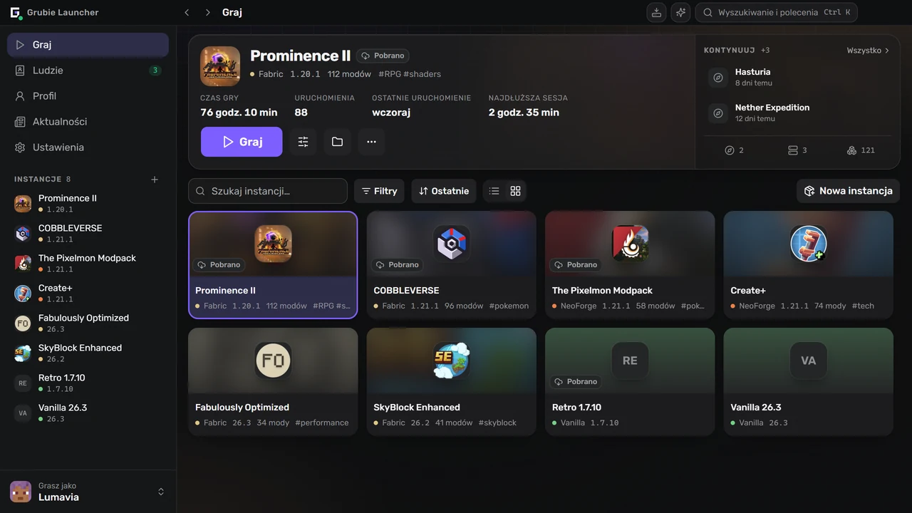
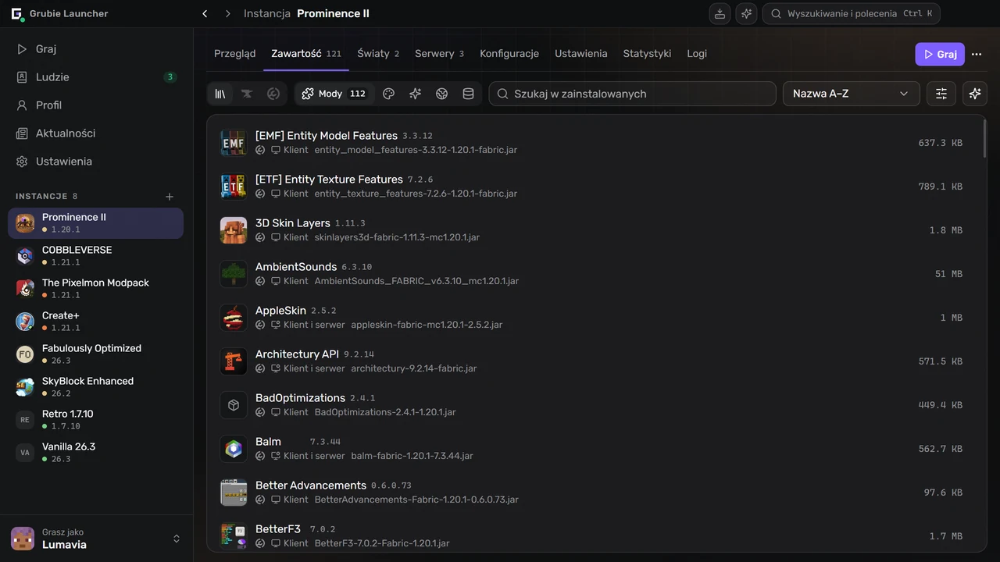
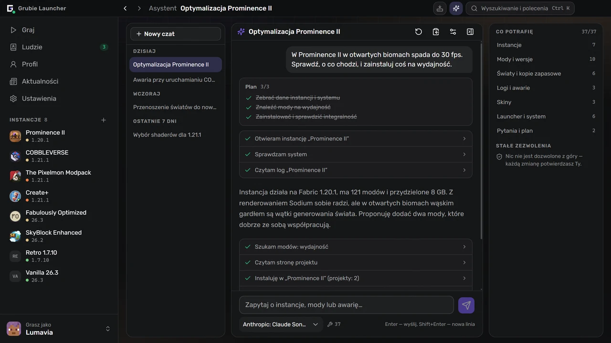
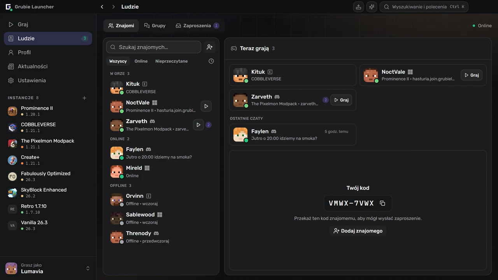

  

  <a href="https://grubielauncher.com/pl">grubielauncher.com</a>

  
  
  
   
  

---

# Grubie Launcher

Launcher Minecrafta na Windows i Linux. Instaluje wersje gry i loadery modów, sam pobiera pasującą Javę i trzyma każdą instancję — mody, światy, konfiguracje, ustawienia uruchamiania — w jednym miejscu. Od zwykłego launchera odróżniają go dwie rzeczy: gdy gra ulegnie awarii, czyta raport i mówi, co się zepsuło, a znajomi są w tym samym oknie — czat, głos i dołączanie do swoich światów bez przekierowania portów i wynajmowania serwera.

Interfejs to stały pasek boczny i pełne ekrany zamiast piętrzących się okien. <kbd>Ctrl</kbd>+<kbd>K</kbd> otwiera paletę poleceń, która prowadzi do każdej instancji, ekranu i ustawienia, <kbd>Ctrl</kbd>+<kbd>I</kbd> otwiera asystenta, a <kbd>Alt</kbd>+<kbd>←</kbd> / <kbd>Alt</kbd>+<kbd>→</kbd> przechodzą po historii jak w przeglądarce.

<kbd></kbd>
<kbd></kbd>
<kbd></kbd>
<kbd></kbd>
<kbd></kbd>
<kbd></kbd>
<kbd></kbd>
<kbd></kbd>

# Zrzuty ekranu

**Biblioteka i ostatnio uruchamiana instancja**

**Mody, paczki zasobów i shadery wyszukiwane w launcherze**

**Asystent, który czyta instancje, logi i awarie**

**Znajomi, grupy i zaproszenia obok czatu**

# Funkcje

### Granie

- Oficjalne wersje Minecrafta: wydania, snapshoty i stare wersje alfa/beta.
- Loadery modów: **Forge**, **NeoForge**, **Fabric**, **Quilt**.
- Java pobiera się automatycznie i jest dobierana do wersji gry.
- Konta: **Microsoft**, **Ely.by**, **Discord** i offline. Kilka naraz, przełączane z paska bocznego.
- Biblioteka instancji w widoku listy i siatki, z grupami, tagami i notatkami.
- Kontynuacja tam, gdzie skończyła się gra: wejście prosto do świata lub na serwer z ekranu instancji.
- Pamięć, flagi JVM i priorytet procesu ustawia się globalnie, a dla każdej instancji można je nadpisać.
- Dla pojedynczej instancji można utworzyć skrót na pulpicie.

### Instancje

- Mody, paczki zasobów, shadery i paczki danych z **CurseForge** i **Modrinth**, wyszukiwane i instalowane w launcherze.
- Sprawdzanie aktualizacji, które najpierw pokazuje różnice: co zostanie dodane, zaktualizowane i usunięte.
- Import z pliku: paczki Grubie, CurseForge, Modrinth (`.mrpack`), Prism i MultiMC — wystarczy przeciągnąć archiwum na okno.
- Eksport instancji do archiwum; kopia zawiera mody, konfiguracje i światy.
- Publikacja instancji i udostępnienie kodu: każdy, kto ją zainstalował, zobaczy kolejną aktualizację z listą zmian i zsynchronizuje ją jednym kliknięciem.
- Katalog społeczności z publicznymi instancjami, w launcherze i na [grubielauncher.com/packs](https://grubielauncher.com/pl/packs).
- Sprawdzanie integralności, które ponownie pobiera uszkodzone lub brakujące pliki.
- Edytor konfiguracji z wyszukiwaniem, podpowiedziami i zapisanymi wersjami do przywrócenia.
- Edytor chunków dla światów: mapa wszystkich wygenerowanych chunków w każdym wymiarze z widokiem satelitarnym terenu, filtry chunków nigdy nieodwiedzanych, nieaktualnych lub uszkodzonych oraz usuwanie poprzedzone kopią zapasową.

### Razem

- Znajomi, zaproszenia do znajomych, wiadomości prywatne i czaty grupowe.
- Głos: pokoje w grupach i rozmowy jeden na jeden, „Naciśnij, aby mówić”, tłumienie szumów, głośność dla każdego uczestnika.
- **Wspólna gra** — otwarcie świata, w którym się gra, dla znajomych lub dla wszystkich, przez internet, bez przekierowania portów.
- Dołączanie do świata znajomego jednym kliknięciem: launcher instaluje i synchronizuje jego instancję, a potem łączy.
- Zaproszenia do gry; powiadomienia w Telegramie docierają także przy zamkniętym launcherze.
- Discord Rich Presence z instancją, w którą się gra.
- Profil z osiągnięciami, statystykami i rankingiem. Osiągnięcia liczą się także w udostępnionym świecie znajomego.
- Skiny i peleryny: własna garderoba, import z pliku, linku lub nicku oraz katalog społeczności, w którym można publikować.

### Gdy coś pójdzie nie tak

- Karta awarii: launcher czyta raport awarii, wskazuje prawdopodobnego winowajcę i podpowiada, co zrobić. Reguły przychodzą z serwera, więc poprawiają się bez aktualizacji launchera.
- Analiza awarii przez AI dla przypadków, których reguły nie rozpoznają — tylko na życzenie, a przed wysłaniem z logu usuwane są ścieżki, nicki i tokeny.
- Historia uruchomień: każde uruchomienie z logiem, wyszukiwaniem, kodem wyjścia i raportem, który kopiuje się jednym kliknięciem do prośby o pomoc.
- Kopie zapasowe światów: automatyczne po sesji i ręczne, z kopią bezpieczeństwa przed każdym przywróceniem.
- Test połączenia z usługami launchera oraz oficjalnymi serwerami Minecrafta, CurseForge i Modrinth — przydatny, gdy dostawca coś blokuje.
- Centrum zadań: instalacje i aktualizacje z postępem, błędami dla każdego pliku i ponowieniem.
- Pobieranie może iść przez mirror Grubie i samo wraca do oficjalnego źródła.

### Asystent

- Działa z **własnym** dostawcą i **własnym** kluczem: dowolny endpoint zgodny z OpenAI, domyślnie OpenRouter. Klucz zostaje na komputerze.
- Czyta to, czego potrzebuje do odpowiedzi: instancje, zainstalowane mody, logi, ostatnią awarię, światy, konta, zajęte miejsce na dysku, informacje o systemie.
- Działa w imieniu użytkownika: tworzy instancje, instaluje, aktualizuje, wyłącza i usuwa mody, zmienia pamięć i argumenty uruchamiania, robi i przywraca kopie zapasowe światów, wybiera skin, uruchamia grę.
- Pyta, zanim cokolwiek zmieni, a przy usuwaniu pyta za każdym razem — niezależnie od wcześniejszych zgód.
- Historia czatu synchronizuje się z kontem Grubie; synchronizację można wyłączyć w ustawieniach.

### Własny serwer

- Serwer tworzy się obok instancji: **Vanilla**, **Spigot**, **Bukkit**, **Paper**, **Purpur**, **Forge**, **NeoForge**, **Fabric**, **Quilt**.
- Konsola, edytor `server.properties`, a serwer przejmuje mody i konfiguracje instancji, do której należy.

# Instalacja

1. Pobierz najnowszą wersję z [Releases](https://github.com/MOJI6416/grubielauncher/releases).
2. **Windows** — uruchom instalator `-setup.exe`. **Linux** — uruchom plik `.AppImage` lub zainstaluj paczkę `.deb`.
3. Zaloguj się kontem lub utwórz konto offline i wybierz wersję.

Launcher aktualizuje się sam; nowe wersje przychodzą bez ponownej instalacji.

# Licencja

**MIT** — zobacz [LICENSE](../LICENSE).

# Linki

- **Strona:** [grubielauncher.com](https://grubielauncher.com/pl)
- **Pobieranie:** [Releases](https://github.com/MOJI6416/grubielauncher/releases)
- **Lista zmian:** [grubielauncher.com/changelog](https://grubielauncher.com/pl/changelog)
- **Discord:** [serwer Grubie Launcher](https://discord.com/invite/URrKha9hk7)
- **Polityka prywatności:** [grubielauncher.com/privacy](https://grubielauncher.com/pl/privacy)
