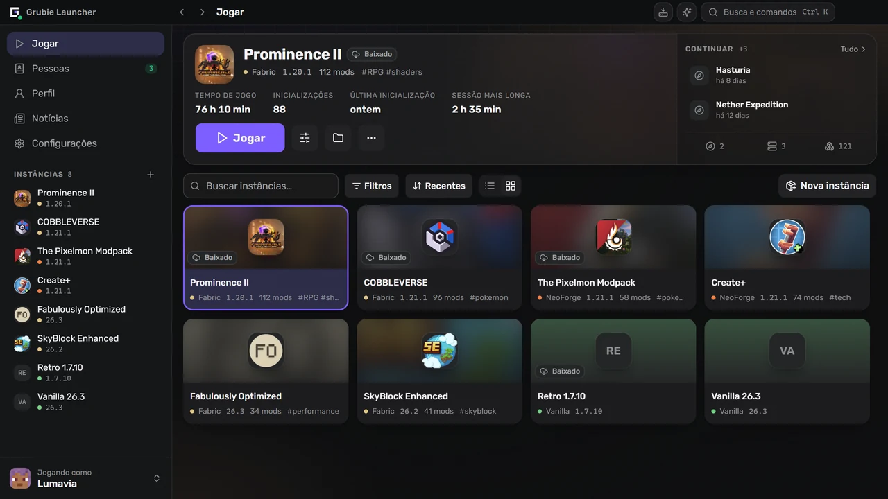
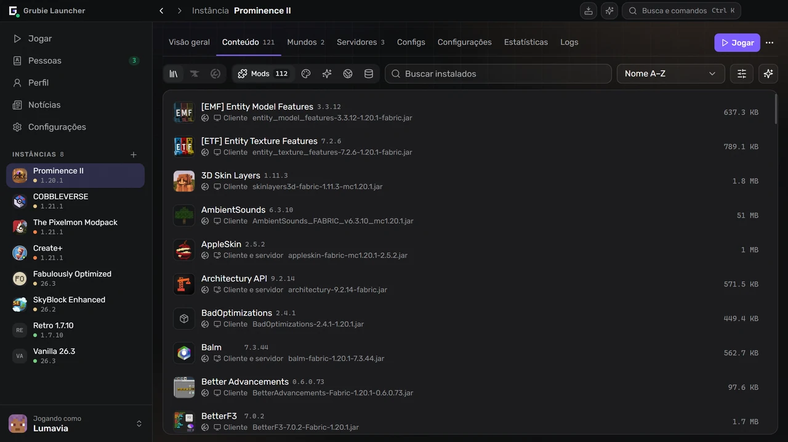
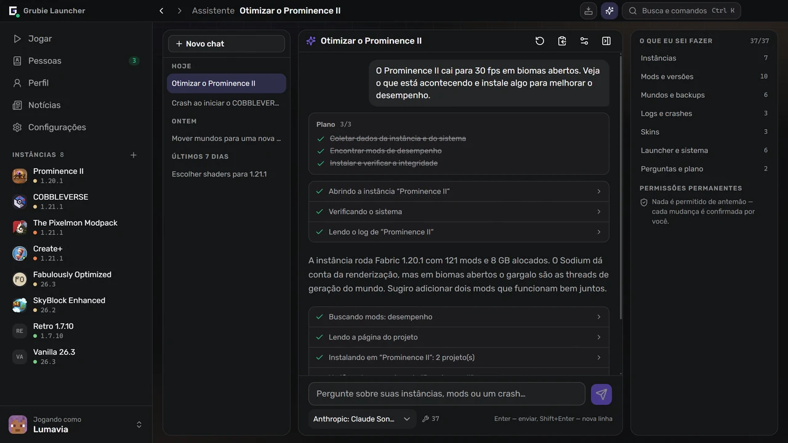
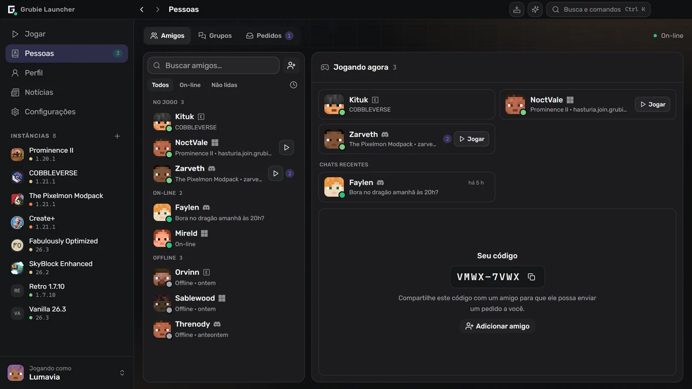

  

  <a href="https://grubielauncher.com/pt">grubielauncher.com</a>

  
  
  
  
   
  

---

# Grubie Launcher

Um launcher de Minecraft para Windows, macOS e Linux. Ele instala versões do jogo e loaders de mods, baixa sozinho o Java certo e mantém cada instância — mods, mundos, configurações, ajustes de inicialização — em um só lugar. Duas coisas o diferenciam de um launcher comum: quando o jogo crasha, ele lê o relatório e diz o que quebrou, e seus amigos ficam na mesma janela — chat, voz e entrar no mundo uns dos outros sem redirecionar portas nem alugar servidor.

A interface é uma barra lateral fixa com telas inteiras em vez de janelas empilhadas. <kbd>Ctrl</kbd>+<kbd>K</kbd> abre uma paleta de comandos que leva a qualquer instância, tela ou configuração, <kbd>Ctrl</kbd>+<kbd>I</kbd> abre o assistente, e <kbd>Alt</kbd>+<kbd>←</kbd> / <kbd>Alt</kbd>+<kbd>→</kbd> percorrem o histórico como em um navegador.

<kbd></kbd>
<kbd></kbd>
<kbd></kbd>
<kbd></kbd>
<kbd></kbd>
<kbd></kbd>
<kbd></kbd>
<kbd></kbd>

# Capturas de tela

**A biblioteca e a última instância jogada**

**Mods, pacotes de recursos e shaders, pesquisados dentro do launcher**

**Um assistente que lê suas instâncias, logs e crashes**

**Amigos, grupos e pedidos, ao lado do chat**

# Recursos

### Jogar

- Versões oficiais do Minecraft: lançamentos, snapshots e versões alfa/beta antigas.
- Loaders de mods: **Forge**, **NeoForge**, **Fabric**, **Quilt**.
- Versões antigas também: **Legacy Fabric**, **Babric**, **Ornithe**, **Better than Adventure** com Babric, **ReIndev** com FoxLoader e jar mods.
- O Java é baixado automaticamente e escolhido conforme a versão do jogo.
- Contas: **Microsoft**, **Ely.by**, **Discord** e offline. Várias ao mesmo tempo, trocadas pela barra lateral.
- Biblioteca de instâncias com visualização em lista e em grade, grupos, tags e notas.
- Continue de onde parou: entre direto em um mundo ou servidor pela tela da instância.
- Catálogo de servidores do Modrinth: encontre um servidor que combine com sua instância ou crie uma instância para qualquer servidor do catálogo.
- Memória, flags da JVM e prioridade do processo são definidas globalmente e podem ser alteradas por instância.
- Dá para criar um atalho na área de trabalho para uma única instância.

### Instâncias

- Mods, pacotes de recursos, shaders e pacotes de dados do **CurseForge** e do **Modrinth**, pesquisados e instalados dentro do launcher.
- Verificação de atualizações que mostra antes as diferenças: o que será adicionado, atualizado e removido.
- Importação de arquivo: pacotes do Grubie, CurseForge, Modrinth (`.mrpack`), Prism e MultiMC — é só arrastar o arquivo para a janela.
- Exportação de uma instância para um arquivo compactado; a cópia leva mods, configurações e mundos.
- Publique uma instância e compartilhe o código: todos que a instalaram veem sua próxima atualização, com as diferenças, e sincronizam com um clique.
- Uma instância instalada a partir de um modpack do CurseForge ou do Modrinth continua vinculada a ele: atualize para uma versão mais nova vendo antes o que muda, e volte para a anterior se algo quebrar.
- Passe uma instância para outra versão do Minecraft ou outro loader: o launcher cria uma cópia com versões de mods compatíveis e pode levar junto os ajustes, as configurações dos mods e os mundos.
- Conjuntos de mods: salve os mods de uma instância como um conjunto e depois adicione-o a qualquer instância ou escolha-o ao criar uma nova.
- Seus próprios grupos de mods: recolha-os e ative ou desative um grupo inteiro de uma vez.
- Catálogo da comunidade com instâncias públicas, dentro do launcher e em [grubielauncher.com/packs](https://grubielauncher.com/pt/packs).
- Verificação de integridade que baixa de novo arquivos danificados ou ausentes.
- Editor de configurações com busca, autocompletar e versões salvas para voltar atrás.
- Editor de chunks para mundos: um mapa de todos os chunks gerados em cada dimensão com vista de satélite do terreno, filtros para chunks nunca visitados, desatualizados ou danificados, e exclusão com um backup de segurança feito antes.

### Juntos

- Amigos, pedidos de amizade, mensagens diretas e chats em grupo.
- Voz: salas nos grupos e chamadas individuais, apertar para falar, supressão de ruído, volume por participante.
- **Jogar juntos** — abra o mundo em que você está para amigos ou para todos, pela internet, sem redirecionar portas.
- Entre no mundo de um amigo com um clique: o launcher instala e sincroniza a instância dele e depois conecta você.
- Convites para jogar; as notificações do Telegram chegam mesmo com o launcher fechado.
- Discord Rich Presence com a instância que você está jogando.
- Perfil com conquistas, estatísticas e ranking. As conquistas também contam no mundo compartilhado de um amigo.
- Skins e capas: seu próprio guarda-roupa, importação por arquivo, link ou apelido, e um catálogo da comunidade onde você pode publicar.

### Quando algo dá errado

- Cartão de crash: o launcher lê o relatório do crash, aponta o provável culpado e o que fazer. As regras vêm do servidor e melhoram sem atualizar o launcher.
- Análise de crash por IA para os casos que as regras não reconhecem — só se você ativar, e o log tem caminhos, apelidos e tokens removidos antes do envio.
- Histórico de execuções: cada inicialização com seu log, busca, código de saída e um relatório para copiar com um clique ao pedir ajuda.
- Backups de mundos: automáticos depois de cada sessão e manuais, com uma cópia de segurança antes de qualquer restauração.
- Teste de conexão com os serviços do launcher e com os servidores oficiais do Minecraft, CurseForge e Modrinth — útil quando um provedor bloqueia algo.
- Central de tarefas: instalações e atualizações com progresso, erros por arquivo e nova tentativa.
- Os downloads podem passar pelo espelho do Grubie e voltam sozinhos para a fonte oficial.

### Assistente

- Funciona com o **seu** provedor e a **sua** chave: qualquer endpoint compatível com OpenAI, OpenRouter por padrão. A chave fica no seu computador.
- Lê o que precisa para responder: instâncias, mods instalados, logs, o último crash, mundos, contas, uso de disco, informações do sistema.
- Age por você: cria instâncias, instala, atualiza, desativa e remove mods, muda a memória e os argumentos de inicialização, faz backup e restaura mundos, escolhe uma skin, inicia o jogo.
- Pergunta antes de mudar qualquer coisa, e pergunta de novo toda vez que for excluir algo — não importa o que você tenha permitido antes.
- O histórico do chat é sincronizado com sua conta Grubie; a sincronização pode ser desativada nas configurações.

### Seu próprio servidor

- Crie um servidor ao lado de uma instância: **Vanilla**, **Spigot**, **Bukkit**, **Paper**, **Purpur**, **Forge**, **NeoForge**, **Fabric**, **Quilt**.
- Console, editor de `server.properties`, e o servidor recebe os mods e as configurações da instância à qual pertence.

# Instalação

1. Baixe a versão mais recente em [Releases](https://github.com/MOJI6416/grubielauncher/releases).
2. **Windows** — execute o instalador `-setup.exe`. **macOS** (12 ou mais recente) — abra o `.dmg` do seu Mac (`arm64` para Apple Silicon, `x64` para Intel) e arraste o app para Aplicativos. **Linux** — execute o `.AppImage` ou instale o `.deb`.
3. Entre com uma conta ou crie uma conta offline e escolha uma versão.

O launcher se atualiza sozinho; as novas versões chegam sem reinstalação.

# Licença

**MIT** — veja [LICENSE](../LICENSE).

# Links

- **Site:** [grubielauncher.com](https://grubielauncher.com/pt)
- **Downloads:** [Releases](https://github.com/MOJI6416/grubielauncher/releases)
- **Histórico de mudanças:** [grubielauncher.com/changelog](https://grubielauncher.com/pt/changelog)
- **Discord:** [servidor do Grubie Launcher](https://discord.com/invite/URrKha9hk7)
- **Política de privacidade:** [grubielauncher.com/privacy](https://grubielauncher.com/pt/privacy)
