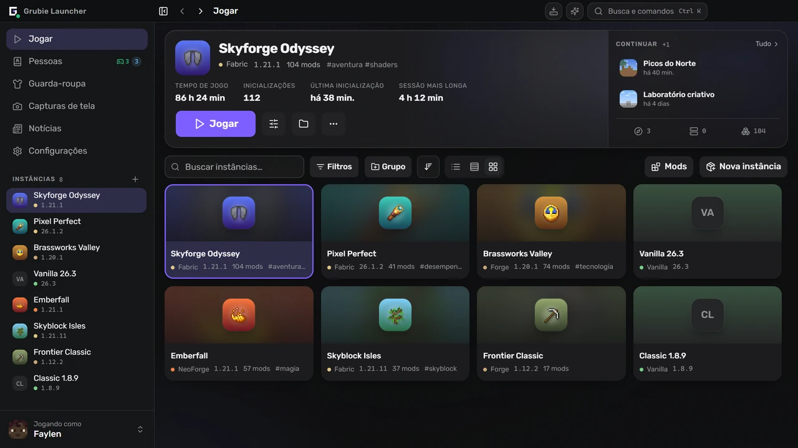
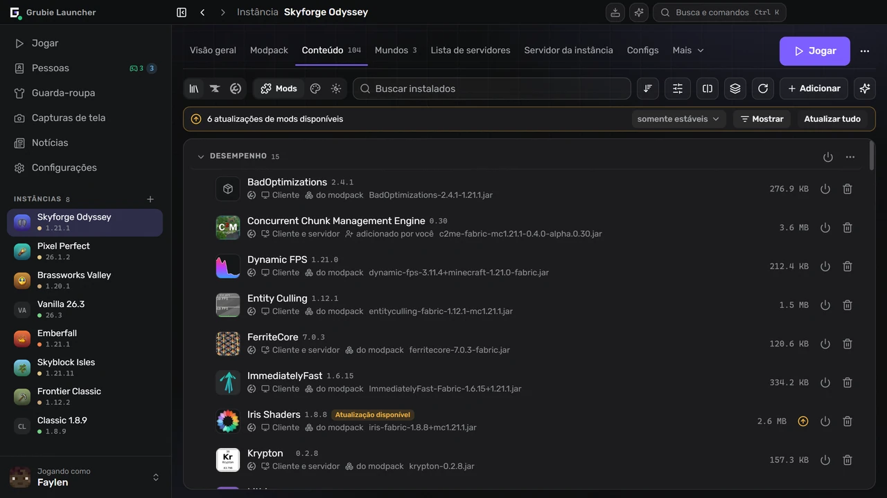
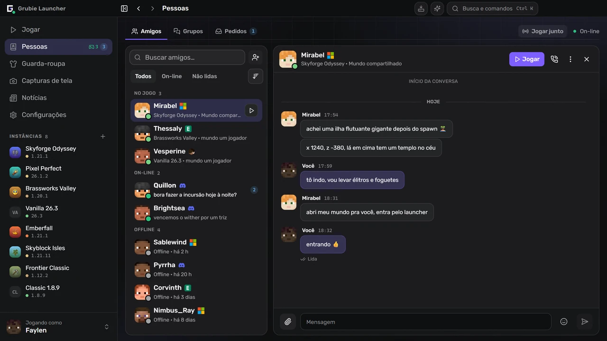
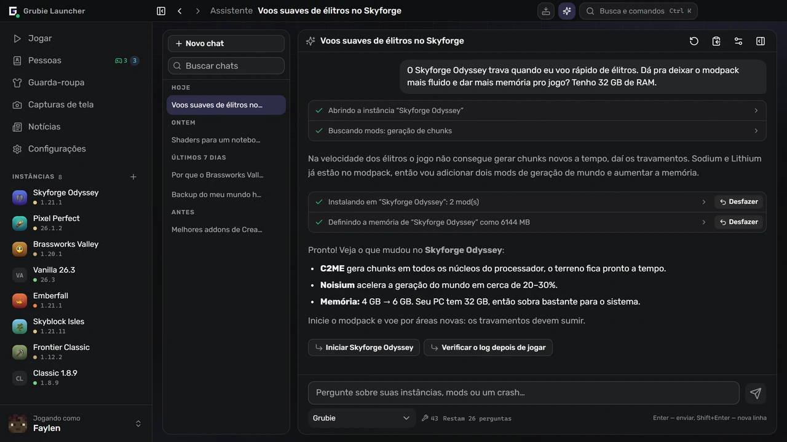

  

  <a href="https://grubielauncher.com/pt">grubielauncher.com</a>

  
  
  
  
   
  

---

# Grubie Launcher

Um launcher de Minecraft gratuito e de código aberto para Windows, macOS e Linux, sem anúncios e sem recursos pagos. Ele instala qualquer versão do jogo e qualquer loader de mods junto com o Java necessário, cuida de mods e modpacks do CurseForge e do Modrinth e mantém cada instância — mods, mundos, configurações, ajustes de inicialização — em um só lugar. Seus amigos ficam na mesma janela: chat, voz e entrar no mundo uns dos outros sem redirecionar portas. Quando o jogo crasha, o launcher lê o relatório e diz o que quebrou.

A interface é uma barra lateral fixa com telas inteiras em vez de janelas empilhadas. <kbd>Ctrl</kbd>+<kbd>K</kbd> abre uma paleta de comandos que leva a qualquer instância, tela ou configuração, <kbd>Ctrl</kbd>+<kbd>I</kbd> abre o assistente, e <kbd>Alt</kbd>+<kbd>←</kbd> / <kbd>Alt</kbd>+<kbd>→</kbd> percorrem o histórico como em um navegador.

<kbd></kbd>
<kbd></kbd>
<kbd></kbd>
<kbd></kbd>
<kbd></kbd>
<kbd></kbd>
<kbd></kbd>
<kbd></kbd>

# Capturas de tela

**A biblioteca e a última instância jogada**

**Mods, pacotes de recursos e shaders, pesquisados dentro do launcher**

**Amigos, grupos e pedidos, ao lado do chat**

**Um assistente que lê suas instâncias, logs e crashes**

# Recursos

### Jogar e instâncias

- Todas as versões oficiais do Minecraft: lançamentos, snapshots e versões alfa e beta antigas.
- Loaders de mods: **Forge**, **NeoForge**, **Fabric**, **Quilt** e **Cleanroom** para 1.12.2 com Java moderno.
- Versões antigas também: **Legacy Fabric**, **Babric**, **Ornithe**, **Better than Adventure** com Babric, **ReIndev** com FoxLoader e jar mods.
- **OptiFine** para vanilla e Forge 1.7.2–1.16.5, baixado do optifine.net; nas versões mais novas o launcher indica Sodium e Iris.
- O Java é baixado e escolhido sozinho para cada versão do jogo.
- Contas: **Microsoft**, **Ely.by**, **LittleSkin**, **Discord** e offline. Várias ao mesmo tempo, trocadas pela barra lateral.
- Modpacks do **CurseForge** e do **Modrinth**: veja o que vem dentro antes de instalar, escolha os arquivos opcionais, atualize vendo antes o que muda e volte atrás se algo quebrar. Um pacote instalado de um zip ou de um link é atualizado do mesmo jeito.
- Importação de arquivo: pacotes do Grubie, CurseForge, Modrinth (`.mrpack`), Prism e MultiMC — é só arrastar o arquivo para a janela. Exportação para um arquivo do Grubie ou um `.mrpack` do Modrinth, com caixas de seleção para pastas e mundos.
- Traga suas instâncias de outro launcher: Prism, MultiMC, ATLauncher, GDLauncher, CurseForge, Modrinth App, o launcher oficial, TLauncher e Legacy Launcher. As instâncias são copiadas; o launcher antigo fica como estava.
- Passe uma instância para outra versão do Minecraft ou outro loader: o launcher cria uma cópia com versões de mods compatíveis e pode levar junto os ajustes, as configurações e os mundos.
- Configurações de jogo compartilhadas: controles, gráficos, servidores, barras rápidas e pacotes de recursos passam de uma instância para outra. Cada instância pode deixar qualquer grupo de fora.
- Mods, pacotes de recursos e shaders idênticos ficam no disco uma única vez, não importa quantas instâncias os usem.
- Biblioteca de instâncias com visualização em lista e em grade, grupos, tags e notas. Continue direto em um mundo ou em um servidor; um atalho na área de trabalho para uma única instância.
- Memória, flags da JVM e opções de inicialização são definidas globalmente e podem ser alteradas por instância. No Minecraft 26.x o launcher protege contra crashes do Vulkan e pode abrir o jogo na placa de vídeo dedicada.
- As configurações continuam abertas enquanto você joga; só esperam as opções que quebrariam o jogo em execução.
- Navegação por controle e um “Modo grande” para Steam Deck e TV.
- Uma versão portátil para Windows que guarda todos os dados em uma pasta ao lado do programa — para um pen drive ou um computador compartilhado.

### Mods e tradução

- Mods, pacotes de recursos e shaders do **CurseForge** e do **Modrinth**, pesquisados e instalados dentro do launcher, ou direto do catálogo para qualquer instância.
- Os botões “Instalar” nos sites do Modrinth e do CurseForge podem abrir o Grubie — isso é ativado nas configurações.
- As atualizações mostram antes o que muda. Escolha o canal — só versões estáveis ou também betas e alfas — e fixe um mod na versão dele.
- Relações de um mod: o que ele exige, o que precisa dele e o que vem embutido nele. Ao desativar um mod, o launcher oferece desativar o que depende dele; ao remover, remove as dependências que mais nada usa.
- Grupos de mods que se recolhem e são ativados ou desativados de uma vez, e conjuntos de mods que você salva e adiciona a qualquer instância.
- Marcações e filtros para o que veio com o modpack e o que você mesmo adicionou.
- Arquivos que não estão nem no CurseForge nem no Modrinth são sinalizados e só são instalados se você marcar. Cópias do mesmo mod são encontradas e limpas com um clique.
- A lista de mods de uma instância continua aberta enquanto o jogo roda.
- Editor de configurações com busca, realce de sintaxe, grupos, comentários traduzidos e cópias salvas para voltar atrás.
- **Tradução de mods para russo e ucraniano**, desativada por padrão: primeiro os pacotes de tradução da comunidade, e a IA no servidor do Grubie completa o resto, com um cache compartilhado. Abrange mods, os pacotes de recursos do próprio modpack, livros-guia (Lavender, Patchouli, GuideME) e missões (FTB Quests, QuestZ). A parte de IA exige uma conta Grubie e tem um limite diário.

### Mundos

- Mapas e pacotes de dados do catálogo: um mapa vira o seu próprio mundo, um pacote de dados vai para o mundo que você escolher.
- Os progressos de cada mundo, e a semente dele, que abre no mapa da semente.
- Esquemas (`.litematic`, `.schem`, `.schematic`, `.nbt`) com os nomes e ícones reais dos blocos, uma lista de materiais e uma visualização em 3D.
- Editor de chunks: um mapa de todos os chunks gerados em cada dimensão com vista de satélite, filtros para chunks nunca visitados, desatualizados ou danificados, e exclusão com um backup de segurança feito antes.
- Backups de mundos: automáticos depois de cada sessão e manuais, com uma cópia de segurança antes de qualquer restauração.

### Juntos

- Amigos, pedidos de amizade, mensagens diretas e chats em grupo. Com uma conta Microsoft, seus amigos do Minecraft 26.2 também aparecem.
- Voz: salas nos grupos e chamadas individuais, “Apertar para falar” em uma tecla global, supressão de ruído, volume por participante.
- **Jogar junto** — abra o mundo em que você está para amigos ou para todos, pela internet, sem redirecionar portas nem usar Hamachi. Os amigos se conectam diretamente quando a rede permite e, se não, pelo servidor de retransmissão do Grubie.
- Entre no mundo de um amigo com um clique: o launcher instala a instância dele com a mesma versão e os mesmos mods e depois conecta você.
- Compartilhe uma instância por um código curto: todos que a instalaram recebem sua próxima atualização com as diferenças do que muda. Instâncias públicas aparecem no catálogo da comunidade, dentro do launcher e em [grubielauncher.com/packs](https://grubielauncher.com/pt/packs). Os autores veem instalações, jogadores e tempo de jogo, e podem publicar um aviso para os jogadores.
- Convites para grupos como links https que abrem pelo Discord ou pelo Telegram.
- O catálogo de servidores mostra quais amigos jogam onde, e você entra com a instância deles.
- Capturas de tela de todas as instâncias em um só feed; qualquer uma pode ser enviada para um chat.
- Notificações de mensagens e convites por cima do jogo no modo janela e sem bordas, <kbd>F7</kbd> aceita.
- Notificações no Telegram enquanto o launcher está fechado; Discord Rich Presence com links para o seu perfil e para a instância.

### Mod complementar

- Leva o launcher para dentro do jogo: um painel de amigos na tecla <kbd>G</kbd> com convites, abertura do seu mundo e voz; botões do Grubie no menu do jogo para abrir o mundo para os amigos ou convidar um; notificações de mensagens, convites, conquistas e da captura de tela que você acabou de tirar, com “Enviar a um amigo”; quem está falando no chat de voz e se o seu microfone está silenciado.
- Diz ao launcher em qual mod o jogo travou e conta as conquistas do launcher em servidores multijogador.
- Fabric, Quilt e Forge a partir da 1.16.5, NeoForge a partir da 1.20.1, até a 26.3. Ativado por padrão nas instâncias novas, ajustável por instância. O código é aberto: [grubie-companion](https://github.com/MOJI6416/grubie-companion).

### Seu próprio servidor

- Crie um servidor ao lado de uma instância: **Vanilla**, **Paper**, **Purpur**, **Spigot**, **Bukkit**, **Forge**, **NeoForge**, **Fabric**, **Quilt**. Ele recebe os mods e as configurações da instância à qual pertence.
- Console e editor de `server.properties`. A partir da 1.21.9, jogadores, banimentos, operadores, a lista-branca e as regras do jogo passam pelo protocolo de gerenciamento da Mojang.
- Abra-o para os amigos pelo servidor de retransmissão do Grubie: só para convidados ou aberto a todos, lista de convidados, expulsão, limite de vagas.

### Quando algo dá errado

- Cartão de crash: o launcher lê o relatório do crash, aponta o provável culpado e o que fazer. As regras vêm do servidor e melhoram sem atualizar o launcher; logs ofuscados do vanilla e do Fabric são lidos primeiro com os nomes da Mojang.
- Análise de crash por IA para os casos que as regras não reconhecem — sem chave, e o log tem caminhos, apelidos e tokens removidos antes do envio.
- Busca do culpado: um assistente desativa metade dos seus mods, você inicia o jogo e diz se o problema continua. Depois de algumas execuções sobra um mod ou um par — também para lag e bugs visuais, não só para crashes.
- Quando o jogo congela, o mod complementar diz ao launcher em qual mod ele travou.
- Verificação de integridade que baixa de novo arquivos danificados ou ausentes.
- Histórico de execuções: cada inicialização com seu log, busca e código de saída. Um relatório para o suporte com um código `GRB-`, e as respostas do suporte chegam no launcher.
- Se um serviço de login estiver fora do ar, o jogo abre com a sessão salva.
- Teste de conexão com os serviços do launcher e com os servidores oficiais do Minecraft, CurseForge e Modrinth. Os downloads podem passar pelo espelho do Grubie e voltam sozinhos para a fonte oficial.
- Central de tarefas: instalações e atualizações com progresso, erros por arquivo e nova tentativa.

### Assistente

- Funciona com o **seu** provedor e a **sua** chave: qualquer endpoint compatível com OpenAI, OpenRouter por padrão. A chave fica no seu computador.
- Lê o que precisa para responder: instâncias, mods instalados, logs, o último crash, mundos, contas, uso de disco, informações do sistema.
- Age por você: cria instâncias, instala, atualiza, desativa e remove mods, muda a memória e os argumentos de inicialização, faz backup e restaura mundos, escolhe uma skin, inicia o jogo.
- Pergunta antes de mudar qualquer coisa, e pergunta de novo toda vez que for excluir algo — não importa o que você tenha permitido antes.
- Exige uma conta online (Microsoft, Ely.by, LittleSkin ou Discord). O histórico do chat é sincronizado com sua conta Grubie; a sincronização pode ser desativada nas configurações.

### Skins, temas e perfil

- Guarda-roupa: skins e capas, importação por arquivo, link ou apelido, uma visualização em 3D. Um catálogo da comunidade onde você pode publicar, e o nome de cada autor abre o perfil dele.
- Temas: suas próprias cores e uma imagem de fundo, layouts predefinidos e uma galeria de temas de jogadores.
- Sincronização pela conta Grubie: temas, o guarda-roupa de skins e as configurações do launcher acompanham você em outro computador. Caminhos, memória e Java ficam próprios de cada computador.
- 60 conquistas contadas nos seus próprios mundos, no mundo compartilhado de um amigo e, com o mod complementar, em servidores. Cada uma mostra quantos jogadores a têm. Um ranking e um perfil público em [grubielauncher.com](https://grubielauncher.com/pt).

### Segurança e privacidade

- As atualizações são assinadas: o launcher só instala uma atualização que tenha a assinatura do Grubie.
- Instâncias publicadas são verificadas em busca de malware conhecido nos jars antes de chegar ao catálogo e verificadas de novo em segundo plano.
- Jars de origem desconhecida são sinalizados ao importar uma instância e na lista de mods.
- Os códigos de diagnóstico de crashes, os contadores de recursos e as estatísticas para autores de modpacks vêm ativados por padrão e são desativados em “Configurações → Privacidade”.
- O modo streamer esconde endereços, sementes, códigos e caminhos durante a transmissão.
- Nove idiomas de interface: inglês, russo, ucraniano, alemão, espanhol, francês, polonês, português (Brasil) e turco.

# Instalação

1. Baixe a versão mais recente em [grubielauncher.com/download](https://grubielauncher.com/pt/download) ou em [Releases](https://github.com/MOJI6416/grubielauncher/releases).
2. **Windows** — execute o instalador `-setup.exe` ou descompacte o `-portable.zip` em qualquer lugar. **macOS** (12 ou mais recente) — abra o `.dmg` do seu Mac (`arm64` para Apple Silicon, `x64` para Intel) e arraste o app para Aplicativos. **Linux** — execute o `.AppImage` ou instale o `.deb`.
3. Entre com uma conta ou crie uma conta offline e escolha uma versão.

O launcher se atualiza sozinho; as novas versões chegam sem reinstalação.

# Licença

**GPL-3.0** — veja [LICENSE](../LICENSE).

O nome Grubie Launcher e o logotipo não são cobertos por esta licença. Forks são bem-vindos, mas precisam de nome e logotipo próprios e não podem se apresentar como o launcher oficial.

# Links

- **Site:** [grubielauncher.com](https://grubielauncher.com/pt)
- **Downloads:** [grubielauncher.com/download](https://grubielauncher.com/pt/download)
- **Histórico de mudanças:** [grubielauncher.com/changelog](https://grubielauncher.com/pt/changelog)
- **Discord:** [servidor do Grubie Launcher](https://discord.com/invite/URrKha9hk7)
- **Política de privacidade:** [grubielauncher.com/privacy](https://grubielauncher.com/pt/privacy)
