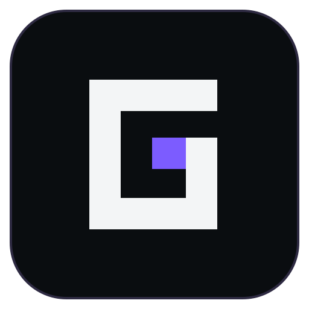
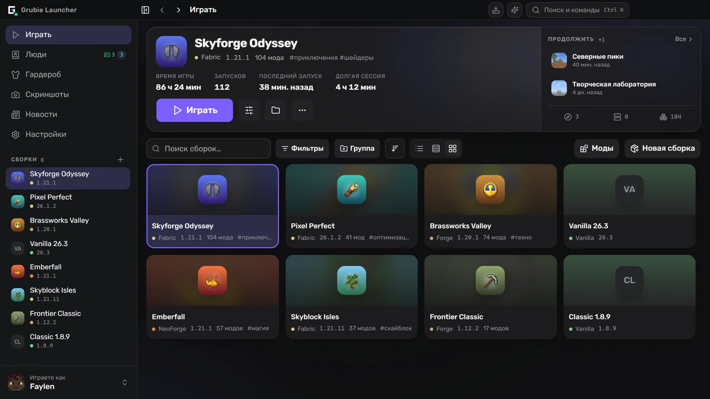
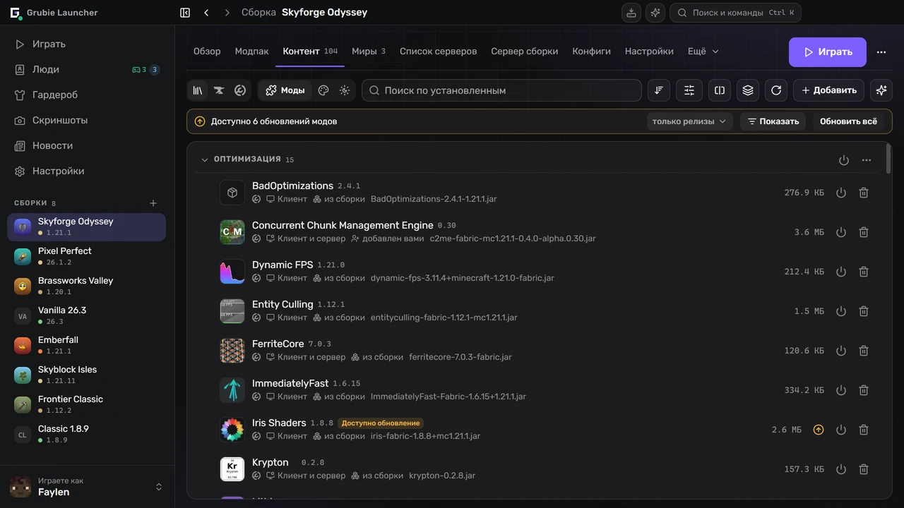
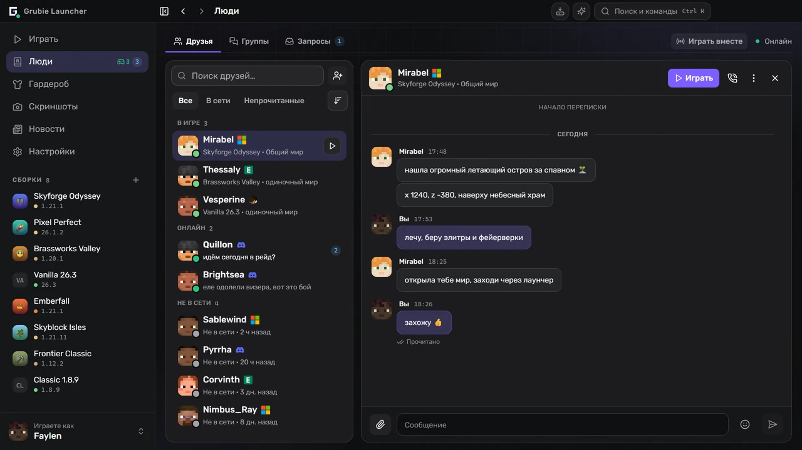
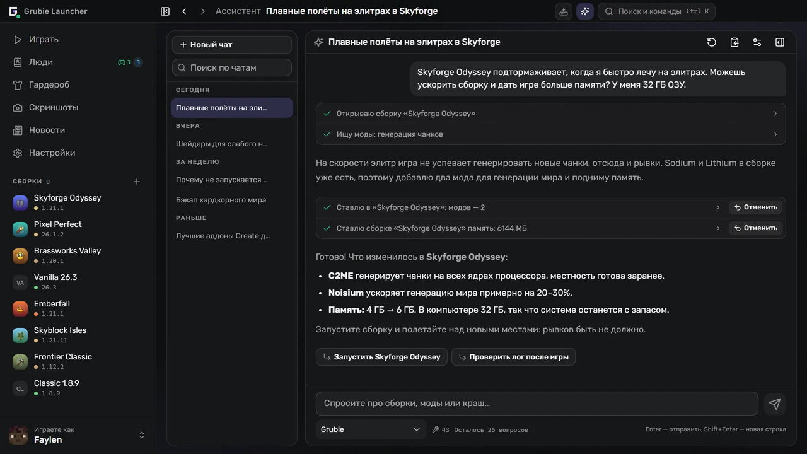

  

  <a href="https://grubielauncher.com/">grubielauncher.com</a>

  
  
  
  
   
  

---

# Grubie Launcher

Бесплатный лаунчер Minecraft с открытым кодом для Windows, macOS и Linux — без рекламы и платных функций. Он ставит любую версию игры и любой загрузчик вместе с нужной Java, работает с модами и сборками с CurseForge и Modrinth и держит каждую сборку — моды, миры, конфиги, настройки запуска — в одном месте. Друзья живут в том же окне: переписка, голос и вход в мир друг друга без проброса портов. А если игра вылетела, лаунчер прочитает отчёт и скажет, что сломалось.

Интерфейс — постоянная боковая панель и полноценные экраны вместо стопки диалогов. <kbd>Ctrl</kbd>+<kbd>K</kbd> открывает палитру команд, из которой доступны любая сборка, экран и настройка, <kbd>Ctrl</kbd>+<kbd>I</kbd> открывает ассистента, а <kbd>Alt</kbd>+<kbd>←</kbd> / <kbd>Alt</kbd>+<kbd>→</kbd> ходят по истории, как в браузере.

<kbd></kbd>
<kbd></kbd>
<kbd></kbd>
<kbd></kbd>
<kbd></kbd>
<kbd></kbd>
<kbd></kbd>
<kbd></kbd>

# Скриншоты

**Библиотека и сборка, в которую вы играли последней**

**Моды, ресурспаки и шейдеры — поиск прямо в лаунчере**

**Друзья, группы и заявки рядом с перепиской**

**Ассистент, который читает ваши сборки, логи и вылеты**

# Возможности

### Игра и сборки

- Все официальные версии Minecraft: релизы, снапшоты и старые alpha и beta.
- Загрузчики модов: **Forge**, **NeoForge**, **Fabric**, **Quilt** и **Cleanroom** — 1.12.2 на современной Java.
- И для старых версий: **Legacy Fabric**, **Babric**, **Ornithe**, **Better than Adventure** на Babric, **ReIndev** на FoxLoader и jar-моды.
- **OptiFine** для ванили и Forge 1.7.2–1.16.5 — скачивается с optifine.net; на новых версиях лаунчер подскажет Sodium и Iris.
- Java скачивается сама и подбирается под каждую версию игры.
- Аккаунты: **Microsoft**, **Ely.by**, **LittleSkin**, **Discord** и офлайн. Несколько сразу, переключение — в боковой панели.
- Сборки с **CurseForge** и **Modrinth**: состав видно до установки, необязательные файлы выбираются галочками, обновление показывает, что изменится, а если что-то сломалось — откатывается. Сборка из zip-архива или по ссылке обновляется так же.
- Импорт из файла: сборки Grubie, CurseForge, Modrinth (`.mrpack`), Prism и MultiMC — перетащите архив в окно. Экспорт в архив Grubie или в `.mrpack` для Modrinth, папки и миры отмечаются галочками.
- Переезд из другого лаунчера: Prism, MultiMC, ATLauncher, GDLauncher, CurseForge, Modrinth App, официальный лаунчер, TLauncher и Legacy Launcher. Сборки копируются, в старом лаунчере всё остаётся как было.
- Перенос сборки на другую версию Minecraft или другой загрузчик: лаунчер создаёт копию с подходящими версиями модов и может перенести настройки, конфиги и миры.
- Общие настройки игры: управление, графика, серверы, хотбары и ресурспаки переходят из сборки в сборку. У каждой сборки любую группу можно отключить.
- Одинаковые моды, ресурспаки и шейдеры хранятся на диске один раз, сколько бы сборок их ни использовало.
- Библиотека сборок — списком или плиткой, с группами, тегами и заметками. Продолжить можно сразу в мире или на сервере; для отдельной сборки — ярлык на рабочем столе.
- Память, флаги JVM и параметры запуска — общие, с переопределением для каждой сборки. На Minecraft 26.x лаунчер страхует от вылетов на Vulkan и умеет запускать игру на дискретной видеокарте.
- Настройки открыты и во время игры; ждут закрытия только те, что сломали бы запущенную игру.
- Управление геймпадом и крупный режим для Steam Deck и телевизора.
- Portable-версия для Windows: все данные лежат в папке рядом с программой — для флешки или общего компьютера.

### Моды и перевод

- Моды, ресурспаки и шейдеры с **CurseForge** и **Modrinth** — поиск и установка прямо в лаунчере, в том числе из каталога сразу в любую сборку.
- Кнопки «Установить» на сайтах Modrinth и CurseForge могут открывать Grubie — включается в настройках.
- Перед обновлением видно, что изменится. Можно выбрать канал — только релизы или ещё беты и альфы — и закрепить мод на его версии.
- Связи мода: что ему нужно, кому нужен он и что встроено внутрь. При отключении мода лаунчер предложит выключить и то, что от него зависит, а при удалении уберёт зависимости, которые больше никому не нужны.
- Группы модов — сворачиваются и включаются целиком, и наборы модов — сохраняются и добавляются в любую сборку.
- Метки и фильтры: что пришло со сборкой, а что вы добавили сами.
- Файлы, которых нет ни на CurseForge, ни на Modrinth, помечаются и без вашей галочки не ставятся. Копии одного мода находятся и убираются в один клик.
- Список модов сборки можно смотреть и во время игры.
- Редактор конфигов с поиском, подсветкой, группами, переводом комментариев и сохранёнными копиями для отката.
- **Перевод модов на русский и украинский**, по умолчанию выключен: сначала готовые паки перевода от сообщества, остальное переводит ИИ на сервере Grubie, с общим кэшем. Переводятся моды, ресурспаки самой сборки, книги-гайды (Lavender, Patchouli, GuideME) и квесты (FTB Quests, QuestZ). Для ИИ-части нужен аккаунт Grubie, у неё есть дневной лимит.

### Миры

- Карты и датапаки из каталога: карта становится вашим собственным миром, датапак ставится в выбранный мир.
- Прогресс достижений в каждом мире и его сид на карте генерации.
- Схематики (`.litematic`, `.schem`, `.schematic`, `.nbt`) с настоящими названиями и иконками блоков, списком материалов и 3D-просмотром.
- Редактор чанков: карта всех сгенерированных чанков по измерениям со спутниковым видом, фильтры по непосещённым, устаревшим и повреждённым чанкам и удаление с предварительной резервной копией.
- Бэкапы миров: автоматически после сессии и вручную, а перед любым восстановлением делается страховочная копия.

### Вместе с друзьями

- Друзья, заявки, личные сообщения и групповые чаты. На аккаунте Microsoft видны и друзья из Minecraft 26.2.
- Голос: комнаты в группах и звонки один на один, кнопка «говорить» на глобальной клавише, шумоподавление, громкость каждого участника.
- **Играть вместе** — откройте мир, в котором играете, друзьям или всем, через интернет, без проброса портов и Hamachi. Друзья подключаются напрямую, если сеть позволяет, а иначе — через ретранслятор Grubie.
- Вход в мир друга в один клик: лаунчер ставит его сборку той же версии и с теми же модами и подключает вас.
- Сборкой можно поделиться коротким кодом: все, кто её установил, получат ваше следующее обновление и увидят, что изменилось. Публичные сборки попадают в каталог сообщества — в лаунчере и на [grubielauncher.com/packs](https://grubielauncher.com/packs). Автор видит установки, игроков и время в игре и может оставить игрокам объявление.
- Приглашения в группу — https-ссылками, которые открываются из Discord и Telegram.
- В каталоге серверов видно, где играют друзья, а зайти можно с их сборкой.
- Скриншоты всех сборок в одной ленте; любой можно отправить в чат.
- Уведомления о сообщениях и приглашениях поверх игры в оконном и безрамочном режиме, <kbd>F7</kbd> — принять.
- Уведомления в Telegram, пока лаунчер закрыт; Discord Rich Presence со ссылками на ваш профиль и сборку.

### Компаньон-мод

- Переносит лаунчер в игру: панель друзей на <kbd>G</kbd> с приглашениями, открытием мира и голосом; кнопки Grubie в меню паузы — открыть мир друзьям или пригласить друга; уведомления о сообщениях, приглашениях, достижениях и только что сделанном скриншоте с кнопкой «Отправить другу»; кто говорит в голосовом чате и выключен ли ваш микрофон.
- Подсказывает лаунчеру, на каком моде зависла игра, и засчитывает достижения лаунчера на серверах.
- Fabric, Quilt и Forge с 1.16.5, NeoForge с 1.20.1 — до 26.3. В новых сборках включён сам, у каждой сборки выключается отдельно. Код открыт: [grubie-companion](https://github.com/MOJI6416/grubie-companion).

### Свой сервер

- Сервер рядом со сборкой: **Vanilla**, **Paper**, **Purpur**, **Spigot**, **Bukkit**, **Forge**, **NeoForge**, **Fabric**, **Quilt**. Моды и конфиги он берёт из своей сборки.
- Консоль и редактор `server.properties`. С 1.21.9 игроки, баны, операторы, белый список и правила игры управляются через официальный протокол Mojang.
- Сервер открывается друзьям через ретранслятор Grubie: только по приглашению или для всех, список гостей, кик, лимит мест.

### Когда что-то сломалось

- Карточка вылета: лаунчер читает краш-репорт, называет вероятного виновника и говорит, что делать. Правила приходят с сервера и улучшаются без обновления лаунчера; обфусцированные логи ванили и Fabric сначала переводятся в имена Mojang.
- ИИ-разбор вылетов, которые правила не узнали, — без ключа, а из лога перед отправкой убираются пути, ники и токены.
- Поиск виновника: мастер выключает половину модов, вы запускаете игру и говорите, осталась ли проблема. Через несколько запусков остаётся один мод или пара — работает и для лагов и визуальных багов, не только для вылетов.
- Если игра зависла, компаньон-мод подскажет лаунчеру, на каком моде.
- Проверка целостности заново скачивает повреждённые и недостающие файлы.
- История запусков: каждый запуск с логом, поиском и кодом выхода. Отчёт для поддержки с кодом `GRB-`, а ответы поддержки приходят прямо в лаунчер.
- Если сервис входа не отвечает, игра запускается с сохранённой сессией.
- Проверка соединения с сервисами лаунчера и официальными адресами Minecraft, CurseForge и Modrinth. Загрузки могут идти через зеркало Grubie и сами возвращаются на официальный источник.
- Центр задач: установки и обновления с прогрессом, ошибками по каждому файлу и повтором.

### Ассистент

- Работает на **вашем** провайдере и **вашем** ключе: любой OpenAI-совместимый адрес, по умолчанию OpenRouter. Ключ остаётся на вашем компьютере.
- Читает то, что нужно для ответа: сборки, установленные моды, логи, последний вылет, миры, аккаунты, занятое место, сведения о системе.
- Делает работу за вас: создаёт сборки, ставит, обновляет, выключает и удаляет моды, меняет память и аргументы запуска, делает и восстанавливает бэкапы миров, подбирает скин, запускает игру.
- Спрашивает перед любым изменением, а перед удалением — каждый раз заново, что бы вы ни разрешили раньше.
- Нужен онлайн-аккаунт (Microsoft, Ely.by, LittleSkin или Discord). История чатов синхронизируется с аккаунтом Grubie; синхронизацию можно выключить в настройках.

### Скины, темы и профиль

- Гардероб: скины и плащи, импорт из файла, по ссылке или по нику, 3D-просмотр. Каталог сообщества, куда можно выложить свой скин; имя автора ведёт на его профиль.
- Темы: свои цвета и фоновая картинка, пресеты раскладки и галерея тем игроков.
- Синхронизация через аккаунт Grubie: темы, гардероб скинов и настройки лаунчера переезжают с вами на другой компьютер. Пути, память и Java остаются у каждого компьютера свои.
- 60 достижений по статистике ваших миров, общего мира друга и — с компаньон-модом — серверов. У каждого видно, у какой доли игроков оно есть. Рейтинг и публичный профиль на [grubielauncher.com](https://grubielauncher.com/).

### Безопасность и приватность

- Обновления подписаны: лаунчер ставит только обновление с подписью Grubie.
- Опубликованные сборки проверяются на известные вредоносные моды до попадания в каталог и перепроверяются в фоне.
- Jar-файлы неизвестного происхождения помечаются при импорте сборки и в списке модов.
- Коды диагнозов вылетов, счётчики функций и статистика для авторов сборок включены по умолчанию и выключаются в «Настройки → Приватность».
- Режим стримера прячет адреса, сиды, коды и пути на трансляции.
- Девять языков интерфейса: английский, русский, украинский, немецкий, испанский, французский, польский, португальский (Бразилия) и турецкий.

# Установка

1. Скачайте свежую версию с [grubielauncher.com/download](https://grubielauncher.com/download) или из [Releases](https://github.com/MOJI6416/grubielauncher/releases).
2. **Windows** — запустите установщик `-setup.exe` или распакуйте `-portable.zip` в любую папку. **macOS** (12 и новее) — откройте `.dmg` для своего Mac (`arm64` для Apple Silicon, `x64` для Intel) и перетащите приложение в «Программы». **Linux** — запустите `.AppImage` или поставьте `.deb`.
3. Войдите в аккаунт или создайте офлайн-аккаунт и выберите версию.

Лаунчер обновляется сам, переустанавливать его для новых версий не нужно.

# Лицензия

**GPL-3.0** — см. [LICENSE](../LICENSE).

Название Grubie Launcher и логотип лицензией не охватываются. Форкать можно, но у форка должны быть своё название и свой логотип, и он не должен выдавать себя за официальный лаунчер.

# Ссылки

- **Сайт:** [grubielauncher.com](https://grubielauncher.com/)
- **Загрузки:** [grubielauncher.com/download](https://grubielauncher.com/download)
- **История изменений:** [grubielauncher.com/changelog](https://grubielauncher.com/changelog)
- **Discord:** [сервер Grubie Launcher](https://discord.com/invite/URrKha9hk7)
- **Политика конфиденциальности:** [grubielauncher.com/privacy](https://grubielauncher.com/privacy)
