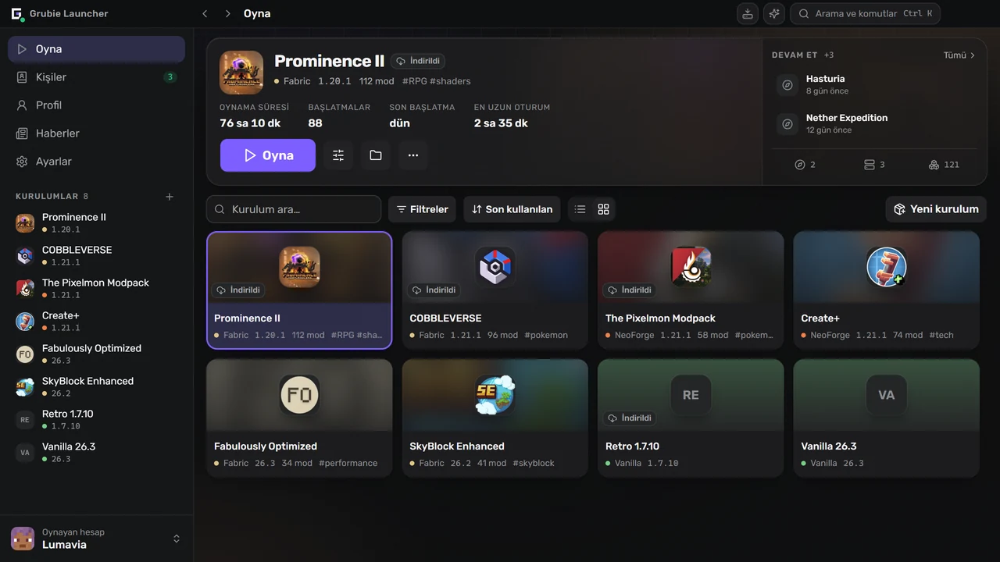
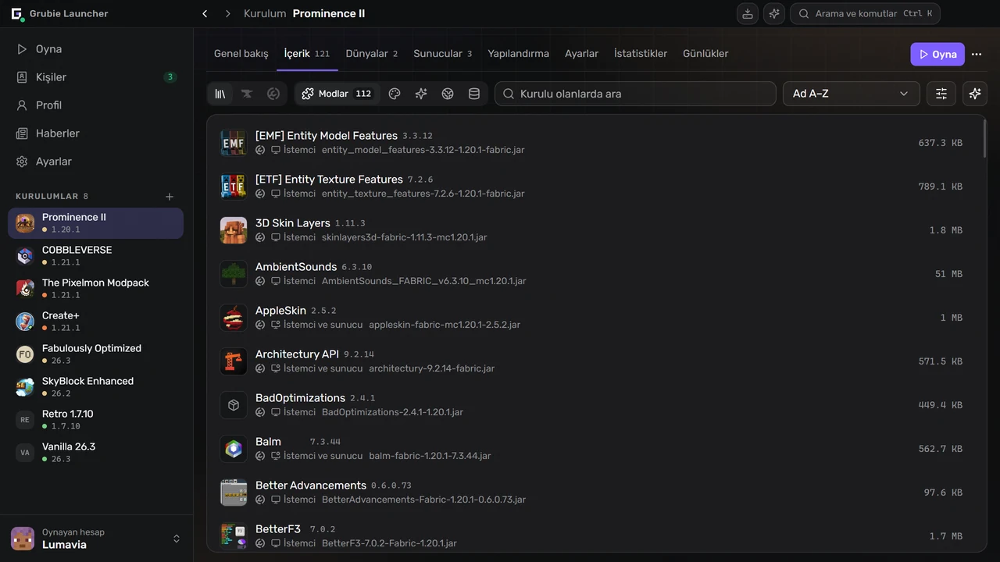
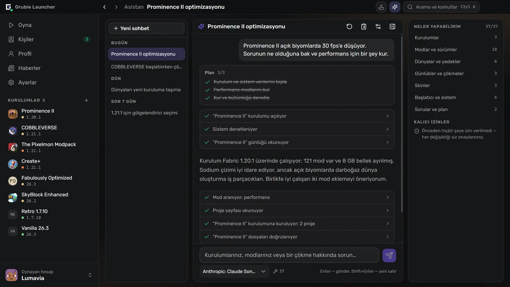
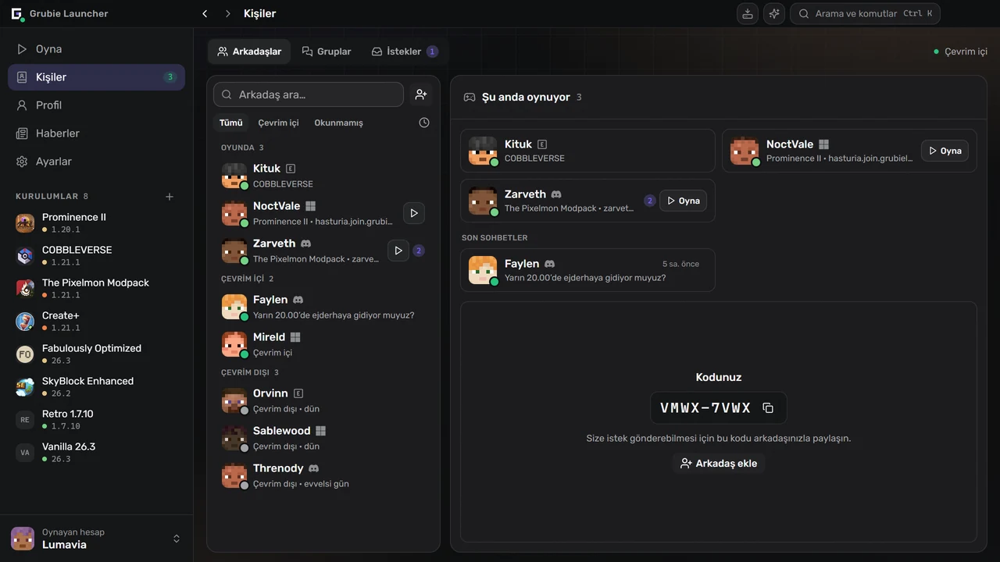

  

  <a href="https://grubielauncher.com/tr">grubielauncher.com</a>

  
  
  
  
   
  

---

# Grubie Launcher

Windows, macOS ve Linux için bir Minecraft başlatıcısı. Oyun sürümlerini ve mod yükleyicilerini kurar, uygun Java’yı kendisi indirir ve her kurulumu — modlar, dünyalar, yapılandırmalar, başlatma ayarları — tek bir yerde tutar. Onu sıradan bir başlatıcıdan ayıran iki şey var: Oyun çöktüğünde raporu okur ve neyin bozulduğunu söyler; arkadaşlarınız da aynı pencerede — sohbet, sesli konuşma ve port yönlendirmesi ya da kiralık sunucu olmadan birbirinizin dünyasına katılma.

Arayüz, üst üste açılan pencereler yerine sabit bir kenar çubuğundan ve tam ekranlardan oluşur. <kbd>Ctrl</kbd>+<kbd>K</kbd> herhangi bir kuruluma, ekrana veya ayara ulaşan komut paletini açar, <kbd>Ctrl</kbd>+<kbd>I</kbd> asistanı açar, <kbd>Alt</kbd>+<kbd>←</kbd> / <kbd>Alt</kbd>+<kbd>→</kbd> ise tarayıcıdaki gibi geçmişte gezinir.

<kbd></kbd>
<kbd></kbd>
<kbd></kbd>
<kbd></kbd>
<kbd></kbd>
<kbd></kbd>
<kbd></kbd>
<kbd></kbd>

# Ekran görüntüleri

**Kütüphane ve en son oynadığınız kurulum**

**Modlar, kaynak paketleri ve gölgelendiriciler, başlatıcının içinde aranır**

**Kurulumlarınızı, günlükleri ve çökmeleri okuyan bir asistan**

**Arkadaşlar, gruplar ve istekler, sohbetin yanında**

# Özellikler

### Oyna

- Resmî Minecraft sürümleri: yayın sürümleri, snapshot’lar ve eski alfa/beta sürümleri.
- Mod yükleyicileri: **Forge**, **NeoForge**, **Fabric**, **Quilt**.
- Eski sürümler de: **Legacy Fabric**, **Babric**, **Ornithe**, Babric ile **Better than Adventure**, FoxLoader ile **ReIndev** ve jar modları.
- Java otomatik olarak indirilir ve oyun sürümüne göre seçilir.
- Hesaplar: **Microsoft**, **Ely.by**, **Discord** ve çevrimdışı. Aynı anda birkaç tane, kenar çubuğundan değiştirilir.
- Liste ve ızgara görünümlü kurulum kütüphanesi; gruplar, etiketler ve notlar.
- Kaldığınız yerden devam edin: kurulum ekranından doğrudan bir dünyaya veya sunucuya girin.
- Modrinth sunucu kataloğu: kurulumunuza uyan bir sunucu bulun veya katalogdaki herhangi bir sunucu için kurulum oluşturun.
- Bellek, JVM bayrakları ve işlem önceliği genel olarak ayarlanır, her kurulum için ayrıca değiştirilebilir.
- Tek bir kurulum için masaüstü kısayolu oluşturulabilir.

### Kurulumlar

- **CurseForge** ve **Modrinth**’ten modlar, kaynak paketleri, gölgelendiriciler ve veri paketleri; başlatıcının içinde aranır ve kurulur.
- Önce farkı gösteren güncelleme denetimi: neyin ekleneceği, güncelleneceği ve kaldırılacağı.
- Dosyadan içe aktarma: Grubie, CurseForge, Modrinth (`.mrpack`), Prism ve MultiMC paketleri — arşivi pencereye sürüklemeniz yeterli.
- Bir kurulumu arşive dışa aktarma; kopya modları, yapılandırmaları ve dünyaları taşır.
- Bir kurulumu yayımlayın ve kodu paylaşın: Onu kuran herkes bir sonraki güncellemenizi değişikliklerin farkıyla görür ve tek tıkla eşitler.
- CurseForge veya Modrinth mod paketinden kurulan bir kurulum ona bağlı kalır: değişikliklerin önizlemesiyle daha yeni bir sürüme güncelleyin, bir şey bozulursa öncekine dönün.
- Bir kurulumu başka bir Minecraft sürümüne veya mod yükleyicisine taşıyın: başlatıcı, uyumlu mod sürümleriyle bir kopya oluşturur ve ayarları, mod yapılandırmalarını ve dünyaları da taşıyabilir.
- Mod setleri: bir kurulumun modlarını set olarak kaydedin, sonra herhangi bir kuruluma ekleyin veya yeni bir kurulum oluştururken seçin.
- Kendi mod gruplarınız: daraltılabilir, bütün bir grup tek seferde açılıp kapatılabilir.
- Herkese açık kurulumların topluluk kataloğu, başlatıcının içinde ve [grubielauncher.com/packs](https://grubielauncher.com/tr/packs) adresinde.
- Hasarlı veya eksik dosyaları yeniden indiren bütünlük denetimi.
- Arama, otomatik tamamlama ve geri dönmek için kayıtlı sürümlerle yapılandırma düzenleyicisi.
- Dünyalar için yığın düzenleyicisi: her boyutta oluşturulmuş tüm yığınları araziyi uydu görünümüyle gösteren harita, hiç ziyaret edilmemiş, eski veya hasarlı yığınlar için filtreler ve önce güvenlik yedeği alınarak silme.

### Birlikte

- Arkadaşlar, arkadaşlık istekleri, özel mesajlar ve grup sohbetleri.
- Ses: gruplarda odalar ve bire bir görüşmeler, bas-konuş, gürültü bastırma, katılımcı başına ses düzeyi.
- **Birlikte oyna** — içinde bulunduğunuz dünyayı arkadaşlarınıza veya herkese, internet üzerinden ve port yönlendirmesi olmadan açın.
- Bir arkadaşınızın dünyasına tek tıkla katılın: Başlatıcı onun kurulumunu kurar ve eşitler, sonra sizi bağlar.
- Oyun davetleri; Telegram bildirimleri başlatıcı kapalıyken de size ulaşır.
- Oynadığınız kurulumla Discord Rich Presence.
- Başarımlar, istatistikler ve sıralama içeren profil. Başarımlar bir arkadaşınızın paylaşılan dünyasında da sayılır.
- Skinler ve pelerinler: kendi gardırobunuz, dosya, bağlantı veya oyuncu adıyla içe aktarma ve yayımlayabileceğiniz bir topluluk kataloğu.

### Bir şeyler ters gittiğinde

- Çökme kartı: Başlatıcı çökme raporunu okur, olası suçluyu ve ne yapılması gerektiğini söyler. Kurallar sunucudan gelir, bu yüzden başlatıcı güncellenmeden iyileşir.
- Kuralların tanımadığı çökmeler için yapay zekâ analizi — yalnızca isteğe bağlı; günlük gönderilmeden önce yollar, oyuncu adları ve belirteçlerden arındırılır.
- Çalıştırma geçmişi: her başlatma günlüğüyle birlikte, arama, çıkış kodu ve yardım isterken tek tıkla kopyalanan bir rapor.
- Dünya yedekleri: oturumdan sonra otomatik ve elle; her geri yüklemeden önce güvenlik kopyası alınır.
- Başlatıcının kendi hizmetlerine ve Minecraft, CurseForge ve Modrinth’in resmî uç noktalarına bağlantı testi — bir sağlayıcı bir şeyi engellediğinde işe yarar.
- Görev merkezi: ilerleme, dosya başına hatalar ve yeniden deneme ile kurulumlar ve güncellemeler.
- İndirmeler Grubie aynası üzerinden gidebilir ve gerekirse kendiliğinden resmî kaynağa döner.

### Asistan

- **Sizin** sağlayıcınız ve **sizin** anahtarınızla çalışır: OpenAI uyumlu herhangi bir uç nokta, varsayılan olarak OpenRouter. Anahtar bilgisayarınızda kalır.
- Yanıt vermek için gerekeni okur: kurulumlar, yüklü modlar, günlükler, son çökme, dünyalar, hesaplar, disk kullanımı, sistem bilgileri.
- Sizin adınıza işlem yapar: kurulum oluşturur; modları kurar, günceller, devre dışı bırakır ve kaldırır; belleği ve başlatma argümanlarını değiştirir; dünyaları yedekler ve geri yükler; skin seçer; oyunu başlatır.
- Bir şeyi değiştirmeden önce sorar; silme işlemlerinde ise daha önce neye izin vermiş olursanız olun her seferinde yeniden sorar.
- Sohbet geçmişi Grubie hesabınızla eşitlenir; eşitleme ayarlardan kapatılabilir.

### Kendi sunucunuz

- Bir kurulumun yanında sunucu oluşturun: **Vanilla**, **Spigot**, **Bukkit**, **Paper**, **Purpur**, **Forge**, **NeoForge**, **Fabric**, **Quilt**.
- Konsol, `server.properties` düzenleyicisi; sunucu, ait olduğu kurulumun modlarını ve yapılandırmalarını alır.

# Yükleme

1. En son sürümü [Releases](https://github.com/MOJI6416/grubielauncher/releases) sayfasından indirin.
2. **Windows** — `-setup.exe` yükleyicisini çalıştırın. **macOS** (12 veya üzeri) — Mac’iniz için `.dmg` dosyasını açın (Apple Silicon için `arm64`, Intel için `x64`) ve uygulamayı Uygulamalar klasörüne sürükleyin. **Linux** — `.AppImage` dosyasını çalıştırın veya `.deb` paketini yükleyin.
3. Bir hesapla giriş yapın veya çevrimdışı bir hesap oluşturun ve bir sürüm seçin.

Başlatıcı kendini günceller; yeni sürümler yeniden yükleme gerekmeden gelir.

# Lisans

**MIT** — bkz. [LICENSE](../LICENSE).

# Bağlantılar

- **Web sitesi:** [grubielauncher.com](https://grubielauncher.com/tr)
- **İndirmeler:** [Releases](https://github.com/MOJI6416/grubielauncher/releases)
- **Değişiklik günlüğü:** [grubielauncher.com/changelog](https://grubielauncher.com/tr/changelog)
- **Discord:** [Grubie Launcher sunucusu](https://discord.com/invite/URrKha9hk7)
- **Gizlilik politikası:** [grubielauncher.com/privacy](https://grubielauncher.com/tr/privacy)
