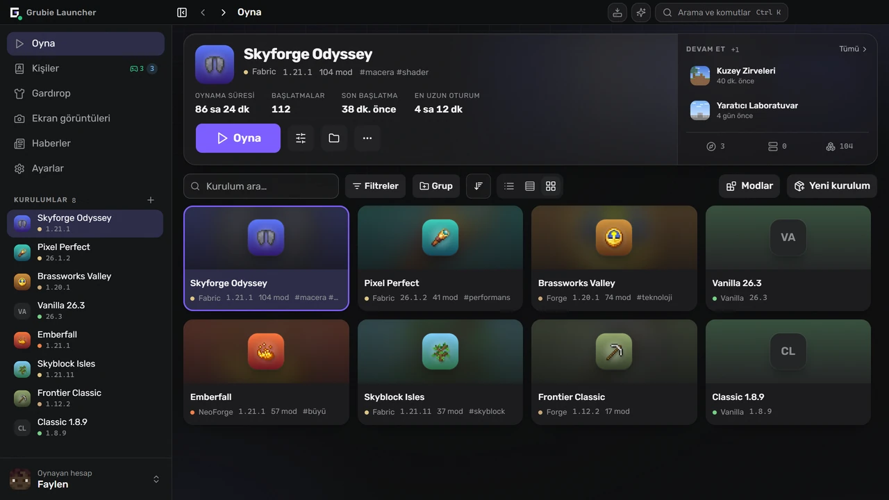
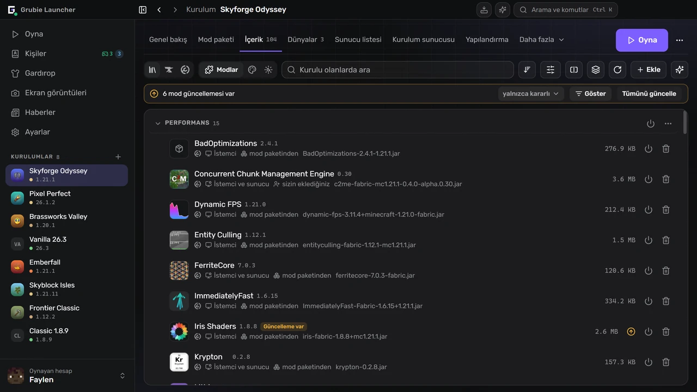
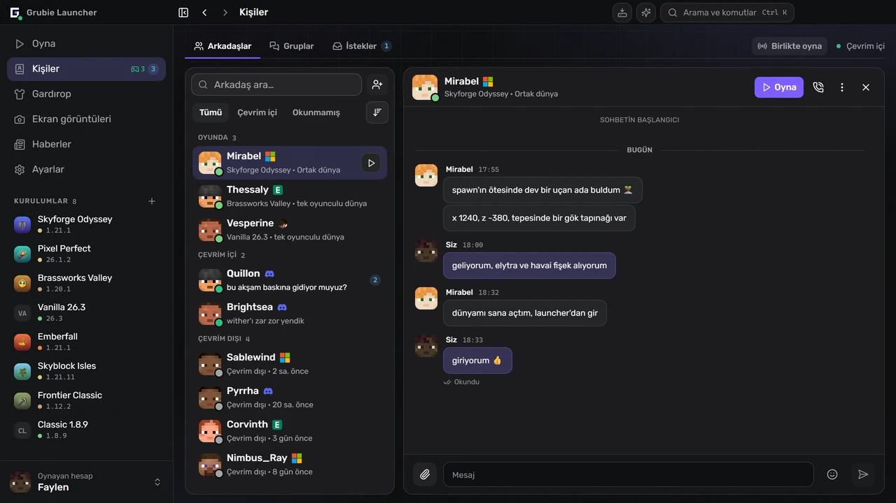
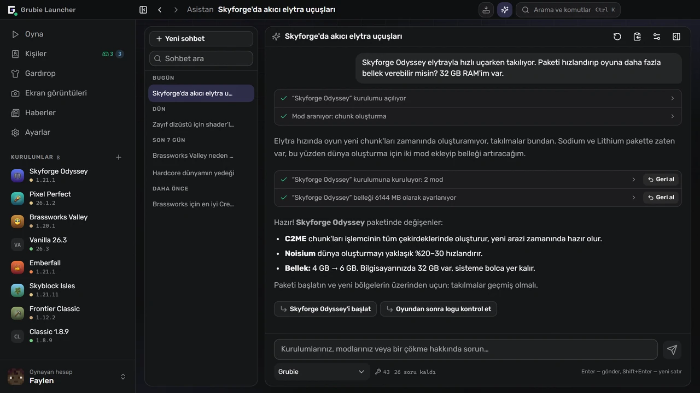

  

  <a href="https://grubielauncher.com/tr">grubielauncher.com</a>

  
  
  
  
   
  

---

# Grubie Launcher

Windows, macOS ve Linux için ücretsiz ve açık kaynaklı bir Minecraft başlatıcısı; reklam ve ücretli özellik yok. Her oyun sürümünü ve mod yükleyicisini gereken Java ile birlikte kurar, CurseForge ve Modrinth’ten modları ve mod paketlerini yönetir ve her kurulumu — modlar, dünyalar, yapılandırmalar, başlatma ayarları — tek bir yerde tutar. Arkadaşlarınız da aynı pencerede: sohbet, sesli konuşma ve port yönlendirmesi olmadan birbirinizin dünyasına katılma. Oyun çöktüğünde başlatıcı raporu okur ve neyin bozulduğunu söyler.

Arayüz, üst üste açılan pencereler yerine sabit bir kenar çubuğundan ve tam ekranlardan oluşur. <kbd>Ctrl</kbd>+<kbd>K</kbd> herhangi bir kuruluma, ekrana veya ayara ulaşan komut paletini açar, <kbd>Ctrl</kbd>+<kbd>I</kbd> asistanı açar, <kbd>Alt</kbd>+<kbd>←</kbd> / <kbd>Alt</kbd>+<kbd>→</kbd> ise tarayıcıdaki gibi geçmişte gezinir.

<kbd></kbd>
<kbd></kbd>
<kbd></kbd>
<kbd></kbd>
<kbd></kbd>
<kbd></kbd>
<kbd></kbd>
<kbd></kbd>

# Ekran görüntüleri

**Kütüphane ve en son oynadığınız kurulum**

**Modlar, kaynak paketleri ve gölgelendiriciler, başlatıcının içinde aranır**

**Arkadaşlar, gruplar ve istekler, sohbetin yanında**

**Kurulumlarınızı, günlükleri ve çökmeleri okuyan bir asistan**

# Özellikler

### Oyun ve kurulumlar

- Tüm resmî Minecraft sürümleri: yayın sürümleri, ön izleme sürümleri ve eski alfa ve beta sürümleri.
- Mod yükleyicileri: **Forge**, **NeoForge**, **Fabric**, **Quilt** ve modern Java’da 1.12.2 için **Cleanroom**.
- Eski sürümler de: **Legacy Fabric**, **Babric**, **Ornithe**, Babric ile **Better than Adventure**, FoxLoader ile **ReIndev** ve jar modları.
- Vanilla ve Forge 1.7.2–1.16.5 için **OptiFine**, optifine.net’ten indirilir; daha yeni sürümlerde başlatıcı Sodium ve Iris’i önerir.
- Java kendiliğinden indirilir ve her oyun sürümüne göre seçilir.
- Hesaplar: **Microsoft**, **Ely.by**, **LittleSkin**, **Discord** ve çevrimdışı. Aynı anda birkaç tane, kenar çubuğundan değiştirilir.
- **CurseForge** ve **Modrinth** mod paketleri: kurmadan önce içinde ne olduğunu görün, isteğe bağlı dosyaları seçin, nelerin değişeceğini önizleyerek güncelleyin ve bir şey bozulursa geri alın. Zip dosyasından veya bağlantıdan kurulan bir paket de aynı şekilde güncellenir.
- Dosyadan içe aktarma: Grubie, CurseForge, Modrinth (`.mrpack`), Prism ve MultiMC paketleri — arşivi pencereye sürüklemeniz yeterli. Klasörler ve dünyalar için onay kutularıyla Grubie arşivine veya Modrinth `.mrpack` dosyasına dışa aktarma.
- Başka bir başlatıcıdan taşıma: Prism, MultiMC, ATLauncher, GDLauncher, CurseForge, Modrinth App, resmî başlatıcı, TLauncher ve Legacy Launcher. Kurulumlar kopyalanır; eski başlatıcı olduğu gibi kalır.
- Bir kurulumu başka bir Minecraft sürümüne veya mod yükleyicisine taşıyın: başlatıcı, uyumlu mod sürümleriyle bir kopya oluşturur ve ayarları, yapılandırmaları ve dünyaları da taşıyabilir.
- Ortak oyun ayarları: kontroller, görüntü ayarları, sunucular, araç çubukları ve kaynak paketleri kurulumlar arasında aktarılır. Her kurulum istediği grubu bunun dışında tutabilir.
- Aynı modlar, kaynak paketleri ve gölgelendiriciler, kaç kurulum kullanırsa kullansın diskte yalnızca bir kez saklanır.
- Liste ve ızgara görünümlü kurulum kütüphanesi; gruplar, etiketler ve notlar. Doğrudan bir dünyada veya sunucuda devam edin; tek bir kurulum için masaüstü kısayolu.
- Bellek, JVM bayrakları ve başlatma seçenekleri genel olarak ayarlanır, her kurulum için ayrıca değiştirilebilir. Minecraft 26.x’te başlatıcı Vulkan çökmelerine karşı önlem alır ve oyunu harici ekran kartında başlatabilir.
- Oyun sırasında ayarlar açık kalır; yalnızca çalışan oyunu bozacak seçenekler bekler.
- Oyun kumandasıyla gezinme ve Steam Deck ile televizyon için “Büyük mod”.
- Tüm verilerini programın yanındaki bir klasörde tutan, Windows için taşınabilir sürüm — USB bellek veya ortak bilgisayar için.

### Modlar ve çeviri

- **CurseForge** ve **Modrinth**’ten modlar, kaynak paketleri ve gölgelendiriciler; başlatıcının içinde aranır ve kurulur ya da katalogdan doğrudan herhangi bir kuruluma eklenir.
- Modrinth ve CurseForge sitelerindeki “Kur” düğmeleri Grubie’yi açabilir — bu, ayarlardan açılır.
- Güncellemeler önce neyin değişeceğini gösterir. Kanalı seçin — yalnızca kararlı sürümler ya da betalar ve alfalar da — ve bir modu sürümüne sabitleyin.
- Bir modun ilişkileri: neyi gerektirdiği, onu neyin gerektirdiği ve içine neyin gömülü olduğu. Bir modu kapatırken başlatıcı ona bağlı olanları da kapatmayı önerir; kaldırırken başka hiçbir şeyin ihtiyaç duymadığı bağımlılıkları da kaldırır.
- Daraltılabilen ve tek seferde açılıp kapatılabilen mod grupları ile kaydedip herhangi bir kuruluma ekleyebileceğiniz mod setleri.
- Mod paketiyle gelenler ve sizin eklediğiniz için işaretler ve filtreler.
- Ne CurseForge’da ne de Modrinth’te bulunan dosyalar işaretlenir ve siz işaretlemedikçe kurulmaz. Aynı modun kopyaları bulunur ve tek tıkla temizlenir.
- Bir kurulumun mod listesi oyun çalışırken de açık kalır.
- Arama, sözdizimi vurgulama, gruplar, çevrilmiş yorumlar ve geri dönmek için kayıtlı kopyalarla yapılandırma düzenleyicisi.
- **Modların Rusçaya ve Ukraynacaya çevirisi**, varsayılan olarak kapalı: önce topluluğun çeviri paketleri, eksikleri Grubie sunucusunda yapay zekâ tamamlar, ortak bir önbellekle. Modları, mod paketinin kendi kaynak paketlerini, rehber kitapları (Lavender, Patchouli, GuideME) ve görevleri (FTB Quests, QuestZ) kapsar. Yapay zekâ kısmı bir Grubie hesabı gerektirir ve günlük bir sınırı vardır.

### Dünyalar

- Katalogdan haritalar ve veri paketleri: bir harita kendi dünyanız olur, bir veri paketi seçtiğiniz dünyaya eklenir.
- Her dünyanın gelişim ilerlemesi; dünya oluşturucusu kodu da bir harita üzerinde açılır.
- Gerçek blok adları ve simgeleri, malzeme listesi ve 3D görünümle şemalar (`.litematic`, `.schem`, `.schematic`, `.nbt`).
- Yığın düzenleyici: her boyutta oluşturulmuş tüm yığınları uydu görünümüyle gösteren harita, hiç ziyaret edilmemiş, eski veya hasarlı yığınlar için filtreler ve önce güvenlik yedeği alınarak silme.
- Dünya yedekleri: oturumdan sonra otomatik ve elle; her geri yüklemeden önce güvenlik kopyası alınır.

### Birlikte

- Arkadaşlar, arkadaşlık istekleri, özel mesajlar ve grup sohbetleri. Microsoft hesabında Minecraft 26.2’deki arkadaşlarınız da görünür.
- Ses: gruplarda odalar ve bire bir görüşmeler, genel bir tuşla bas-konuş, gürültü engelleme, katılımcı başına ses düzeyi.
- **Birlikte oyna** — içinde bulunduğunuz dünyayı arkadaşlarınıza veya herkese, internet üzerinden, port yönlendirmesi ve Hamachi olmadan açın. Ağ izin verdiğinde arkadaşlarınız doğrudan, vermediğinde Grubie rölesi üzerinden bağlanır.
- Bir arkadaşınızın dünyasına tek tıkla katılın: başlatıcı onun kurulumunu aynı sürüm ve aynı modlarla kurar, sonra sizi bağlar.
- Bir kurulumu kısa bir kodla paylaşın: onu kuran herkes bir sonraki güncellemenizi değişikliklerin farkıyla alır. Herkese açık kurulumlar topluluk kataloğunda, başlatıcının içinde ve [grubielauncher.com/packs](https://grubielauncher.com/tr/packs) adresinde görünür. Yazarlar kurulum sayılarını, oyuncuları ve oynama süresini görür ve oyuncularına bir not bırakabilir.
- Discord’dan veya Telegram’dan açılan https bağlantıları biçiminde grup davetleri.
- Sunucu kataloğu hangi arkadaşınızın nerede oynadığını gösterir; onların kurulumuyla katılırsınız.
- Tüm kurulumların ekran görüntüleri tek bir akışta; herhangi biri sohbete gönderilebilir.
- Pencereli ve kenarlıksız modda oyunun üzerinde mesaj ve davet bildirimleri, <kbd>F7</kbd> ile kabul.
- Başlatıcı kapalıyken Telegram bildirimleri; profilinize ve kuruluma bağlantılar içeren Discord Rich Presence.

### Yardımcı mod

- Başlatıcıyı oyuna taşır: <kbd>G</kbd> tuşunda davetler, dünyanızı açma ve sesli sohbet içeren arkadaş paneli; dünyayı arkadaşlara açmak veya bir arkadaşı davet etmek için oyun menüsünde Grubie düğmeleri; mesajlar, davetler, başarımlar ve az önce aldığınız ekran görüntüsü için “Bir arkadaşa gönder” düğmeli bildirimler; sesli sohbette kimin konuştuğu ve mikrofonunuzun kapalı olup olmadığı.
- Oyunun hangi modda takıldığını başlatıcıya bildirir ve çok oyunculu sunucularda başlatıcı başarımlarını sayar.
- 1.16.5’ten itibaren Fabric, Quilt ve Forge, 1.20.1’den itibaren NeoForge, 26.3’e kadar. Yeni kurulumlarda varsayılan olarak açık, her kurulum için ayrı açılıp kapatılır. Kaynak kodu açık: [grubie-companion](https://github.com/MOJI6416/grubie-companion).

### Kendi sunucunuz

- Bir kurulumun yanında sunucu oluşturun: **Vanilla**, **Paper**, **Purpur**, **Spigot**, **Bukkit**, **Forge**, **NeoForge**, **Fabric**, **Quilt**. Sunucu, ait olduğu kurulumun modlarını ve yapılandırmalarını alır.
- Konsol ve `server.properties` düzenleyicisi. 1.21.9’dan itibaren oyuncular, yasaklar, operatörler, beyaz liste ve oyun kuralları Mojang’ın yönetim protokolü üzerinden yönetilir.
- Sunucuyu Grubie rölesi üzerinden arkadaşlarınıza açın: yalnızca davetle veya herkese açık, konuk listesi, atma, yer sınırı.

### Bir şeyler ters gittiğinde

- Çökme kartı: başlatıcı çökme raporunu okur, olası suçluyu ve ne yapılması gerektiğini söyler. Kurallar sunucudan gelir, bu yüzden başlatıcı güncellenmeden iyileşir; gizlenmiş vanilla ve Fabric günlükleri önce Mojang’ın adlarıyla okunur.
- Kuralların tanımadığı çökmeler için yapay zekâ analizi — anahtar gerekmez; günlük gönderilmeden önce yollardan, oyuncu adlarından ve belirteçlerden arındırılır.
- Suçlu araması: bir sihirbaz modlarınızın yarısını kapatır, siz oyunu başlatıp sorunun sürüp sürmediğini söylersiniz. Birkaç başlatmadan sonra tek bir mod ya da bir çift kalır — yalnızca çökmeler için değil, takılmalar ve görsel hatalar için de.
- Oyun donduğunda yardımcı mod, hangi modda takıldığını başlatıcıya bildirir.
- Hasarlı veya eksik dosyaları yeniden indiren bütünlük denetimi.
- Çalıştırma geçmişi: her başlatma günlüğü, arama ve çıkış koduyla. Destek için `GRB-` kodlu bir rapor; destek ekibinin yanıtları başlatıcıya gelir.
- Bir giriş hizmeti çalışmıyorsa oyun kayıtlı oturumla başlar.
- Başlatıcının kendi hizmetlerine ve Minecraft, CurseForge ve Modrinth’in resmî uç noktalarına bağlantı testi. İndirmeler Grubie aynası üzerinden gidebilir ve gerekirse kendiliğinden resmî kaynağa döner.
- Görev merkezi: ilerleme, dosya başına hatalar ve yeniden deneme ile kurulumlar ve güncellemeler.

### Asistan

- **Sizin** sağlayıcınız ve **sizin** anahtarınızla çalışır: OpenAI uyumlu herhangi bir uç nokta, varsayılan olarak OpenRouter. Anahtar bilgisayarınızda kalır.
- Yanıt vermek için gerekeni okur: kurulumlar, yüklü modlar, günlükler, son çökme, dünyalar, hesaplar, disk kullanımı, sistem bilgileri.
- Sizin adınıza işlem yapar: kurulum oluşturur; modları kurar, günceller, devre dışı bırakır ve kaldırır; belleği ve başlatma argümanlarını değiştirir; dünyaları yedekler ve geri yükler; skin seçer; oyunu başlatır.
- Bir şeyi değiştirmeden önce sorar; silme işlemlerinde ise daha önce neye izin vermiş olursanız olun her seferinde yeniden sorar.
- Çevrimiçi bir hesap gerekir (Microsoft, Ely.by, LittleSkin veya Discord). Sohbet geçmişi Grubie hesabınızla eşitlenir; eşitleme ayarlardan kapatılabilir.

### Skinler, temalar ve profil

- Gardırop: skinler ve pelerinler, dosya, bağlantı veya oyuncu adıyla içe aktarma, 3D önizleme. Yayımlayabileceğiniz bir topluluk kataloğu; her yazarın adı onun profilini açar.
- Temalar: kendi renkleriniz ve arka plan resmi, yerleşim hazır ayarları ve oyuncu temalarından oluşan bir galeri.
- Grubie hesabıyla eşitleme: temalar, skin gardırobu ve başlatıcı ayarları sizinle birlikte başka bir bilgisayara gelir. Yollar, bellek ve Java her bilgisayarda ayrı kalır.
- Kendi dünyalarınızdan, bir arkadaşınızın paylaşılan dünyasından ve yardımcı modla sunuculardan sayılan 60 başarım. Her birinde kaç oyuncunun ona sahip olduğu görünür. [grubielauncher.com](https://grubielauncher.com/tr) üzerinde sıralama ve herkese açık profil.

### Güvenlik ve gizlilik

- Güncellemeler imzalıdır: başlatıcı yalnızca Grubie imzası taşıyan bir güncellemeyi kurar.
- Yayımlanan kurulumların jar dosyaları, kataloğa girmeden önce bilinen kötü amaçlı yazılımlara karşı taranır ve arka planda yeniden denetlenir.
- Kaynağı bilinmeyen jar dosyaları, bir kurulumu içe aktarırken ve mod listesinde işaretlenir.
- Çökme teşhis kodları, özellik sayaçları ve mod paketi yazarları için istatistikler varsayılan olarak açıktır ve “Ayarlar → Gizlilik” bölümünden kapatılır.
- Yayıncı modu yayında adresleri, dünya oluşturucusu kodlarını, kodları ve yolları gizler.
- Dokuz arayüz dili: İngilizce, Rusça, Ukraynaca, Almanca, İspanyolca, Fransızca, Lehçe, Portekizce (Brezilya) ve Türkçe.

# Yükleme

1. En son sürümü [grubielauncher.com/download](https://grubielauncher.com/tr/download) adresinden veya [Releases](https://github.com/MOJI6416/grubielauncher/releases) sayfasından indirin.
2. **Windows** — `-setup.exe` yükleyicisini çalıştırın veya `-portable.zip` dosyasını istediğiniz bir yere açın. **macOS** (12 veya üzeri) — Mac’iniz için `.dmg` dosyasını açın (Apple Silicon için `arm64`, Intel için `x64`) ve uygulamayı Uygulamalar klasörüne sürükleyin. **Linux** — `.AppImage` dosyasını çalıştırın veya `.deb` paketini yükleyin.
3. Bir hesapla giriş yapın veya çevrimdışı bir hesap oluşturun ve bir sürüm seçin.

Başlatıcı kendini günceller; yeni sürümler yeniden yükleme gerekmeden gelir.

# Lisans

**GPL-3.0** — bkz. [LICENSE](../LICENSE).

Grubie Launcher adı ve logosu bu lisansın kapsamında değildir. Fork'lar memnuniyetle karşılanır, ancak kendi adları ve logoları olmalı ve kendilerini resmî başlatıcı olarak tanıtmamalıdır.

# Bağlantılar

- **Web sitesi:** [grubielauncher.com](https://grubielauncher.com/tr)
- **İndirmeler:** [grubielauncher.com/download](https://grubielauncher.com/tr/download)
- **Değişiklik günlüğü:** [grubielauncher.com/changelog](https://grubielauncher.com/tr/changelog)
- **Discord:** [Grubie Launcher sunucusu](https://discord.com/invite/URrKha9hk7)
- **Gizlilik politikası:** [grubielauncher.com/privacy](https://grubielauncher.com/tr/privacy)
