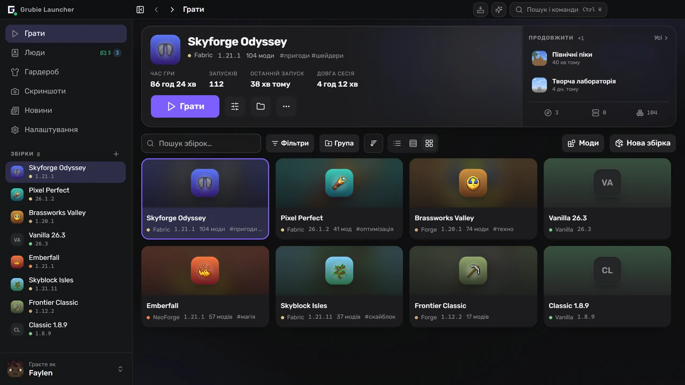
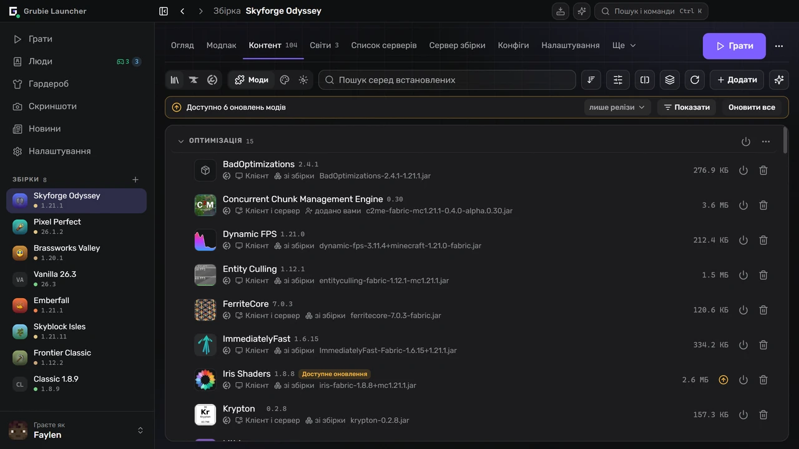
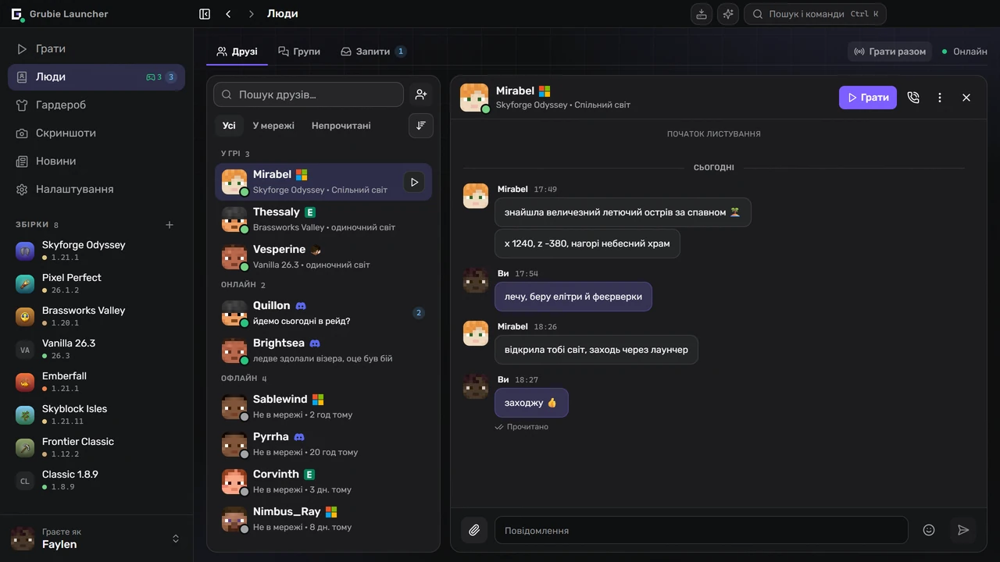
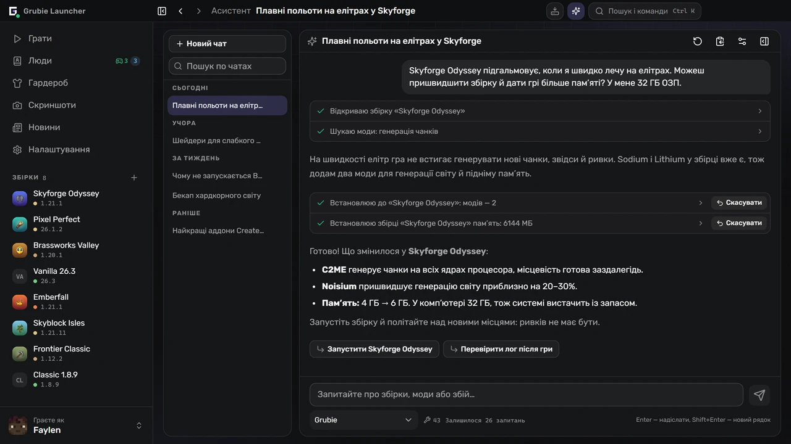

  

  <a href="https://grubielauncher.com/">grubielauncher.com</a>

  
  
  
  
   
  

---

# Grubie Launcher

Безкоштовний лаунчер Minecraft із відкритим кодом для Windows, macOS і Linux — без реклами та платних функцій. Він встановлює будь-яку версію гри та будь-який завантажувач модів разом із потрібною Java, працює з модами й модпаками з CurseForge і Modrinth і тримає кожну збірку — моди, світи, конфіги, налаштування запуску — в одному місці. Друзі живуть у тому самому вікні: листування, голос і вхід у світи одне одного без прокидання портів. А коли гра падає, лаунчер читає звіт і каже, що зламалося.

Інтерфейс — постійна бічна панель і повноцінні екрани замість стосу діалогів. <kbd>Ctrl</kbd>+<kbd>K</kbd> відкриває палітру команд, з якої доступні будь-яка збірка, екран і налаштування, <kbd>Ctrl</kbd>+<kbd>I</kbd> відкриває асистента, а <kbd>Alt</kbd>+<kbd>←</kbd> / <kbd>Alt</kbd>+<kbd>→</kbd> ходять історією, як у браузері.

<kbd></kbd>
<kbd></kbd>
<kbd></kbd>
<kbd></kbd>
<kbd></kbd>
<kbd></kbd>
<kbd></kbd>
<kbd></kbd>

# Знімки екрана

**Бібліотека і збірка, у яку ви грали востаннє**

**Моди, ресурспаки та шейдери — пошук просто в лаунчері**

**Друзі, групи та заявки поруч із листуванням**

**Асистент, який читає ваші збірки, логи та вильоти**

# Можливості

### Гра та збірки

- Усі офіційні версії Minecraft: релізи, снапшоти та старі alpha і beta.
- Завантажувачі модів: **Forge**, **NeoForge**, **Fabric**, **Quilt** і **Cleanroom** для 1.12.2 на сучасній Java.
- І старі версії: **Legacy Fabric**, **Babric**, **Ornithe**, **Better than Adventure** з Babric, **ReIndev** з FoxLoader і jar-моди.
- **OptiFine** для ванілі та Forge 1.7.2–1.16.5, завантажується з optifine.net; на новіших версіях лаунчер підкаже Sodium та Iris.
- Java завантажується сама й добирається під кожну версію гри.
- Акаунти: **Microsoft**, **Ely.by**, **LittleSkin**, **Discord** та офлайн. Кілька одночасно, перемикання з бічної панелі.
- Модпаки з **CurseForge** і **Modrinth**: вміст видно ще до встановлення, необов'язкові файли можна вибрати, оновлення показує, що зміниться, а якщо щось зламалося — можна відкотитися. Модпак, встановлений із zip-архіву або за посиланням, оновлюється так само.
- Імпорт із файлу: збірки Grubie, CurseForge, Modrinth (`.mrpack`), Prism і MultiMC — перетягніть архів у вікно. Експорт в архів Grubie або в `.mrpack` для Modrinth, папки й світи позначаються галочками.
- Переїзд з іншого лаунчера: Prism, MultiMC, ATLauncher, GDLauncher, CurseForge, Modrinth App, офіційний лаунчер, TLauncher і Legacy Launcher. Збірки копіюються, а в старому лаунчері все залишається як було.
- Перенесення збірки на іншу версію Minecraft або інший завантажувач: лаунчер робить копію з відповідними версіями модів і може перенести налаштування, конфіги та світи.
- Спільні налаштування гри: керування, налаштування відео, сервери, хотбари та ресурспаки переходять зі збірки в збірку. Будь-яку групу можна вимкнути для окремої збірки.
- Однакові моди, ресурспаки та шейдери зберігаються на диску один раз, скільки б збірок їх не використовувало.
- Бібліотека збірок — списком або сіткою, з групами, тегами та нотатками. Продовжити можна одразу у світі або на сервері; для окремої збірки — ярлик на робочому столі.
- Пам'ять, прапорці JVM і параметри запуску задаються глобально, а для окремої збірки їх можна перевизначити. На Minecraft 26.x лаунчер захищає від падінь на Vulkan і вміє запускати гру на дискретній відеокарті.
- Налаштування відкриті й під час гри; закриття гри чекають лише ті, що зламали б запущену гру.
- Керування геймпадом і великий режим для Steam Deck і телевізора.
- Portable-версія для Windows: усі дані лежать у папці поруч із програмою — для флешки або спільного комп'ютера.

### Моди та переклад

- Моди, ресурспаки та шейдери з **CurseForge** і **Modrinth** — пошук і встановлення просто в лаунчері, зокрема з каталогу одразу в будь-яку збірку.
- Кнопки «Встановити» на сайтах Modrinth і CurseForge можуть відкривати Grubie — це вмикається в налаштуваннях.
- Перед оновленням видно, що зміниться. Можна вибрати канал — лише релізи або ще бети й альфи — і закріпити мод на його версії.
- Зв'язки мода: що йому потрібно, кому потрібен він і що вбудовано всередину. Під час вимкнення мода лаунчер запропонує вимкнути й те, що від нього залежить, а під час видалення прибере залежності, які більше нікому не потрібні.
- Групи модів, які згортаються й вмикаються або вимикаються цілком, і набори модів, які можна зберегти й додати до будь-якої збірки.
- Позначки та фільтри: що прийшло з модпаком, а що ви додали самі.
- Файли, яких немає ні на CurseForge, ні на Modrinth, позначаються й без вашої галочки не встановлюються. Копії одного мода знаходяться й прибираються в один клік.
- Список модів збірки можна переглядати й під час гри.
- Редактор конфігів із пошуком, підсвічуванням синтаксису, групами, перекладом коментарів і збереженими копіями для відкату.
- **Переклад модів російською та українською**, типово вимкнений: спершу готові паки перекладу від спільноти, решту перекладає ШІ на сервері Grubie, зі спільним кешем. Перекладаються моди, ресурспаки самого модпака, книги-гайди (Lavender, Patchouli, GuideME) і квести (FTB Quests, QuestZ). Для ШІ-частини потрібен акаунт Grubie, і в неї є денний ліміт.

### Світи

- Карти й датапаки з каталогу: карта стає вашим власним світом, датапак встановлюється у вибраний світ.
- Прогрес досягнень у кожному світі, а його сід відкривається на мапі сіду.
- Схематики (`.litematic`, `.schem`, `.schematic`, `.nbt`) зі справжніми назвами та іконками блоків, списком матеріалів і 3D-переглядом.
- Редактор чанків: мапа всіх згенерованих чанків за вимірами з виглядом із супутника, фільтри для невідвіданих, застарілих і пошкоджених чанків та видалення з попередньою резервною копією.
- Резервні копії світів: автоматичні після сесії та ручні, а перед будь-яким відновленням знімається страхувальна копія.

### Разом

- Друзі, заявки в друзі, особисті повідомлення та групові чати. На акаунті Microsoft видно й друзів із Minecraft 26.2.
- Голос: кімнати в групах і дзвінки віч-на-віч, режим рації на глобальній клавіші, придушення шуму, гучність за кожним учасником.
- **«Грати разом»** — відкрийте світ, у якому граєте, друзям або всім, через інтернет, без прокидання портів і Hamachi. Друзі підключаються напряму, якщо мережа дозволяє, а інакше — через ретранслятор Grubie.
- Вхід у світ друга в один клік: лаунчер встановлює його збірку тієї самої версії та з тими самими модами, а потім підключає вас.
- Збіркою можна поділитися коротким кодом: усі, хто її встановив, отримають ваше наступне оновлення й побачать, що змінилося. Публічні збірки потрапляють до каталогу спільноти — у лаунчері та на [grubielauncher.com/packs](https://grubielauncher.com/packs). Автор бачить встановлення, гравців і час у грі та може залишити гравцям оголошення.
- Запрошення до групи — https-посиланнями, які відкриваються з Discord і Telegram.
- У каталозі серверів видно, де грають друзі, а зайти можна з їхньою збіркою.
- Скриншоти всіх збірок в одній стрічці; будь-який можна надіслати в чат.
- Сповіщення про повідомлення й запрошення поверх гри у віконному та безрамковому режимі, <kbd>F7</kbd> — прийняти.
- Сповіщення в Telegram, поки лаунчер закритий; Discord Rich Presence із посиланнями на ваш профіль і збірку.

### Мод-компаньйон

- Переносить лаунчер у гру: панель друзів на <kbd>G</kbd> із запрошеннями, відкриттям світу й голосом; кнопки Grubie в ігровому меню — відкрити світ друзям або запросити друга; сповіщення про повідомлення, запрошення, досягнення та щойно зроблений скриншот із кнопкою «Надіслати другові»; хто говорить у голосовому чаті та чи вимкнено ваш мікрофон.
- Підказує лаунчеру, на якому моді зависла гра, і зараховує досягнення лаунчера на серверах.
- Fabric, Quilt і Forge з 1.16.5, NeoForge з 1.20.1 — до 26.3. У нових збірках типово увімкнений, для кожної збірки перемикається окремо. Код відкритий: [grubie-companion](https://github.com/MOJI6416/grubie-companion).

### Власний сервер

- Сервер поруч зі збіркою: **Vanilla**, **Paper**, **Purpur**, **Spigot**, **Bukkit**, **Forge**, **NeoForge**, **Fabric**, **Quilt**. Моди й конфіги він бере зі своєї збірки.
- Консоль і редактор `server.properties`. З 1.21.9 гравці, бани, оператори, білий список та ігрові правила керуються через протокол керування Mojang.
- Сервер відкривається друзям через ретранслятор Grubie: лише за запрошенням або для всіх, список гостей, кік, ліміт місць.

### Коли щось ламається

- Картка падіння: лаунчер читає crash-report, називає ймовірного винуватця і що з цим робити. Правила приходять із сервера, тож покращуються без оновлення лаунчера; обфусковані логи ванілі та Fabric спершу перекладаються в імена Mojang.
- ШІ-розбір падінь, яких правила не впізнали, — без ключа, а перед надсиланням із лога вирізаються шляхи, ніки та токени.
- Пошук винуватця: майстер вимикає половину ваших модів, ви запускаєте гру й кажете, чи лишилася проблема. За кілька запусків залишається один мод або пара — це працює й для лагів і візуальних багів, не лише для падінь.
- Коли гра зависає, мод-компаньйон підказує лаунчеру, на якому моді.
- Перевірка цілісності заново завантажує пошкоджені та відсутні файли.
- Історія запусків: кожен запуск зі своїм логом, пошуком і кодом виходу. Звіт для підтримки з кодом `GRB-`, а відповіді підтримки приходять просто в лаунчер.
- Якщо сервіс входу не працює, гра запускається зі збереженою сесією.
- Тест зв'язку із сервісами лаунчера та офіційними адресами Minecraft, CurseForge і Modrinth. Завантаження можуть іти через дзеркало Grubie і самі повертаються на офіційне джерело.
- Центр задач: встановлення й оновлення з поступом, помилками за кожним файлом і повтором.

### Асистент

- Працює на **вашому** провайдері та **вашому** ключі: будь-який OpenAI-сумісний ендпоінт, типово OpenRouter. Ключ залишається на вашому комп'ютері.
- Читає те, що потрібно для відповіді: збірки, встановлені моди, логи, останнє падіння, світи, акаунти, зайняте місце, відомості про систему.
- Діє за вас: створює збірки, встановлює, оновлює, вимикає та видаляє моди, змінює пам'ять і аргументи запуску, робить і відновлює резервні копії світів, обирає скін, запускає гру.
- Питає дозволу перед будь-якою зміною, а на видалення питає щоразу наново — хай що ви дозволили раніше.
- Потрібен онлайн-акаунт (Microsoft, Ely.by, LittleSkin або Discord). Історія листування синхронізується з вашим акаунтом Grubie; синхронізацію можна вимкнути в налаштуваннях.

### Скіни, теми та профіль

- Гардероб: скіни та плащі, імпорт файлом, за посиланням або за ніком, 3D-перегляд. Каталог спільноти, куди можна опублікувати свій скін; ім'я кожного автора веде на його профіль.
- Теми: власні кольори й фонове зображення, пресети розкладки та галерея тем гравців.
- Синхронізація через акаунт Grubie: теми, гардероб скінів і налаштування лаунчера переїжджають із вами на інший комп'ютер. Шляхи, пам'ять і Java в кожного комп'ютера залишаються свої.
- 60 досягнень за вашими світами, спільним світом друга і — з модом-компаньйоном — серверами. У кожного досягнення видно, скільки гравців його мають. Рейтинг і публічний профіль на [grubielauncher.com](https://grubielauncher.com/).

### Безпека та приватність

- Оновлення підписані: лаунчер встановлює лише оновлення з підписом Grubie.
- Опубліковані збірки перевіряються на відоме шкідливе ПЗ у jar-файлах до потрапляння в каталог і повторно перевіряються у фоні.
- Jar-файли невідомого походження позначаються під час імпорту збірки та в списку модів.
- Коди діагнозів падінь, лічильники функцій і статистика для авторів збірок типово увімкнені й вимикаються в «Налаштування → Приватність».
- Режим стрімера приховує адреси, сіди, коди та шляхи на трансляції.
- Дев'ять мов інтерфейсу: англійська, російська, українська, німецька, іспанська, французька, польська, португальська (Бразилія) і турецька.

# Встановлення

1. Завантажте останню версію з [grubielauncher.com/download](https://grubielauncher.com/download) або з [Releases](https://github.com/MOJI6416/grubielauncher/releases).
2. **Windows** — запустіть інсталятор `-setup.exe` або розпакуйте `-portable.zip` у будь-яку папку. **macOS** (12 і новіші) — відкрийте `.dmg` для свого Mac (`arm64` для Apple Silicon, `x64` для Intel) і перетягніть застосунок у «Програми». **Linux** — запустіть `.AppImage` або встановіть `.deb`.
3. Увійдіть в акаунт або створіть офлайн-профіль і виберіть версію.

Лаунчер оновлюється сам, перевстановлювати його заради нових версій не потрібно.

# Ліцензія

**GPL-3.0** — див. [LICENSE](../LICENSE).

Назва Grubie Launcher і логотип ліцензією не охоплюються. Форкати можна, але форк повинен мати власну назву й власний логотип і не повинен видавати себе за офіційний лаунчер.

# Посилання

- **Сайт:** [grubielauncher.com](https://grubielauncher.com/)
- **Завантаження:** [grubielauncher.com/download](https://grubielauncher.com/download)
- **Історія змін:** [grubielauncher.com/changelog](https://grubielauncher.com/changelog)
- **Discord:** [сервер Grubie Launcher](https://discord.com/invite/URrKha9hk7)
- **Політика конфіденційності:** [grubielauncher.com/privacy](https://grubielauncher.com/privacy)
